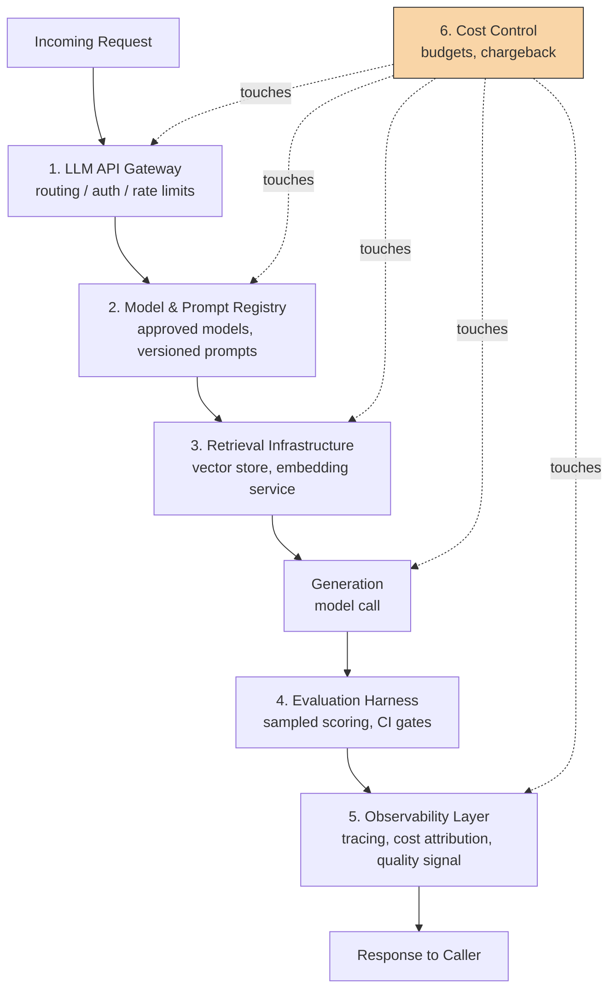

Ask five people at your company what "the AI platform" means and you'll get five different answers. The gateway team thinks it means the gateway. The data team thinks it means the vector store. Whoever owns the eval dashboard thinks it means evals. None of them are wrong, exactly — they're each describing one piece of something that only works as a system. I wrote the narrative version of how we got here in [the internal platform build-out post](/posts/building-an-internal-ai-platform/); this one is the blueprint — the actual components, how they connect, and who should own what.

The confusion isn't academic. It costs real time. A product team asks "can I use the platform for this?" and gets three different answers from three different teams because nobody agreed on what "the platform" includes. So let's fix that by naming the six components explicitly.



## The six components

**1. LLM API gateway.** The front door. Routing, auth, rate limiting, provider failover. I've covered the gateway in depth in [Building Internal LLM Gateways](/posts/building-internal-llm-gateways/) and [Production LLM Gateway Architecture](/posts/production-llm-gateway-architecture/), so I won't repeat that here — but it's worth saying plainly: the gateway is necessary and it is not the platform. Teams that stop here have solved authentication and nothing else.

**2. Model and prompt registry.** A single source of truth for which models are approved for use, which prompt versions are live, and what changed between versions. Without this, "we updated the prompt" means someone edited a string in a Slack thread and redeployed. With it, every prompt change is a versioned artifact with a diff, an owner, and a rollback path.

**3. Vector/retrieval infrastructure.** Shared access to vector stores and an embedding service so that every team doing RAG isn't running its own Postgres-with-pgvector instance with its own embedding model choice, chunk size, and reindexing schedule. Shared doesn't mean one tenant — it means one well-operated service with isolation built in.

**4. Evaluation harness.** A shared framework for scoring outputs — correctness, relevance, safety — that plugs into CI so a prompt or model change can't ship without running against a golden dataset first. If every team builds its own eval scripts, you get inconsistent quality bars and no way to compare one team's "95% pass rate" against another's.

**5. Observability layer.** Tracing (what happened in this request, step by step), cost attribution (which team/feature spent what), and quality monitoring (is output quality drifting in production, not just at eval time). This is the layer that answers "why did this request cost $4 and take 11 seconds" six weeks after the fact.

**6. Cost control.** Budgets, rate limits per team, and chargeback reporting. Notice in the diagram that cost control doesn't sit in the request path — it touches every other component. It's a cross-cutting concern, not a step.

## Three maturity stages

You don't build all six at once. Most platforms grow through three stages:

**Stage 1 — gateway only.** You've centralized API keys and basic routing. This solves "who has prod credentials" and nothing about quality or cost visibility. Most orgs land here first because it's the easiest win and the most urgent fire (credential sprawl).

**Stage 2 — gateway + registry + evals.** Now prompt and model changes are versioned and tested before they ship. This is the stage where "the platform" starts meaning something beyond "the place requests go through." Most mid-maturity platforms I've seen sit here for 6-12 months.

**Stage 3 — full six-component platform.** Retrieval infrastructure is shared and governed, observability gives real-time quality and cost signal, and cost control enforces budgets automatically rather than via a monthly spreadsheet someone reconciles by hand.

Don't skip stages to look impressive. A stage 1 gateway that's rock solid beats a stage 3 platform where half the components are half-built and nobody trusts any of them.

## Who owns what

This is where the org chart question — covered in [The AI Platform Engineering Team](/posts/the-ai-platform-engineering-team/) — actually matters, so I'll just summarize the mapping rather than re-litigate it: the platform team typically owns components 1, 2, 5, and 6 (gateway, registry, observability, cost control) because these require centralized infrastructure and cross-team consistency. Components 3 and 4 (retrieval infra and eval harness) are more often co-owned — the platform team provides the shared service, but product teams own their own retrieval configuration and eval datasets because those are domain-specific.

The anti-pattern is a platform team that insists on owning eval datasets for every product team. They don't have the domain knowledge, and it creates a bottleneck. The platform team owns *the harness* — the CI integration, the scoring infrastructure, the dashboard. Product teams own *what gets evaluated*.

## A platform component catalog entry

Whatever form your internal documentation takes, every component should have a registry entry that answers "what is this, who owns it, how do I use it." Here's the format we use:

```yaml
component: llm-api-gateway
status: ga              # ga | beta | deprecated
owner_team: ai-platform-core
slack_channel: "#ai-platform-gateway"
description: >
  Single ingress point for all LLM calls. Handles auth, routing,
  rate limiting, and provider failover.
sla:
  availability: "99.9%"
  p95_latency_ms: 800
integration:
  method: "REST + SDK (python, typescript)"
  auth: "service account JWT via platform IAM"
docs_url: "https://internal-docs/platform/gateway"
onboarding_time_estimate: "< 1 day"
dependencies: []
---
component: eval-harness
status: beta
owner_team: ai-platform-core
co_owners: [product-teams-per-dataset]
slack_channel: "#ai-platform-evals"
description: >
  Shared scoring framework with CI integration. Platform team owns
  the harness and dashboard; product teams own their eval datasets.
sla:
  ci_run_time_p95_minutes: 15
integration:
  method: "CLI + GitHub Action"
  auth: "repo-scoped token"
docs_url: "https://internal-docs/platform/evals"
onboarding_time_estimate: "2-3 days (includes golden dataset creation)"
dependencies: [llm-api-gateway, model-prompt-registry]
```

That `dependencies` field matters more than it looks. The eval harness depends on the gateway and the registry because it needs to call models through governed infrastructure and needs to know which prompt version it's testing against. Map these dependencies explicitly and you catch the ordering problem early: you cannot stand up a useful eval harness before you have a registry, because there's nothing stable to evaluate against.

## The integration flow in practice

Trace a single request through the full six-component system: a request hits the gateway, which authenticates it and checks rate limits. The gateway consults the registry to resolve "which model and prompt version does this feature currently use" — this is a lookup, not a hardcoded string in the calling service's code. If the feature uses retrieval, the request goes to the retrieval layer for context assembly before generation. The actual model call happens, and the response gets scored by a sampled slice of the eval harness (you don't eval every request, you sample — more on that in the SLO post). Every step gets traced and logged to the observability layer, which also tags the request with cost attribution metadata. Cost control doesn't block the request in real time (except at hard budget ceilings) but it's reading from the same trace data to build chargeback reports.

The point of drawing this out is that these six components aren't six separate products you buy or build independently — they're one request's path through your system. Build them as if they'll never talk to each other and you'll spend the next two years gluing them together after the fact.

If you're deciding where to invest next quarter, the honest answer is: whichever of these six components is currently a spreadsheet, a Slack thread, or "ask Dave." That's your next build.
