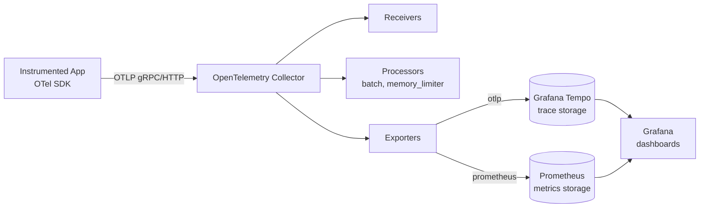

Every observability vendor pitch starts the same way: point your SDK at our endpoint, get dashboards in five minutes. That's a fine trade when your trace volume is modest and your data has no residency constraints. It stops being a fine trade somewhere around the point where per-span pricing starts showing up as a line item your finance team asks about every quarter, or where legal tells you prompt content containing customer data can't leave your network at all. At that point the question isn't "which platform" — it's "can we run this ourselves," and the answer is yes, with components that are individually boring and well-understood: an OpenTelemetry Collector, Grafana Tempo, Prometheus, and Grafana. None of this is new technology. What's new is applying it specifically to LLM and agent traces.



## Why self-host this instead of buying it

The case for self-hosting isn't "open source is better." It's narrower than that, and you should be honest with yourself about which of these actually apply before committing engineering time to running infrastructure:

- **Volume economics**: commercial LLM observability platforms typically price per trace, per span, or per GB ingested. An agentic pipeline that fans out into a dozen nested spans per user request burns through those unit economics fast. Tempo and Prometheus charge you in compute and disk, which scales differently — often much better — at high volume.
- **Data residency**: if prompts and completions contain regulated or sensitive content, "our vendor has a BAA" is a weaker answer than "the data never left our VPC."
- **Retention and sampling control**: you decide what gets kept, for how long, and at what sampling rate, without negotiating a contract tier.

What you give up is covered honestly at the end of this post. Don't skip that section — it's the part that actually determines whether this is the right call for your team.

## The components and what each one does

- **OTel SDK in the application** — emits spans for LLM calls, tool calls, and retrieval calls as the app runs. Covered in depth elsewhere on this blog; this post picks up after instrumentation exists.
- **OpenTelemetry Collector** — a standalone process that receives spans over OTLP, applies processing (batching, filtering, memory limits), and exports to one or more backends. This is the piece most teams underestimate — it's not a passthrough, it's where real operational control lives.
- **Grafana Tempo** — a trace storage backend built to be cheap at scale because it indexes only trace IDs, not every attribute. Object storage (S3, GCS, or local disk for dev) backs it, so storage cost scales close to linearly with retention.
- **Prometheus** — stores metrics derived from spans (span count, latency histograms, token counts aggregated as counters) for alerting and trend dashboards, separate from the raw trace detail in Tempo.
- **Grafana** — the single pane of glass, with Tempo and Prometheus as data sources, where you build the actual dashboards and trace-search UI your team uses day to day.

## A working docker-compose setup

This is enough to run the full pipeline locally or in staging. It is not a production topology — no HA, no auth hardening — but every config shown here is the same config you'd use in production, just with single replicas.

```yaml
# docker-compose.yml
services:
  otel-collector:
    image: otel/opentelemetry-collector-contrib:0.111.0
    command: ["--config=/etc/otel-collector-config.yaml"]
    volumes:
      - ./otel-collector-config.yaml:/etc/otel-collector-config.yaml
    ports:
      - "4317:4317"   # OTLP gRPC
      - "4318:4318"   # OTLP HTTP
    depends_on:
      - tempo

  tempo:
    image: grafana/tempo:2.6.0
    command: ["-config.file=/etc/tempo.yaml"]
    volumes:
      - ./tempo.yaml:/etc/tempo.yaml
      - tempo-data:/var/tempo
    ports:
      - "3200:3200"   # Tempo query API
      - "4319:4317"   # OTLP (if Tempo receives directly; unused when Collector routes to it)

  prometheus:
    image: prom/prometheus:v2.54.1
    volumes:
      - ./prometheus.yaml:/etc/prometheus/prometheus.yml
    ports:
      - "9090:9090"

  grafana:
    image: grafana/grafana:11.2.0
    environment:
      - GF_AUTH_ANONYMOUS_ENABLED=true
      - GF_AUTH_ANONYMOUS_ORG_ROLE=Admin
    volumes:
      - ./grafana-datasources.yaml:/etc/grafana/provisioning/datasources/datasources.yaml
    ports:
      - "3000:3000"
    depends_on:
      - tempo
      - prometheus

volumes:
  tempo-data:
```

## The Collector config, in detail

This is where the actual pipeline logic lives — receivers in, processors for safety and shaping, exporters out.

```yaml
# otel-collector-config.yaml
receivers:
  otlp:
    protocols:
      grpc:
        endpoint: 0.0.0.0:4317
      http:
        endpoint: 0.0.0.0:4318

processors:
  memory_limiter:
    check_interval: 1s
    limit_mib: 512
    spike_limit_mib: 128
  batch:
    timeout: 5s
    send_batch_size: 1024

exporters:
  otlp/tempo:
    endpoint: tempo:4317
    tls:
      insecure: true
  prometheus:
    endpoint: 0.0.0.0:8889

service:
  pipelines:
    traces:
      receivers: [otlp]
      processors: [memory_limiter, batch]
      exporters: [otlp/tempo]
    metrics:
      receivers: [otlp]
      processors: [memory_limiter, batch]
      exporters: [prometheus]
```

`memory_limiter` goes first in every pipeline — it's the processor that keeps a traffic spike from OOM-killing the Collector. `batch` goes right before export because batching reduces the number of network round-trips to Tempo and Prometheus, which matters more than it sounds once you're pushing meaningful span volume. Notice there's no sampling processor here yet — tail sampling for cost control is its own topic, covered next in this series, because it deserves more than a paragraph.

## Instrumenting a Python LLM call end to end

```python
from opentelemetry import trace
from opentelemetry.sdk.trace import TracerProvider
from opentelemetry.sdk.trace.export import BatchSpanProcessor
from opentelemetry.exporter.otlp.proto.grpc.trace_exporter import OTLPSpanExporter
from opentelemetry.sdk.resources import Resource

resource = Resource(attributes={"service.name": "support-agent"})
provider = TracerProvider(resource=resource)
provider.add_span_processor(
    BatchSpanProcessor(OTLPSpanExporter(endpoint="localhost:4317", insecure=True))
)
trace.set_tracer_provider(provider)

tracer = trace.get_tracer("support-agent")

def call_llm(prompt: str, model: str = "claude-sonnet-4-5"):
    with tracer.start_as_current_span("gen_ai.chat") as span:
        span.set_attributes({
            "gen_ai.system": "anthropic",
            "gen_ai.request.model": model,
        })
        response = anthropic_client.messages.create(
            model=model,
            max_tokens=1024,
            messages=[{"role": "user", "content": prompt}],
        )
        span.set_attributes({
            "gen_ai.usage.input_tokens": response.usage.input_tokens,
            "gen_ai.usage.output_tokens": response.usage.output_tokens,
        })
        return response
```

Run the compose stack, run this script against it, and open `localhost:3000`. Add Tempo and Prometheus as datasources (the compose file above provisions them automatically via `grafana-datasources.yaml` — a standard Grafana datasource YAML pointing `tempo:3200` and `prometheus:9090`), and the span shows up in Tempo's trace search within seconds of the script running. That's the whole pipeline, working.

## What this doesn't give you out of the box

This is the part the docker-compose demo doesn't show you, and it's the part that actually matters when deciding whether to build this yourself. A commercial LLM observability platform ships with pre-built agent timeline views, cost-per-user or cost-per-feature attribution dashboards, and increasingly, AI-assisted trace investigation that surfaces anomalies without you writing a query. None of that exists here by default. Tempo gives you trace search and a generic span waterfall view. Grafana gives you a dashboarding engine. The agent-specific timeline visualization, the cost attribution rollups, the "here's probably what went wrong" investigation assistant — all of that is a Grafana dashboard you build, a PromQL query you write, a TraceQL search you save. It's achievable, but it's work, and it's ongoing work as your agent architecture evolves.

## The real cost conversation

"Self-hosted" gets talked about as if it means "free." It doesn't. Tempo and Prometheus at meaningful trace volume need real compute, real disk, and real operational attention — upgrades, capacity planning, incident response when the Collector falls behind and starts dropping spans under memory pressure. The honest framing is infrastructure cost plus engineering time versus vendor cost plus vendor lock-in, not free versus paid. For a team with the platform engineering capacity to run this well, it's a strong trade. For a team without that capacity, the vendor's five-minute setup is buying you something real, and pretending otherwise is how self-hosting projects turn into abandoned side projects six months later.
