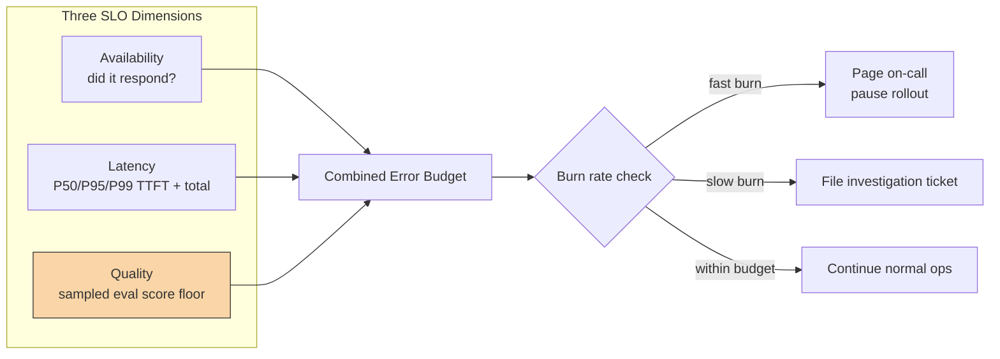

A gateway can return a 200 status code, in 400ms, with a completely hallucinated answer. By every standard SRE metric, that request succeeded. The service was available. The latency was within budget. And the output was wrong in a way that will embarrass someone or cost money. This is the gap that standard SLOs don't cover, and it's the reason an AI platform needs a reliability model that traditional availability/latency SLOs weren't built for.

I'm not arguing against standard SRE practice — availability and latency SLOs are necessary and you should absolutely have them. I'm arguing they're not sufficient, because "the system responded" and "the system was correct" are genuinely different properties, and treating the first as a proxy for the second will bite you in production months after you ship.



## The three-dimensional model

**Availability SLO.** Does the platform respond at all, within a timeout window, without a 5xx or a provider-side failure bubbling up uncaught. Standard SRE practice applies directly here — nothing AI-specific about measuring whether a service is up.

**Latency SLO.** P50/P95/P99 for time-to-first-token (TTFT) and total response time. TTFT matters separately from total latency because a streaming UI feels responsive even if total generation takes a while — but if TTFT itself is slow, users perceive the system as broken regardless of streaming.

**Quality SLO.** This is the one that doesn't exist in traditional SRE vocabulary. It's a quality floor, measured by running a sampled slice of production traffic through your eval harness and tracking the pass rate over time. I've written about the continuous monitoring mechanics that feed this in [Continuous Quality Monitoring in AI Production](/posts/continuous-quality-monitoring-ai-production/) — that post covers the *how* of sampling and scoring; this one is about what you do with the number once you have it: turn it into an SLO with a target and a burn-rate alert, the same way you'd treat availability.

## Setting the quality threshold empirically

The temptation is to pick a quality target that sounds good — "99% correctness" — and write it into a doc. Don't do this. You don't know what 99% means for your specific feature until you've measured your baseline.

The actual process:

1. Run your eval harness against two to four weeks of real production traffic (sampled, not full volume — see the sampling discussion in the monitoring post).
2. Get the distribution of scores, not just the mean. A feature that averages 0.91 but has a long left tail of 0.3-scoring outputs on a specific input pattern is a different risk profile than one that's tightly clustered around 0.91.
3. Set the initial quality SLO at roughly your P10 observed score, not your mean. This tells you "we already tolerate this level of quality in production today" rather than inventing an aspirational number nobody has validated.
4. Revisit quarterly. As you fix known failure modes, tighten the threshold. Don't tighten it reactively the week after an incident — that's goal-post moving, not target-setting.

Setting the target from your own baseline does something important politically too: when a product team pushes back on a quality SLO, you're not arguing from an arbitrary number, you're showing them "this is literally what your feature does today, we're just going to start watching it."

## The error budget policy

An SLO without a policy for what happens when you breach it is just a chart nobody looks at. The policy needs to specify concrete actions tied to burn rate, not vibes:

- **Fast burn (quality SLO consuming budget at a rate that will exhaust it in hours)**: page on-call, pause further feature rollout for the affected model/prompt version, and treat it as an active incident. This usually means a bad deploy — a prompt change, a model version bump, an upstream provider regression.
- **Slow burn (budget will exhaust in days)**: file an investigation ticket, don't page anyone. This is usually a slower drift — data distribution shift, a new edge case appearing more frequently in traffic.
- **Within budget**: no action, but the dashboard stays visible. Don't let "green" become invisible.

The rollback trigger matters specifically: if a fast-burn quality event correlates with a recent prompt or model version change (which your registry from the reference architecture post should make trivial to check), the default action is roll back that change first and investigate second. Don't debate root cause while the error budget burns — revert, then do the post-mortem.

## Per-component SLOs vs platform-wide SLOs

This is the distinction that gets muddled most often. The gateway's availability SLO — "the gateway responds to 99.95% of requests within timeout" — is a platform team responsibility. It's infrastructure. It doesn't know or care what the request contains.

A feature's quality SLO — "the support-bot feature maintains a 0.85 eval score floor" — is a product team responsibility, because only the product team understands what "correct" means for that specific feature. The platform team provides the *mechanism* (the eval harness, the dashboard, the alerting), but owning the threshold and responding to breaches belongs to whoever owns the feature.

Mixing these up creates two failure modes. If the platform team owns every feature's quality SLO, they become a bottleneck and a scapegoat for domain decisions they can't make. If product teams own availability SLOs for shared infrastructure they don't control, they get paged for outages they can't fix.

## A full SLO definition example

```yaml
slo_definition:
  feature: support-bot-tier1
  owner_team: customer-support-eng
  platform_dependencies: [llm-api-gateway, eval-harness]

  availability:
    target: "99.9%"
    measurement_window: "28d rolling"
    owned_by: ai-platform-core

  latency:
    ttft_p95_ms: 600
    total_p95_ms: 3000
    total_p99_ms: 6000
    measurement_window: "28d rolling"
    owned_by: ai-platform-core

  quality:
    metric: "weighted_eval_score"
    target_floor: 0.82          # set from observed P10 baseline
    sample_rate: 0.05           # 5% of production traffic scored
    measurement_window: "7d rolling"
    owned_by: customer-support-eng

  error_budget_policy:
    fast_burn:
      threshold: "budget exhausted in < 6h at current rate"
      action: ["page_oncall", "pause_rollout", "check_recent_registry_changes"]
    slow_burn:
      threshold: "budget exhausted in < 3d at current rate"
      action: ["file_ticket", "weekly_review"]
    rollback_trigger:
      condition: "fast_burn AND registry_change_within(24h)"
      action: "auto_rollback_to_previous_prompt_version"
```

Three things to notice about this definition. First, quality uses a shorter measurement window (7 days) than availability and latency (28 days) — quality drift tends to be a faster-moving signal tied to recent changes, and a 28-day window would mask a regression for weeks. Second, `owned_by` is set per-dimension, not per-SLO-document, which is the ownership split from above made concrete instead of aspirational. Third, the rollback trigger is conditional on a registry change in the last 24 hours — this is what makes the policy actionable instead of just diagnostic: it doesn't just tell you something's wrong, it tells the system what to do about it when the likely cause is already known.

The honest caveat here: none of this replaces human judgment during an actual incident. What it does is remove the 20 minutes of "wait, is this bad? who owns this? what do we do?" that otherwise happens before anyone starts actually fixing the problem.
