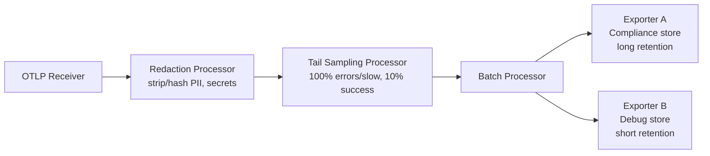

The docker-compose Collector config from last week's post works, and it will also quietly bankrupt your storage budget and hand your security team a finding if you run it unmodified in production. A single agentic request — user query, retrieval call, two tool calls, a synthesis LLM call — can produce fifteen to thirty spans. Every one of those LLM-call spans carries prompt and response text by default, because that's exactly what makes a trace useful for debugging. It's also exactly what makes storing every span at full volume, unredacted, both expensive and risky. The fix lives entirely in the Collector's pipeline, before anything touches long-term storage.



## Why GenAI spans need different handling than service spans

An HTTP span for a database call carries a query shape, maybe a sanitized statement. An LLM span carries the actual user prompt and the actual model response, because the finish reason, the token counts, and the content itself are all what make the span debuggable. That's the exact same content your DLP policy cares about. And volume compounds the problem: a typical microservice request produces one or two spans; an agentic request produces an order of magnitude more, nested two or three levels deep. Default collector settings — the ones from the basic setup — export every span, unredacted, at full volume. That works at demo scale. It does not work at production scale, and it does not pass a compliance review.

Two separate problems, two separate processors: volume is a sampling problem, content safety is a redaction problem. Solve them in that order in the pipeline — redact first, sample second — so that even the spans you keep for sampling decisions never carry raw sensitive content past the redaction stage.

## Redaction at the collector, not in the app

The temptation is to redact in application code before the span is even created. Don't rely on that alone — it means every service team has to get redaction right independently, and one missed case ships raw PII straight to storage. Centralizing redaction in the Collector means one policy, enforced once, regardless of how many services or languages are instrumenting spans.

```yaml
processors:
  redaction:
    allow_all_keys: true
    blocked_values:
      - '[\w\.-]+@[\w\.-]+\.\w+'                  # email addresses
      - 'sk-[a-zA-Z0-9]{20,}'                      # API-key-shaped tokens
      - '\b\d{3}-\d{2}-\d{4}\b'                    # SSN-shaped strings
    summary: debug
```

The `redaction` processor (contrib package) scans span attribute values against the blocked-value patterns and masks matches before the span moves further down the pipeline. For attributes that need to survive in some form for debugging — you want to know a tool call referenced *an* email address, not that it referenced nothing — use the `transform` processor instead, which lets you hash rather than fully strip:

```yaml
processors:
  transform:
    trace_statements:
      - context: span
        statements:
          - replace_pattern(attributes["gen_ai.prompt"], "[\\w\\.-]+@[\\w\\.-]+\\.\\w+", "[EMAIL_REDACTED]")
          - replace_pattern(attributes["gen_ai.completion"], "sk-[a-zA-Z0-9]{20,}", "[KEY_REDACTED]")
```

Pick one approach per attribute class and be consistent — mixing `redaction` and `transform` across the same field in different pipelines is how you end up with inconsistent masking that passes a demo and fails an audit. Either way, the raw prompt text never reaches the exporter stage.

## Tail sampling: keep everything that matters, drop the rest

Head sampling — deciding whether to keep a trace before you know how it turns out — is the wrong tool here, because the traces you most need are the ones that error out or run slow, and you can't know that at the start of the request. Tail sampling defers the keep/drop decision until the trace completes, which is exactly what the `tailsamplingprocessor` is built for.

```yaml
processors:
  tail_sampling:
    decision_wait: 10s
    num_traces: 50000
    policies:
      - name: keep-errors
        type: status_code
        status_code:
          status_codes: [ERROR]
      - name: keep-slow
        type: latency
        latency:
          threshold_ms: 3000
      - name: sample-successful
        type: probabilistic
        probabilistic:
          sampling_percentage: 10
```

Policies are evaluated in order and a trace is kept if any policy matches, so the practical effect of this config is: every error trace is kept, every trace over three seconds is kept, and of what's left — the fast, successful, unremarkable traces — only ten percent survive. That ten percent is enough to track baseline latency and token-count trends without paying full storage cost for the 90% of requests that told you nothing new.

`decision_wait` matters more than it looks — it's how long the Collector buffers a trace's spans before making the sampling decision, which has to be long enough for the slowest span in a trace to arrive. Set it too short and slow traces get evaluated before their final (slow, interesting) span lands, and you silently drop the one trace you most wanted to keep.

## Routing to two backends with different retention and redaction

Compliance and active debugging want different things from the same span stream. Compliance wants everything retained for a long window with aggressive redaction. An engineer debugging a live incident wants recent detail with enough content left intact to actually be useful, for a much shorter retention window. Rather than picking one tradeoff, route the same post-processing span stream to two exporters.

```yaml
exporters:
  otlp/compliance:
    endpoint: tempo-compliance:4317
    tls:
      insecure: true
  otlp/debug:
    endpoint: tempo-debug:4317
    tls:
      insecure: true

service:
  pipelines:
    traces:
      receivers: [otlp]
      processors: [redaction, tail_sampling, batch]
      exporters: [otlp/compliance, otlp/debug]
```

In practice, the "less aggressive redaction" debug store usually runs a second, lighter redaction processor upstream of its own exporter (hash instead of strip, or redact SSNs and keys but leave email domains visible for routing debugging) — which means two parallel processor chains converging on different exporters rather than one shared chain feeding both blindly. The YAML above is the simple version; the production version forks before redaction, not after, once the two stores' policies genuinely diverge.

## The storage math that justifies all of this

Take a realistic estimate: 500,000 agentic requests a day, 20 spans per request average, each span averaging 2KB with prompt/response content included. That's 10 million spans/day, roughly 20GB/day of raw span data before any processing.

At 100% retention, that's ~600GB/month flowing into Tempo, growing without bound as traffic grows. Apply the tail sampling policy above — assume a typical 2% error/slow rate kept at 100%, and the remaining 98% kept at 10% — and the kept volume drops to roughly 12% of total: about 72GB/month instead of 600GB. That's not a marginal optimization; it's close to an 8x reduction in storage and ingest cost, for a sampling policy that still guarantees you never lose a single errored or slow trace — the ones you'd actually reach for during an incident.

The number that actually matters for your workload will differ based on your error rate and latency distribution, but the shape of the argument holds generally: sample the boring traffic hard, sample the interesting traffic not at all, and redact before either decision happens so a logging mistake in the sampling config never becomes a data exposure incident.
