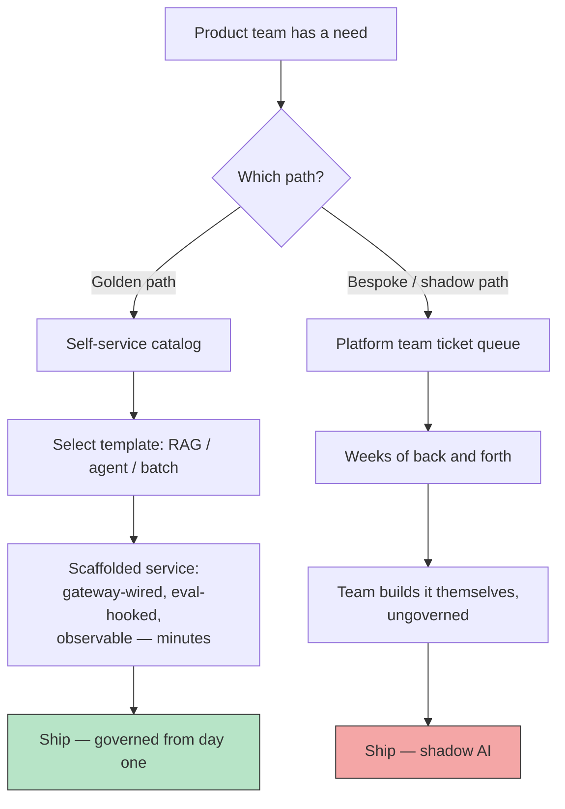

A product team has a RAG feature due in two weeks. They file a ticket with the platform team asking for vector store access, gateway onboarding, and eval harness integration. The platform team's queue says six weeks. The product team doesn't have six weeks, so they spin up their own Postgres instance with pgvector, call OpenAI directly with a team credit card's API key, and ship. Nobody on the platform team finds out until a security review six months later turns up an ungoverned AI system sitting in production, handling customer data, with no observability, no eval coverage, and no cost attribution.

This is shadow AI, and it isn't a discipline problem — it's an incentive problem. The product team didn't skip governance because they don't care about it. They skipped it because going through the platform team was slower than building it themselves. Any fix that doesn't address that speed gap will fail no matter how much policy you write.



## The golden path concept

"Golden path" isn't an AI-specific idea — it comes from platform engineering generally, where it describes a pre-approved, pre-configured way of doing a common thing, designed so the easy option and the correct option are the same option. Apply it to AI infrastructure and the principle doesn't change: instead of a product team assembling a RAG pipeline from scratch — choosing a vector store, wiring retrieval, writing prompt templates, figuring out how to hook up evals — they run one command and get a working, governed service.

Three templates cover the large majority of real requests:

**RAG template.** Vector store provisioned with tenant isolation already configured, retrieval pipeline wired to the shared embedding service, generation routed through the gateway, and eval hooks already attached so the first commit has test coverage instead of needing it bolted on later. The product team customizes the retrieval source and the prompt — they don't rebuild the plumbing.

**Agent template.** A tool-use scaffold with sandboxing and approval-gate patterns already in place. I covered the sandboxing mechanics in detail in [Agent Sandboxing and Isolation](/posts/agent-sandboxing-and-isolation/); the golden path template is what makes that design the default instead of something a team has to know to ask for. A team building an agent from this template gets execution isolation and human-approval gates on sensitive actions without having to have read those posts first.

**Batch-processing template.** For ETL-style LLM enrichment jobs — classification, extraction, summarization run over a dataset rather than live user traffic. This template handles the retry/backoff logic, rate limit coordination with the gateway, and cost tracking for what's often the highest-volume, lowest-attention-per-request workload on the platform.

## What self-service actually means

"Self-service" gets used loosely to mean "there's a form." That's not what makes shadow AI go away. What makes it go away is: a product engineer runs a CLI command or clicks a portal action, and within minutes has a working, governed starting point — not a ticket that starts a conversation with the platform team.

Here's what that looks like in practice:

```shell
$ platform new rag-service support-kb-bot

Scaffolding rag-service from golden path template v3...

✓ Vector store namespace provisioned (tenant: support-kb-bot)
✓ Embedding service client configured (shared pool, isolated keys)
✓ Gateway route registered (auth: service-account, rate limit: tier-2)
✓ Eval harness hooked — golden dataset stub created at
  ./evals/support-kb-bot/golden.jsonl (you populate this)
✓ Observability wired — traces will appear under
  service=support-kb-bot in the platform dashboard
✓ Cost attribution tag set: team=support-eng, feature=support-kb-bot
✓ CI pipeline added: .github/workflows/support-kb-bot-eval.yml

Generated at ./services/support-kb-bot/
  ├── retrieval/          # customize your retrieval source here
  ├── prompts/            # your prompt templates, versioned
  ├── evals/golden.jsonl  # populate with your domain examples
  └── README.md           # what was wired automatically, what you own

Next step: populate evals/golden.jsonl with 20-30 representative
examples before your first deploy. The CI gate will block merges
until this file has at least 10 entries.
```
{: .nolineno }

Everything the reference architecture post describes as the six platform components — gateway, registry, retrieval, evals, observability, cost control — gets wired automatically. The product team's actual job shrinks to the part only they can do: the retrieval source, the prompts, and the domain-specific eval examples. That's the entire point of a golden path — it doesn't remove governance, it removes the part of governance that was never the product team's job to hand-build in the first place.

## The catalog is a living artifact, not a speculative one

Don't try to anticipate every pattern your organization will ever need and build templates for all of them up front. That's a platform team guessing at product needs, and it produces templates nobody uses because they don't match how teams actually work.

The rule we use: a pattern earns a golden path template once it's been built bespoke, by hand, by three or more different teams. Below that threshold, it's not common enough to justify the maintenance cost of a template, and you're better off letting the platform team help that one team directly. Above it, you're accumulating the same risk three times over, and a template pays for itself immediately.

This also means the catalog needs an owner whose job includes watching for repetition — reviewing what teams are asking the platform team for help with, not just what's already in the catalog. If the same "how do I add a reranking step to retrieval" question comes from three teams in a quarter, that's a signal to add a reranking option to the RAG template, not to keep answering it in Slack.

## Measuring whether it's working

The single best proxy for shadow AI risk is: **the percentage of new AI features built from a golden path versus built bespoke.** Not the number of templates in the catalog. Not platform team ticket volume. The adoption rate.

Track it per quarter, broken out by team. A team that's consistently bespoke isn't necessarily doing anything wrong — maybe their use case genuinely doesn't fit any template yet, and that's useful signal for what to build next. But a declining trend of golden-path adoption across the org, especially alongside rising platform team ticket backlogs, is the early warning sign that teams are drifting back toward building it themselves, which means the speed gap has reopened somewhere.

The uncomfortable follow-up question, if adoption is low: is it low because the templates don't cover real needs, or because the templates are slower or more restrictive than teams expect self-service to mean? Both are platform team problems to fix, not product team problems to be lectured about. If the golden path isn't actually faster than going around it, you haven't solved shadow AI — you've just added a step people skip.
