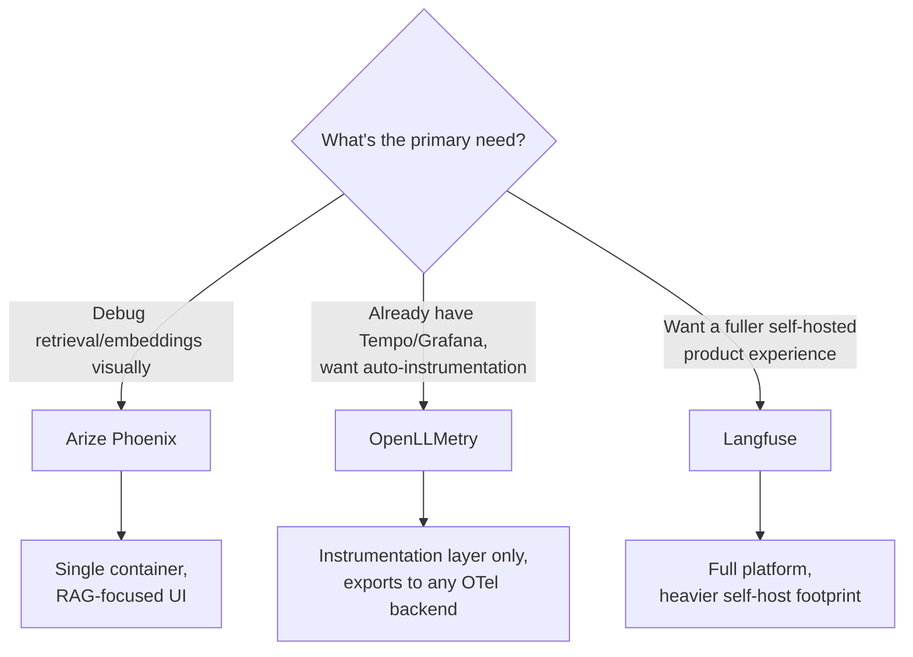

Two posts ago I walked through standing up an OTel Collector, Tempo, and Grafana by hand. That's the right call when you want full control and have the operational capacity for it. It's not the only option, and it's not even the first option most teams should evaluate — there's a middle ground of OSS tools that sit on top of the same OTel foundation but ship with far more built in. The decision isn't really "build versus buy" anymore. It's "how much of this do I want pre-built, and what am I willing to configure myself" — and the honest answer differs by team.



## The shared foundation changes the decision

The useful fact underlying this whole comparison: Phoenix, OpenLLMetry, and Langfuse are all OTel-native or OTel-compatible. They all speak OTLP, they all use (or can use) the `gen_ai.*` semantic conventions, and in several cases the actual instrumentation libraries are shared or interoperable across them. That matters because it changes what "picking a tool" costs you. With a fully proprietary SDK — the LangSmith model, roughly — switching platforms later means re-instrumenting your application. With an OTel-native tool, switching mostly means repointing an OTLP endpoint and swapping which backend renders the dashboards. The instrumentation investment survives the platform decision. That's worth internalizing before you treat this choice as higher-stakes than it actually is.

## Arize Phoenix — built for retrieval debugging

Phoenix's actual differentiator isn't general tracing — plenty of tools do that — it's that Phoenix was built by a team coming from the ML observability world, and it shows in how seriously it treats embeddings and retrieval. If your agent's failure mode is usually "retrieved the wrong chunks" rather than "the LLM reasoned badly," Phoenix gives you visualizations — embedding projections, retrieval relevance scoring, chunk-level inspection — that a generic trace viewer doesn't attempt.

```python
import phoenix as px
from openinference.instrumentation.openai import OpenAIInstrumentor

session = px.launch_app()  # single container, runs locally in seconds
OpenAIInstrumentor().instrument()

# Your existing RAG pipeline code runs unmodified — spans
# flow to the local Phoenix instance automatically
```

It genuinely is a single container you can run locally for dev debugging, which makes it a low-friction first stop even for teams that end up using something else in production. The tradeoff: its platform ambitions beyond RAG-specific debugging are narrower than Langfuse's. It's a strong, focused tool, not a full LLM ops platform.

## OpenLLMetry — instrumentation, not a platform

OpenLLMetry is a different category of thing entirely, and it's worth being precise about that distinction because people regularly compare it to Phoenix and Langfuse as if it does the same job. It doesn't. OpenLLMetry is a pure instrumentation layer — auto-instrumentation for popular LLM frameworks and providers (OpenAI, Anthropic, LangChain, LlamaIndex, and others) that emits standard OTel spans. It has no storage, no UI, no dashboard. You point it at whatever OTel-compatible backend you already run.

```python
from traceloop.sdk import Traceloop

Traceloop.init(
    app_name="support-agent",
    api_endpoint="http://otel-collector:4318",  # your own Collector, from the first post in this series
)

# That's it — Anthropic/OpenAI/LangChain calls in this process
# now emit gen_ai.* spans automatically, no manual span code required
```

Compare that one-liner to the manual span code from the first post in this series:

```python
# Manual instrumentation — full control, more code
with tracer.start_as_current_span("gen_ai.chat") as span:
    span.set_attributes({"gen_ai.system": "anthropic", "gen_ai.request.model": model})
    response = anthropic_client.messages.create(...)
    span.set_attributes({
        "gen_ai.usage.input_tokens": response.usage.input_tokens,
        "gen_ai.usage.output_tokens": response.usage.output_tokens,
    })
```

The manual version gives you exact control over span names, attribute naming, and what gets wrapped at what granularity. OpenLLMetry's auto-instrumentation gives you broad framework coverage for free but less control over the shape of individual spans — if you've already invested in the Tempo/Prometheus/Grafana stack from earlier in this series and your framework is on OpenLLMetry's supported list, it's a fast way to cover the 80% case and reserve manual instrumentation for the custom spans that actually need it.

## Langfuse — the fuller platform, at real operational cost

Langfuse is covered in depth elsewhere on this blog, so I won't re-explain what it is here. What's worth adding in the context of this specific comparison is the operational weight relative to Phoenix. Langfuse's self-hosted stack is Postgres, ClickHouse, Redis, and S3-compatible storage — four stateful services, each with its own operational surface, versus Phoenix's single container. That's not a criticism; it's the direct cost of Langfuse's broader feature set (prompt management, evaluation pipelines, dataset tooling) that Phoenix doesn't attempt. If you want that broader product surface and you're willing to run four services to get it, Langfuse is the strongest self-hosted option in this category. If you just need solid tracing and retrieval debugging, that's a lot of infrastructure to take on for features you won't use.

## Decision table

| Primary need | Pick | Why |
|---|---|---|
| Debugging RAG/retrieval quality visually | Phoenix | Purpose-built embedding and retrieval visualizations, single-container simplicity |
| Already running Tempo/Grafana, want framework auto-instrumentation | OpenLLMetry | Instrumentation-only, no new backend to operate, exports to infra you already run |
| Want a full self-hosted product (prompts, evals, datasets) | Langfuse | Broadest feature set, at the cost of a heavier self-host footprint |
| Need full control over span shape and processing (sampling, redaction) | Manual OTel SDK + Collector | Covered earlier in this series — most control, most configuration work |

## The actual takeaway

None of these choices lock you in the way a proprietary SDK would, and that should lower the stakes of the decision in your head. Start with Phoenix locally if retrieval debugging is your pain point today — it costs you an afternoon to try. Add OpenLLMetry if you've already got Collector infrastructure and want framework coverage without writing span code by hand. Reach for Langfuse only once you actually need the platform features beyond tracing — prompt versioning, managed evaluation runs, dataset curation — because those features are the entire justification for the heavier operational footprint, and paying that cost for tracing alone is the wrong trade.
