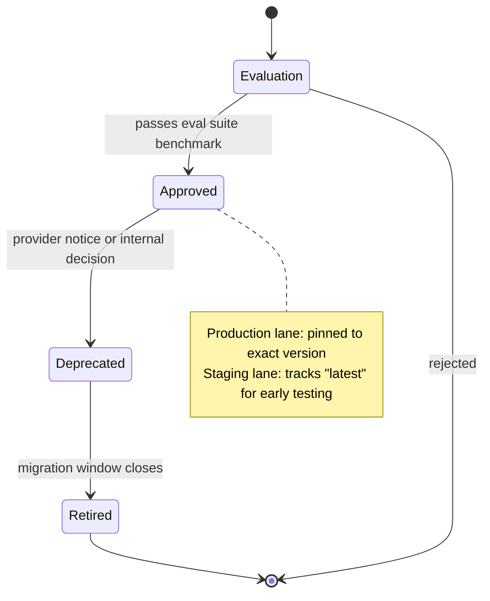

A provider sends a deprecation notice: a specific model version will stop serving requests in 90 days. That email goes to whoever's address was on the account when it was set up — often someone who's since changed teams, or a shared inbox nobody checks. Ninety days later, a feature pinned to that exact version string starts getting 4xx responses in production, and the first anyone hears about it is a page. The deprecation notice existed. Nobody was tracking it.

This is not a hypothetical failure mode, it's the default one, because most organizations treat "which model are we using" as a string in a config file rather than as a tracked entity with a lifecycle. An AI platform needs to manage model lifecycle as deliberately as it manages service deployments — because a model, from the platform's perspective, is a dependency exactly like a library version, except it can be deprecated by a third party on their schedule, not yours.



## The four lifecycle stages

**Evaluation.** A new model candidate is being benchmarked against the platform's eval suite before anyone can use it for anything beyond an experiment. This stage exists specifically so that "I heard the new model is better" doesn't translate directly into a production swap. The eval harness referenced in the [reference architecture post](/posts/enterprise-ai-platform-reference-architecture/) is what does this scoring — a candidate doesn't graduate out of evaluation on vibes or a benchmark leaderboard, it graduates on your own eval suite's numbers.

**Approved.** Available for teams to use, with a documented capability, cost, and latency profile attached. "Approved" doesn't mean "best" — it means teams can pick it up without a separate review, and the platform guarantees it's been through the eval gate and has a known cost/latency footprint.

**Deprecated.** Still callable, but a migration window is open and teams using it have been notified (more on how, below). This is the stage that gets skipped silently most often — a model keeps working, so nobody treats the deprecation as urgent, and then the window closes without warning anyone twice.

**Retired.** No longer callable. The gateway should reject requests to a retired model version outright, with an error that names the replacement, rather than letting the request fail opaquely at the provider.

The stage transitions matter more than the stage names. A model moving from approved to deprecated should be a deliberate, logged, notified event — not something that happens because someone noticed the provider's changelog three weeks late.

## Version pinning: two lanes, not one

The core tension in model versioning is that you want production stability and you want to not fall permanently behind on improvements. Trying to solve both with one pinning strategy doesn't work. Run two lanes instead:

**Production lane — pin to an exact version.** Never point a production feature at `latest` or a floating alias. Pin `claude-sonnet-4-5-20250929` style exact version strings, not `claude-sonnet-4-5`. A floating pointer means the provider's routine update becomes your unannounced production change, and when quality shifts in either direction, you have no clean way to know whether it was your prompt, your data, or a model swap you didn't know happened.

**Staging lane — track "latest" deliberately.** A separate environment continuously runs the eval suite against whatever the provider's current default is, so you find out about quality or behavior shifts in staging, on your schedule, instead of discovering them as a production incident. This is the lane that catches "the new default model handles our edge cases worse" before a pin update ships it to real traffic.

The upgrade path is then explicit: staging surfaces a quality or cost delta worth chasing → someone runs the full eval suite comparing the current pinned version against the candidate → the comparison gets reviewed → the production pin gets updated as a deliberate, versioned change with its own rollback path, exactly like any other registry change referenced in the SLO post's rollback trigger.

## The upgrade testing process

Don't approve a model migration on a vibe check against a handful of manual prompts. Run the full eval suite against the candidate and produce an explicit comparison:

```yaml
migration_evaluation:
  from_model: "claude-sonnet-4-20250514"
  to_model: "claude-sonnet-4-5-20250929"
  evaluated_on: "2026-10-20"
  eval_suite: "platform-golden-v7"
  sample_size: 2400

  results:
    quality_score:
      from: 0.887
      to: 0.912
      delta: "+0.025"
    cost_per_1k_requests:
      from: "$41.20"
      to: "$38.75"
      delta: "-5.9%"
    latency_p95_ms:
      from: 1420
      to: 1180
      delta: "-16.9%"

  regressions_found:
    - category: "multi-step tool use with ambiguous inputs"
      from_pass_rate: 0.94
      to_pass_rate: 0.89
      note: "candidate asks fewer clarifying questions; needs prompt adjustment before migration"

  recommendation: "approve_with_prompt_change"
  migration_owner: "platform-core / jsmith"
```

Three numbers aren't optional in this comparison: quality, cost, and latency, side by side. A model that's cheaper and faster but regresses quality on a specific category — as in the example above — isn't a clean win, it's a conditional approval with a named fix required first. Writing it down this explicitly also means the decision to migrate is defensible later, when someone asks why a feature's behavior changed.

## The registry schema

Extending the component catalog entry from the reference architecture post, every model in the registry carries lifecycle metadata, not just a name:

```yaml
model: claude-sonnet-4-20250514
lifecycle_stage: deprecated        # evaluation | approved | deprecated | retired
approved_date: "2025-05-20"
deprecation_date: "2026-11-01"
retirement_date: "2027-01-15"
migration_target: claude-sonnet-4-5-20250929
migration_owner: "platform-core / jsmith"
eval_scores:
  latest_run: "2026-10-20"
  quality_score: 0.887
  suite_version: "platform-golden-v7"
cost_profile:
  input_per_1k_tokens: "$0.003"
  output_per_1k_tokens: "$0.015"
latency_profile:
  p95_ttft_ms: 340
  p95_total_ms: 1420
consumers:
  - feature: support-kb-bot
    team: support-eng
    pinned_version: "claude-sonnet-4-20250514"
  - feature: code-review-agent
    team: dev-tools
    pinned_version: "claude-sonnet-4-20250514"
```

The `consumers` field is what turns this from documentation into an operational tool. When a model moves to deprecated, this field is the list of who gets notified and who's actually blocked from shipping if they don't migrate before retirement.

## Notifications that actually reach people

A changelog entry is not a notification mechanism — it's a thing that exists for someone to find after the incident, to confirm the warning was technically given. If the registry's `consumers` field is accurate, deprecation notices should be pushed, not published:

- An automated message to the owning team's Slack channel (not email — email is where deprecation notices go to die) when a model they consume moves to deprecated, naming the migration target and the retirement date.
- A recurring reminder — weekly, not once — for any consumer still pinned to a deprecated model as the retirement date approaches, with urgency that escalates as the window closes.
- A hard CI gate: once a model hits deprecated, any *new* feature that tries to pin to it fails the pipeline with a message pointing at the approved replacement. You can keep running on a deprecated model if you're already migrating, but you can't start something new on it.
- At retirement, the gateway itself refuses the request rather than letting it fail at the provider — the error should name the replacement model directly, so the on-call engineer debugging a 4xx isn't starting from zero.

None of this is complicated engineering. It's the unglamorous, process-heavy work of making sure a fact that's known somewhere (a provider's deprecation date) actually reaches the person who needs to act on it, with enough lead time and enough repetition that it doesn't get lost in a queue. The platforms that get burned by silent breakage aren't the ones without this information — they're the ones that had it in a changelog and called that done.
