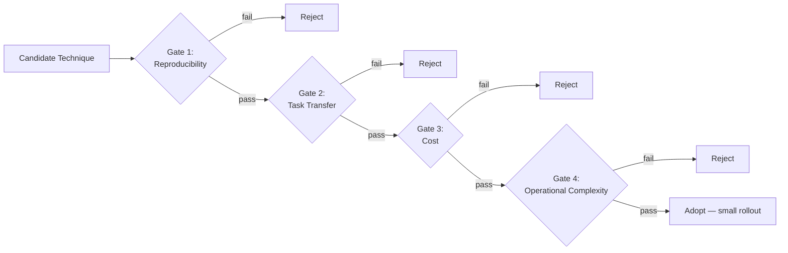

Every few weeks, someone on the team forwards a paper with a one-line message: "this looks like it could help with X." The paper has a benchmark table, a clean improvement number, and a github repo. By Friday, someone's spent two days trying to reproduce it against the production pipeline. This happens often enough in AI engineering right now — new inference-time scaling techniques, new retrieval methods, new agent reasoning patterns, new fine-tuning approaches, all shipping at a pace no team can evaluate ad hoc — that "should we adopt this" needs to stop being a judgment call made fresh every time and start being a process with actual gates.



## The gap a benchmark table doesn't show you

A paper's headline number is a measurement under specific, usually favorable, conditions: a particular dataset, a particular task distribution, a particular baseline that may or may not be the strongest reasonable comparison. None of that is dishonest — it's just not your production workload. The improvement reported is real, for the thing it was measured on. Whether it transfers to your thing is a separate empirical question the paper cannot answer for you, no matter how convincing the abstract is. Treat every new technique as an unverified claim relative to your workload until you've generated your own evidence, not the authors' evidence, that it holds.

The four gates below are the process I use to convert "this looks promising" into "we're adopting this" or "we're not," in a way that's fast enough not to block a team and rigorous enough not to be theater.

## Gate 1: Reproducibility

Before touching your own data at all, can you reproduce even a simplified version of the paper's claimed result on a public benchmark? This is cheaper and faster than it sounds — you're not re-running their full experimental suite, you're spot-checking that the core mechanism behaves the way the paper claims on a small, public, verifiable slice.

```python
def reproducibility_check(technique, public_benchmark, baseline_result, claimed_delta, tolerance=0.3):
    """
    Returns True only if the technique's observed improvement is within
    `tolerance` of the claimed delta on a public benchmark subset.
    tolerance=0.3 means: we accept anywhere from 70% to 130% of the
    claimed effect size before calling this reproduced.
    """
    observed = run_technique(technique, public_benchmark)
    observed_delta = observed.score - baseline_result.score
    lower_bound = claimed_delta * (1 - tolerance)
    return observed_delta >= lower_bound
```

If you can't get in the neighborhood of the claimed effect on the paper's own turf, with public data and no excuses about domain mismatch, that's the cheapest possible signal that something about the result doesn't generalize even as well as advertised — and it's a hard stop before you spend a sprint on it.

## Gate 2: Task transfer

Passing gate 1 tells you the technique does roughly what it claims on its own benchmark. It says nothing about whether your production task resembles that benchmark closely enough for the improvement to show up on your data. A reasoning technique benchmarked on math word problems may do nothing for a customer-support classification task — different failure modes, different error distributions, different notion of what "better" even means.

The test here is concrete: pull a small, representative slice of your own eval set — a few hundred examples is usually enough for a first signal — and run the technique against it, same baseline comparison as gate 1.

```python
def task_transfer_check(technique, your_eval_slice, baseline_result, min_relative_improvement=0.5):
    """
    min_relative_improvement=0.5 means: the technique must deliver at
    least half the relative improvement on YOUR data that it claimed
    on the paper's benchmark, or it doesn't pass.
    """
    observed = run_technique(technique, your_eval_slice)
    your_relative_gain = (observed.score - baseline_result.score) / baseline_result.score
    paper_relative_gain = technique.claimed_relative_improvement
    return your_relative_gain >= (paper_relative_gain * min_relative_improvement)
```

A technique that halves its claimed improvement on your data isn't automatically disqualified — but it needs to clear the next two gates with that smaller, real number, not the paper's number.

## Gate 3: Cost

This is the gate most adoption decisions skip, and it's the one that causes the most regret later. A large share of recent research gains — more inference-time compute steps, more retrieval calls per query, additional verification or self-critique passes — are quality improvements purchased with additional compute. That's a legitimate trade, but it's a trade, and it needs to be modeled before adoption, not discovered in the first production cost report after launch.

```python
def cost_gate(quality_gain_pct, cost_multiplier, max_acceptable_cost_per_quality_point=0.15):
    """
    A simple guardrail: reject techniques where the cost increase per
    percentage point of quality gained exceeds your team's threshold.
    Tune the threshold to what your workload can actually absorb.
    """
    if quality_gain_pct <= 0:
        return False
    cost_increase_pct = (cost_multiplier - 1) * 100
    cost_per_point = cost_increase_pct / quality_gain_pct
    return cost_per_point <= max_acceptable_cost_per_quality_point
```

A technique that delivers a 5% quality gain by tripling inference cost (a 200% cost increase) is spending 40 cost-points per quality-point — almost never worth it for a production workload running at volume. The same 5% gain at a 10% cost increase is a different and usually much easier decision. Model the actual dollar delta at your production volume, not the percentage in isolation — a cost multiplier that's trivial at prototype scale can be a material line item at production traffic.

## Gate 4: Operational complexity

The last gate is the one that's hardest to quantify and most often ignored under deadline pressure: does adopting this technique require new infrastructure, new monitoring, or new failure modes your team now owns? A new retrieval technique might need a new index type and a new embedding pipeline. A new reasoning pattern might need new prompt-length handling and new timeout tuning. Every one of those is an ongoing maintenance burden, not a one-time implementation cost, and it's the gate most likely to be underestimated because it doesn't show up until months after launch.

A short checklist earns its keep here: does this need new services running in production? Does it introduce a new class of failure (a retrieval call that can time out where none existed before, a self-critique loop that can fail to converge)? Does an on-call engineer need new runbooks to debug it? If the honest answer to more than one of these is yes, weigh that against the gains from gates 2 and 3 — a technique can clear the quality and cost bars and still not be worth the standing operational tax.

## The failure mode to watch for in yourself

The most expensive mistake in this whole process isn't failing a gate — it's skipping the gates because a technique is new and interesting and someone senior is excited about it. Novelty is not a signal of production value, and "we should be using the latest thing" is not a reason that survives contact with an incident review six months later. The four gates exist specifically to separate "this is intellectually compelling" from "this is worth the engineering investment," and the discipline is in applying them even — especially — when enthusiasm is high.

## Making this a process, not a one-off

The framework only works if it's applied consistently, which means it needs a lightweight home rather than living in individual engineers' heads. A short weekly "research radar" — thirty minutes, two or three candidate papers or techniques triaged through the four gates, decisions logged even when the decision is "not now" — keeps adoption decisions deliberate instead of reactive. It also builds institutional memory: six months from now, when someone asks "didn't we look at something like this already," the log has the answer, including which gate it failed and why, so the same technique doesn't get re-litigated from scratch every time someone rediscovers the paper.
