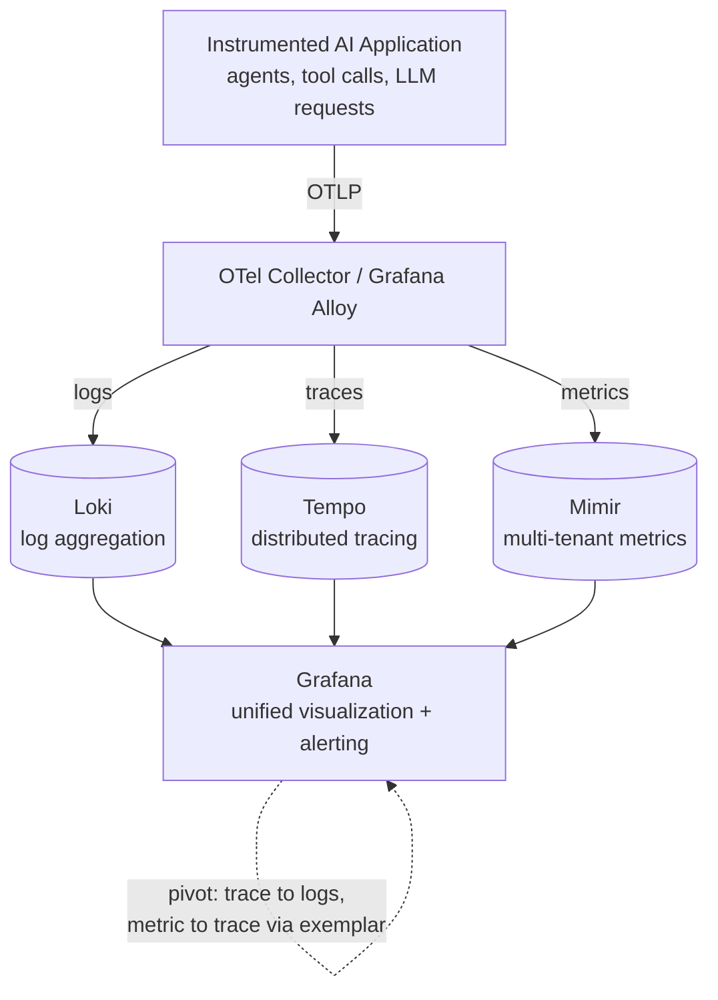

Back in October I wrote up a single-node observability stack for LLM calls — an OTel Collector, Tempo for traces, Prometheus for metrics, Grafana on top. That post was honest about its scope: one Prometheus process, one Tempo process, built for a team that wants trace visibility without a vendor bill. It works, and if you're a single team instrumenting a handful of services, it's still the right starting point.

It stops working the moment "one team" becomes "an AI platform serving two dozen teams." At that point you're not choosing between self-hosted and vendor anymore — you're choosing between an architecture that scales horizontally with real tenant isolation and one that doesn't, no matter who operates it. This post, and the six that follow it this week, are about that second architecture: the Grafana LGTM stack — Loki, Grafana, Tempo, Mimir — as it actually needs to look at enterprise scale.

## The gap between a demo and a platform

A single Prometheus instance has a practical ceiling — it's one process, one disk, one set of scrape targets, and it has no concept of tenant isolation. A single Tempo instance without the distributed components running has similar limits on throughput. Both are fine for a demo, a POC, or a single team's services. Neither is fine for an enterprise AI platform, for three reasons that show up in roughly this order as you scale:

1. **Multi-tenancy.** Dozens of teams building on the same platform means dozens of teams whose traces, metrics, and logs need to be queryable independently, billed/attributed independently, and — critically — isolated so one team's noisy workload or runaway query doesn't degrade another team's dashboards. A single-node Prometheus has no tenant concept at all. You'd be building namespace conventions and hoping nobody breaks them.
2. **Horizontal scale.** Enterprise AI workloads don't scale linearly with user count the way typical web traffic does. A single user request to an agent can fan out into a dozen LLM calls, two dozen tool-call spans, and proportionally more log lines and metric samples than a comparable non-agentic request. One node runs out of headroom fast.
3. **Retention that doesn't bankrupt you.** Debugging a quality regression that someone reports three weeks after the fact requires traces and logs to still exist three weeks later. A single-node setup where retention is "however much fits on this disk" doesn't give you that. You need storage that's cheap enough at scale to keep weeks or months of data, which in practice means object storage, not local disk.

None of this is a knock on the October stack — it's the right first step. The LGTM stack is what you migrate to when the first step's limits start being your limits.

## What each letter actually is

The acronym gets thrown around loosely, so here's what each component does and why it's in the stack rather than some adjacent tool:

- **Loki** — log aggregation, purpose-built to be cheap at scale by indexing only a small set of labels instead of full-text indexing every log line (more on why that matters for AI workloads in Thursday's post). This is new ground for this blog — nothing here has covered structured logging for agent systems yet, and it's the pillar most teams underinvest in relative to traces.
- **Grafana** — not a passive dashboard tool here. It's the correlation layer: one place where a trace, a metric panel, and a log query share enough context (trace IDs, exemplars, linked data sources) that an engineer can pivot between all three without leaving the UI. This is the actual payoff of running all three signals in one ecosystem instead of three separate tools.
- **Tempo** — distributed tracing, object-storage backed, built to index minimally so that keeping months of trace history doesn't require months of expensive hot storage. Same component as the October post, but run as its distributed set of services (distributor, ingester, compactor, querier) instead of a single binary.
- **Mimir** — Prometheus-compatible metrics storage that scales horizontally and adds real multi-tenancy, replacing the single Prometheus instance from October without changing the PromQL interface your team already knows.

## Why AI and agent workloads stress this harder than typical services

A standard microservice emits a fairly predictable, low-cardinality set of telemetry: request count, latency, a handful of status codes. AI and agent workloads break that pattern in three specific ways:

- **Cardinality explosion.** Every span and every metric sample on an AI platform tends to carry per-model, per-team, per-tenant, and sometimes per-prompt-template labels. That's exactly the kind of label cardinality that kills a single Prometheus instance's memory footprint — and it's unavoidable if you want to answer "which team's usage of which model is driving this cost," which is a question every AI platform eventually gets asked.
- **Trace payload size and depth.** A multi-step agent chain — plan, retrieve, call three tools, synthesize, retry once — produces a trace with far more spans than a typical HTTP request, and those spans carry larger attribute payloads (prompts, tool arguments, token counts) than a typical span does.
- **The "why did it do that" problem.** Traces answer what happened and roughly how long it took. They're a weaker tool for answering why an agent picked a particular tool call or produced a particular output — that detail often belongs in a structured log line correlated back to the trace, which is exactly the gap Loki fills and that this blog hasn't covered before.

## How the three pillars work together, conceptually

Here's the mental model worth having before going deep on any one component: a trace shows you the *shape* of one request — what happened, in what order, how long each step took. A metric shows you the *aggregate trend* across thousands of requests — is p95 latency climbing, is error rate spiking, is cost per request drifting up. A log shows you the *specific decision detail* inside one step that a span attribute either couldn't capture or wasn't designed to hold.

None of the three replaces the other two. An alert fires on a metric (aggregate signal), which should let you jump to a specific trace that exemplifies the problem (request-shape signal), which should let you jump to the log lines generated during that exact trace (decision-detail signal). That chain — metric to trace to log — is the actual product the LGTM stack is selling, and it's only real if you deliberately design for it. Running Loki, Tempo, and Mimir side by side without correlation is just three dashboards an engineer manually cross-references during an incident, which is slower than the single-node setup it replaced.

## What the rest of this week covers

This post is the "why" — the next six build the "how," one layer at a time:

- **Tomorrow**: the OTel GenAI semantic conventions in full — the actual attribute and event spec, not a summary, because every other post this week assumes spans are using these names consistently.
- **Thursday through Saturday**: Tempo, Mimir, and Loki individually, each at the depth of "how do I actually query this for agent debugging," with TraceQL, PromQL, and LogQL examples.
- **Sunday**: Grafana Alloy as the unified collector replacing the separate collection agents that otherwise sprawl across metrics, logs, and traces.
- **Monday**: closing the loop — exemplars and trace-ID correlation, the mechanism that actually makes "pivot between signals" real instead of aspirational.

What this week deliberately does *not* cover — multi-tenancy configuration, HA topology, Kubernetes deployment manifests, retention tuning, alerting rules, and dashboard design — is next week's series. This week is foundations: what each pillar is, why it exists, and how to use it on its own. Next week is what it takes to run all of it in production, at scale, reliably.
