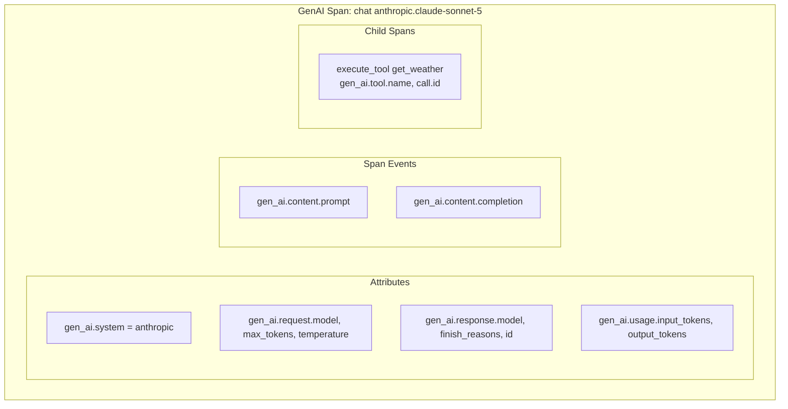

I covered OTel's gen_ai conventions at a general level back in March, as part of a broader piece on agent tracing architecture. That post was an introduction. This one isn't — it's the reference I wish existed when I was writing the instrumentation wrapper our platform team now enforces across every service that calls an LLM. If you're building that wrapper yourself, this is the attribute table to pin.

The short version of why this matters: a dashboard or alert rule written against `gen_ai.usage.input_tokens` only works platform-wide if every team actually emits that attribute name. If one team's spans use `llm.input_tokens` and another uses `prompt_tokens`, you don't have a platform — you have a dozen incompatible islands that happen to share a Grafana instance. The semantic conventions exist to prevent exactly that.



## Why standardization matters more here than for HTTP spans

A typical HTTP span has a handful of well-established attributes — method, status code, route — that essentially every framework emits identically because the HTTP spec itself constrains the shape. LLM calls have no equivalent external constraint. "Temperature," "max tokens," and "the model that actually responded" (which can differ from the model requested, after routing or fallback) are concepts every provider names slightly differently in their own SDKs. Without a shared convention sitting on top of that, every team's instrumentation reinvents field names, and nothing — not a dashboard, not an alert, not a cost report — can be written generically across the platform. This is the single biggest practical reason to adopt the convention wholesale rather than let teams freelance their own attribute names, even internally.

## The core `gen_ai.*` namespace

These are the attributes that belong on every GenAI operation span, split into request-time and response-time groups.

**Request attributes** (known before the call completes):

| Attribute | Type | Example | Notes |
|---|---|---|---|
| `gen_ai.system` | string | `"anthropic"` | The provider/system identifier. Required. |
| `gen_ai.operation.name` | string | `"chat"` | `chat`, `text_completion`, or `embeddings`. Drives span naming. |
| `gen_ai.request.model` | string | `"claude-sonnet-5"` | The model requested, before any provider-side routing. |
| `gen_ai.request.max_tokens` | int | `4096` | Max output tokens requested. |
| `gen_ai.request.temperature` | double | `0.7` | Sampling temperature. |
| `gen_ai.request.top_p` | double | `0.9` | Nucleus sampling parameter, when set. |
| `gen_ai.request.stop_sequences` | string[] | `["\n\nHuman:"]` | Stop sequences, when set. |
| `gen_ai.request.frequency_penalty` | double | `0.0` | When supported by the provider. |
| `gen_ai.request.presence_penalty` | double | `0.0` | When supported by the provider. |

**Response attributes** (known only after the call returns):

| Attribute | Type | Example | Notes |
|---|---|---|---|
| `gen_ai.response.id` | string | `"msg_01Abc..."` | Provider-assigned response/message ID. |
| `gen_ai.response.model` | string | `"claude-sonnet-5-20260115"` | The model that actually served the request — log this even when it matches the request, because routing/fallback means it won't always. |
| `gen_ai.response.finish_reasons` | string[] | `["tool_use"]` | Why generation stopped — `stop`, `length`, `tool_use`, `content_filter`. Array because some providers return multiple. |
| `gen_ai.usage.input_tokens` | int | `842` | Token count for the input. |
| `gen_ai.usage.output_tokens` | int | `213` | Token count for the output. |

Treat the request group as attributes you set when you start the span, and the response group as attributes you add before you end it. Don't wait until the call completes to start the span — you lose the actual request-side latency if you do.

## Span naming and operation kind

The convention is explicit about span names so that a trace viewer's span list is scannable without opening each span: `"{gen_ai.operation.name} {gen_ai.request.model}"`. A chat call to Claude becomes a span literally named `chat claude-sonnet-5`. An embeddings call becomes `embeddings text-embedding-3-large`. This sounds pedantic until you're looking at a trace with forty spans and trying to tell which of six nested LLM calls is the slow one without hovering over each one — consistent naming is what makes that scan fast.

The three operation names the convention currently defines are `chat` (multi-turn or single-turn conversational calls), `text_completion` (legacy completion-style calls), and `embeddings` (vector embedding generation). Pick the one that matches the actual API shape you're calling, not the one that sounds closest to what your product does with the result.

## Events: prompt and completion content live separately from attributes

This is the part people get wrong most often: prompt and completion content are **not** span attributes. They're span **events**, and that's a deliberate design choice for two reasons — size and sensitivity. Attributes are meant to be small, queryable, indexed fields. A prompt can be thousands of tokens; a completion from an agent step can be larger still. Putting that content in an attribute bloats every span and makes it expensive to query against. Putting it in an event keeps it attached to the span for inspection but out of the hot query path.

The event schema:

```json
{
  "name": "gen_ai.content.prompt",
  "attributes": {
    "gen_ai.prompt": "[{\"role\":\"user\",\"content\":\"...\"}]"
  }
}
```

```json
{
  "name": "gen_ai.content.completion",
  "attributes": {
    "gen_ai.completion": "[{\"role\":\"assistant\",\"content\":\"...\"}]"
  }
}
```

The sensitivity angle matters specifically because of the redaction and sampling work covered in the collector post from October — that post's processors operate on event payloads precisely because prompt/completion content lives in events, not attributes. If you're building a platform-wide redaction policy, this is the attachment point: redact or drop `gen_ai.content.*` events at the collector before they're persisted, while leaving the attribute set (which carries no raw content) fully intact for querying.

## Tool-call attributes for agentic spans

This is the area still actively evolving in the upstream spec, but the shape that's converged on in practice looks like this. A tool invocation inside an agent's reasoning loop gets its own child span, distinct from the parent chat span:

| Attribute | Type | Example | Notes |
|---|---|---|---|
| `gen_ai.tool.name` | string | `"get_weather"` | The tool/function name invoked. |
| `gen_ai.tool.call.id` | string | `"call_abc123"` | Matches the tool_use ID the model emitted, so you can join the call back to the parent response. |
| `gen_ai.tool.call.arguments` | string (JSON) | `"{\"city\":\"Pune\"}"` | As an event payload, same sensitivity treatment as prompt/completion content. |
| `gen_ai.tool.call.result` | string (JSON) | `"{\"temp_c\":28}"` | Also an event, not an attribute. |

The span name convention here is `execute_tool {gen_ai.tool.name}`, which keeps it visually distinct from the LLM call spans in a trace view — you want to be able to scan a trace and immediately tell "this branch is a tool call, this branch is a model call" without reading attributes.

## A fully instrumented example

```python
from opentelemetry import trace
from opentelemetry.trace import SpanKind
import json

tracer = trace.get_tracer("platform.llm-wrapper")

def call_claude(messages, model="claude-sonnet-5", max_tokens=4096, temperature=0.7):
    with tracer.start_as_current_span(
        f"chat {model}",
        kind=SpanKind.CLIENT,
        attributes={
            "gen_ai.system": "anthropic",
            "gen_ai.operation.name": "chat",
            "gen_ai.request.model": model,
            "gen_ai.request.max_tokens": max_tokens,
            "gen_ai.request.temperature": temperature,
        },
    ) as span:
        span.add_event("gen_ai.content.prompt", {
            "gen_ai.prompt": json.dumps(messages),
        })

        response = anthropic_client.messages.create(
            model=model, max_tokens=max_tokens, temperature=temperature, messages=messages,
        )

        span.set_attributes({
            "gen_ai.response.id": response.id,
            "gen_ai.response.model": response.model,
            "gen_ai.response.finish_reasons": [response.stop_reason],
            "gen_ai.usage.input_tokens": response.usage.input_tokens,
            "gen_ai.usage.output_tokens": response.usage.output_tokens,
        })
        span.add_event("gen_ai.content.completion", {
            "gen_ai.completion": json.dumps([b.model_dump() for b in response.content]),
        })

        return response
```

That's the full attribute set, populated correctly, for one call. Every platform-level dashboard, alert, and cost report this week's later posts reference assumes spans look like this.

## Enforce this as a shared library, not a convention you hope teams follow

Documenting the attribute set changes nothing if every team hand-rolls their own instrumentation. The only version of this that holds up at platform scale is a thin wrapper library — similar in spirit to the LLM gateway pattern this blog has covered before — that every team imports to make LLM calls, with the attribute population baked into the wrapper itself. Teams get tracing for free by using the sanctioned client; they can't get it wrong because they never write the `set_attributes` call themselves. That's the actual governance lever, and it's worth more than any amount of internal documentation telling people what the attribute names should be.
