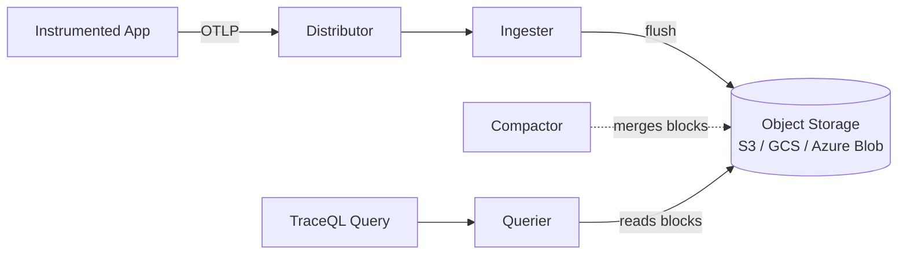

Every trace backend eventually asks you to make a trade: index more and pay more for storage and write throughput, or index less and give something up at query time. Tempo makes that trade deliberately in favor of indexing almost nothing. It stores the raw trace data straight into object storage and keeps only a minimal index on top. That's the single architectural decision that makes keeping weeks of agent traces affordable instead of a constant pruning exercise.

That decision only pays off if the query layer on top of cheap storage is actually good enough to use during an incident, which is where TraceQL comes in. This post covers both halves: why Tempo is shaped the way it is, and how to actually query it for the kind of debugging agentic workloads demand.



## Why object storage, and why that matters for agent workloads specifically

A typical microservice trace has a handful of spans — maybe a dozen for a complex request. An agentic workload routinely produces far more: every planning step, every tool call, every retry, every sub-agent delegation is its own span. Multiply that by request volume across a platform serving dozens of teams, and the volume of raw trace data is an order of magnitude higher than what most trace backends were originally designed around.

Tempo's answer is to not try to index all of that. It stores trace data as blocks in object storage and keeps a lean index — effectively just enough to locate which block a trace ID lives in. The query cost of "give me everything for trace ID X" stays cheap regardless of how much historical data you're sitting on, because retrieval is a targeted object-storage read, not a scan across an indexed structure holding years of attribute data. The cost of that trade is that searching trace data by arbitrary attribute content used to be slow in older trace-search designs — TraceQL and Tempo's attribute indexing improvements are what closed that gap enough to make attribute-based search genuinely usable, which matters a lot for agent debugging where "find me traces where X happened" is the normal query shape, not "look up this one trace ID."

## The components, briefly

You don't need deep internals knowledge to operate Tempo well, but it helps to know what's actually running:

- **Distributor** — receives incoming spans (typically via OTLP), does minimal validation, and routes them to ingesters based on consistent hashing of the trace ID, so all spans for one trace land on the same ingester.
- **Ingester** — buffers spans for a trace in memory until the trace is complete (or a timeout passes), then flushes the completed trace as a block to object storage.
- **Compactor** — runs continuously against object storage, merging small blocks into larger ones and applying retention rules by deleting blocks past their configured age. This is what keeps query performance from degrading as block count grows.
- **Querier** — handles read requests, including TraceQL queries, by locating and reading the relevant blocks from object storage, optionally with a cache layer in front for repeat queries.

That's the whole mental model: writes go distributor to ingester to object storage; reads go querier to object storage; compactor keeps object storage tidy in the background. Multi-tenancy and HA topology for these components is next week's territory — for now, know that each of these can run as multiple replicas behind the scenes without changing anything about how you query.

## TraceQL: queries built for this exact debugging shape

TraceQL looks like a cross between PromQL and a structured log query, and it's purpose-built for asking questions across many traces, not just retrieving one by ID. Here are four queries that come up constantly when debugging agent behavior, assuming spans are using the `gen_ai.*` attribute set from yesterday's post.

**1. Find slow tool-use traces** — traces where the model decided to call a tool and the overall trace took longer than 10 seconds (a common signature of a tool call that hung or a retry loop):

```traceql
{ .gen_ai.response.finish_reasons = "tool_use" } | select(duration) | duration > 10s
```

**2. Find runaway agent loops** — traces with an abnormal number of child spans, which in agentic workloads is usually a proxy for an agent that didn't converge and kept looping tool calls:

```traceql
{ } | count() > 40
```

This counts spans per trace and filters to traces exceeding 40 — tune the threshold to what's normal for your agent's expected step count, since a legitimately complex multi-step agent might run 15-20 spans on a good day.

**3. Compare latency across model tiers within the same store** — useful when deciding whether a cheaper model tier is actually meeting latency SLOs for a given workload:

```traceql
{ .gen_ai.request.model = "claude-haiku-5" } | select(duration)
```

Run the same query swapping the model name and compare the duration distributions directly in Grafana's trace list view — no need for a separate dashboard just to sanity-check one model's latency against another.

**4. Find traces with a specific tool failure**, joining attributes from a child span back up to trace-level filtering — useful when a specific tool integration starts misbehaving and you need every trace that touched it:

```traceql
{ name = "execute_tool" && .gen_ai.tool.name = "payment_lookup" } && { status = error }
```

That last query is the shape that matters most for agent debugging in practice: cross-span correlation within one trace, rather than filtering a single span type in isolation. Agentic failures are rarely visible on one span — they're visible in the relationship between a tool-call span's result and what the parent chat span did next.

## Multi-tenancy: the `X-Scope-OrgID` header

Tempo isolates tenants at write and query time through a single header: `X-Scope-OrgID`. Every write request and every query carries it, and Tempo partitions storage and enforces query scoping based on its value — a query for tenant `team-fraud-detection` physically cannot return spans written under `team-recommendations`. This is the same mechanism Mimir uses for metrics tenancy, which is worth knowing now even though the full multi-tenant deployment pattern — how this interacts with authentication, per-tenant rate limits, and per-tenant retention overrides — is covered properly in next week's series. For this week, the thing to internalize is that tenant isolation in Tempo isn't a convention your team enforces by discipline; it's enforced by the storage and query layer itself, as long as every client is configured to send the header.

## Retention: block age meets object storage lifecycle

Tempo's own retention setting controls how long the compactor keeps blocks before deleting them:

```yaml
compactor:
  compaction:
    block_retention: 720h   # 30 days
```

What trips people up is forgetting that this setting and your object storage bucket's own lifecycle policy are two independent controls that need to agree with each other. If your S3 bucket has a lifecycle rule transitioning objects to a colder storage class — or deleting them outright — at 14 days, and Tempo's `block_retention` says 30 days, you'll get query failures on data between day 14 and day 30 that Tempo thinks should still exist. Set the bucket lifecycle policy to match or exceed Tempo's own retention window, not the other way around, and treat any divergence between the two as a production incident waiting to happen rather than a minor inconsistency.
