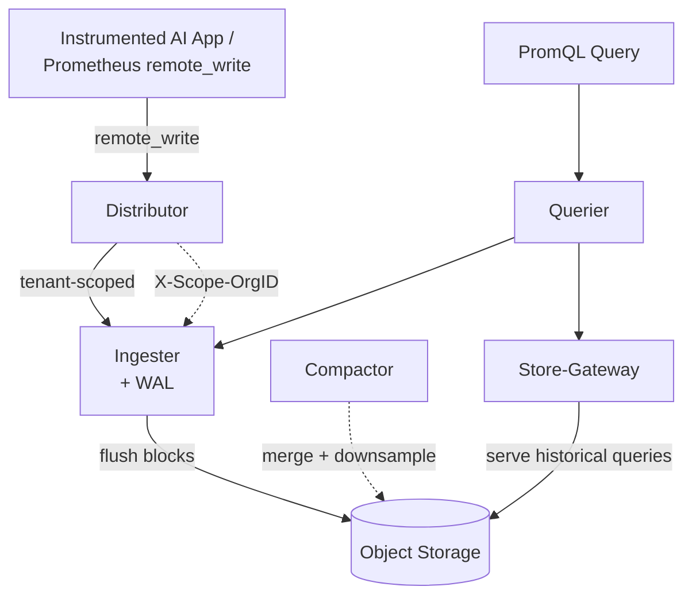

Prometheus doesn't fail loudly when it runs out of headroom. It fails as memory pressure, as scrape timeouts that get worse over weeks, as a `/metrics` endpoint that quietly stops responding under query load — the kind of degradation that's easy to miss until a dashboard that used to load in two seconds takes thirty, or stops loading at all. For an enterprise AI platform, the thing that gets you there fastest isn't total request volume. It's cardinality.

Mimir exists to fix that without asking your team to learn a new query language. It speaks PromQL, it accepts Prometheus remote-write, and from a query author's seat it looks like Prometheus. What's different is everything underneath: horizontal scaling across dedicated components, native multi-tenancy, and object-storage-backed long retention.



## Where single-node Prometheus actually breaks for AI metrics

Cardinality is the number of unique label combinations a metric can have, and it's the thing that determines Prometheus's memory footprint far more than raw sample count does. A typical microservice metric might carry labels for service name and status code — low, bounded cardinality. An AI platform's metrics look structurally different:

- Token usage counters labeled by model, by team, by tenant, sometimes by prompt template version.
- Latency histograms labeled by endpoint, by model tier, by whether the call hit a cache.
- Cost counters labeled by model and team, because someone in finance is going to ask for a per-team cost breakdown eventually and you don't want to reconstruct it from logs after the fact.

Multiply model count by team count by tenant count by endpoint count, and the label combination space grows multiplicatively, not additively. That's exactly the cardinality shape that exhausts a single Prometheus instance's memory long before request volume does. The Oct 6 single-node stack I wrote about was honest that this was its ceiling — Mimir is the direct answer to it.

## What Mimir adds while staying PromQL-compatible

The query interface doesn't change. What changes is the architecture underneath, split into components with distinct jobs:

- **Distributor** — accepts incoming samples via Prometheus remote-write, validates them, and shards them across ingesters based on tenant and series.
- **Ingester** — holds recent samples in memory plus a write-ahead log for durability, and periodically flushes completed blocks to object storage. The WAL is what protects you from losing recent, not-yet-flushed data if an ingester crashes.
- **Compactor** — merges small blocks into larger ones and applies downsampling rules so that long-range queries over months of data don't have to scan full-resolution samples for that entire range.
- **Store-gateway** — serves queries against historical data sitting in object storage, separate from the ingesters that handle recent data, so a long-range dashboard query doesn't compete with live ingestion for the same resources.
- **Querier** — the component your PromQL queries actually hit, which fans out to ingesters (recent data) and store-gateways (historical data) and merges the results.

Multi-tenancy runs on the same `X-Scope-OrgID` header mechanism Tempo uses, enforced at the distributor and querier layer — a tenant's write path and query path are both scoped to their org ID, and cross-tenant queries aren't possible by construction, not by convention. The deeper operational details of running this multi-tenant — per-tenant limits, HA pairing, shuffle sharding — belong to next week's series; for now, know that the isolation mechanism is the same one you already saw with Tempo, which is intentional — Grafana designed the LGTM components to share this pattern.

## What an AI platform should actually be shipping to Mimir

Not every number you could compute is worth a metric series. The set that earns its cardinality cost on an AI platform:

- `llm_tokens_total{model, team, direction}` — a counter for input/output tokens, labeled enough to compute per-team, per-model usage, but not labeled by anything unbounded like user ID or request ID.
- `llm_request_duration_seconds` (histogram) `{endpoint, model_tier}` — latency, bucketed finely enough near your SLO threshold to compute accurate percentiles there.
- `llm_cost_usd_total{model, team}` — a derived cost counter, computed from token counts and your provider's per-token pricing, so finance-facing cost reporting doesn't require someone re-deriving it from raw token metrics every time it's asked for.
- `llm_quality_sample_rate` (gauge) — a sampled signal of output quality, which connects to the SLO and error-budget framing covered in the AI platform SLOs post from October; this series doesn't repeat that content, just note that Mimir is the storage layer those SLO queries run against.

Notice what's deliberately excluded: anything labeled by user ID, session ID, request ID, or raw prompt content. Those belong in Loki (Thursday's post) or Tempo, not in a metric label, precisely because they'd blow up cardinality without adding aggregate value a metric is supposed to provide.

## Remote-write configuration

From an OTel Collector or a standalone Prometheus instance, pushing into Mimir needs a tenant header and the right endpoint path:

```yaml
# otel-collector-config.yaml (relevant exporter section)
exporters:
  prometheusremotewrite:
    endpoint: "https://mimir.internal.example.com/api/v1/push"
    headers:
      X-Scope-OrgID: "team-fraud-detection"
    resource_to_telemetry_conversion:
      enabled: true
```

Or directly from Prometheus's own remote-write config, if you're migrating an existing scrape-based setup rather than pushing from the collector:

```yaml
# prometheus.yml
remote_write:
  - url: "https://mimir.internal.example.com/api/v1/push"
    headers:
      X-Scope-OrgID: "team-fraud-detection"
```

Every write without that header (or with it misconfigured) either gets rejected or, depending on how the gateway in front of Mimir is set up, silently attributed to the wrong tenant. Get this header right before anything else — it's the single most common misconfiguration when onboarding a new team onto a shared Mimir deployment.

## PromQL against Mimir: cost and usage queries

Because the query language hasn't changed, your team's existing PromQL fluency carries over directly. Cost per model per hour:

```promql
sum by (model) (
  rate(llm_cost_usd_total[1h])
) * 3600
```

Token usage rate of change, to catch a sudden spike in consumption before the monthly bill does:

```promql
deriv(
  sum by (team) (rate(llm_tokens_total{direction="output"}[5m]))[30m:]
)
```

Both queries would work unchanged against the Oct 6 post's single-node Prometheus. The difference at Mimir scale isn't the query — it's that this query now runs correctly across tenants, across the full cardinality of your platform's label space, without a single node choking on it.

## Recording rules for keeping dashboards fast

High-cardinality queries that recompute an expensive aggregation on every dashboard load don't scale, even on Mimir. Pre-aggregate the expensive ones with recording rules:

```yaml
groups:
  - name: llm_cost_aggregations
    interval: 1m
    rules:
      - record: team:llm_cost_usd:rate1h
        expr: sum by (team) (rate(llm_cost_usd_total[1h]))
      - record: model:llm_tokens:rate5m
        expr: sum by (model) (rate(llm_tokens_total[5m]))
```

Dashboards query the recorded series instead of re-running the raw aggregation on every load, which matters a lot once you have dozens of teams' dashboards hitting the same underlying high-cardinality metrics simultaneously. This is the same recording-rule discipline Prometheus users already know — it just matters more here, because the queries it's protecting against are bigger.
