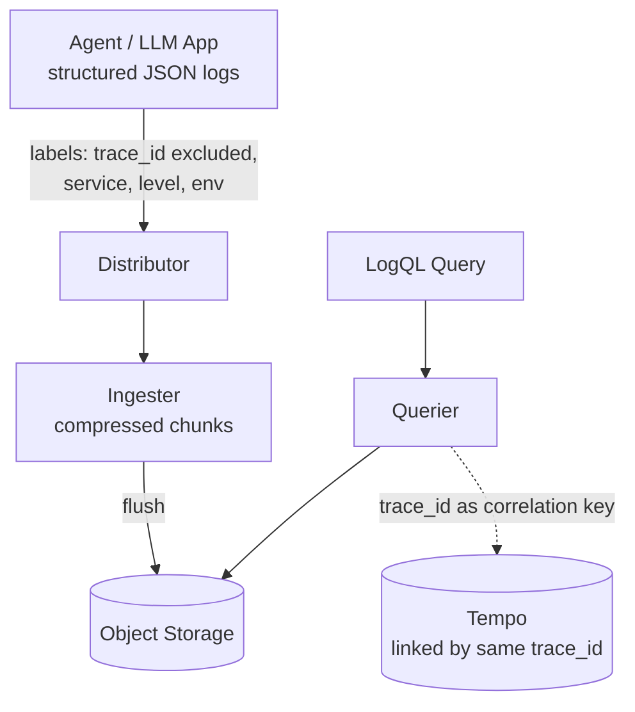

Everything this week has assumed traces and metrics are enough to debug an agent. They're not, and this post is about the gap they leave. A trace span tells you an LLM call happened, took 2.3 seconds, used 840 input tokens, and returned a `tool_use` finish reason. It does not, in any convenient form, tell you *why* the agent's planning step chose that particular tool over two other plausible ones, or what the retry logic decided to do when the first attempt came back malformed. That detail — the actual reasoning trace, a structured decision record, the full tool arguments when they're too large or too sensitive to attach to a span event — belongs in a log line. This blog hasn't covered structured logging for AI systems before now, which is itself a gap worth fixing before going further into this series.

Loki is the pillar for that, and its design is worth understanding before you point a logging library at it, because the way it indexes is deliberately different from what most engineers expect from a log search tool.



## The design choice: labels, not full-text indexing

Elasticsearch and similar full-text log stores index every token in every log line, which is powerful for arbitrary free-text search but expensive at scale — the index itself can end up larger than the log data it's indexing. Loki takes the opposite bet: index only a small set of labels (service name, environment, log level — things with low, bounded cardinality), and store the actual log line content in compressed chunks that aren't indexed at all. Searching by label is fast because the index is small. Searching log *content* within a label-filtered set is a chunk scan, not an index lookup — slower per-query than Elasticsearch's full-text index, but the storage and ingestion cost savings at AI-platform log volume make that trade worth it almost every time.

The practical consequence: pick your labels carefully, and keep them low-cardinality. This is the single most common Loki misconfiguration — someone puts `trace_id` or `user_id` directly on a label, which creates a unique label-value combination (a "stream" in Loki's terms) for every single request. That defeats the entire point of label-based indexing and turns Loki's ingestion path into exactly the cardinality problem Mimir was built to avoid on the metrics side. `trace_id` belongs *in the log line content* as a JSON field, queried with LogQL's parser, never as a label.

## Structured logging format for agent systems

Emit JSON log lines with a consistent field set, so LogQL's JSON parser has something reliable to extract. A reasonable baseline for an agent system:

```json
{
  "timestamp": "2026-11-28T09:14:02.481Z",
  "level": "info",
  "service": "agent-runtime",
  "trace_id": "4bf92f3577b34da6a3ce929d0e0e4736",
  "span_id": "00f067aa0ba902b7",
  "agent_name": "research-assistant",
  "decision": "tool_selected",
  "tool_called": "web_search",
  "reasoning_summary": "query requires current information not in training data",
  "step": 3
}
```

Labels on this stream should be `service`, `level`, and maybe `env` — nothing else. Everything else, including `trace_id`, stays inside the JSON body, where LogQL extracts it on query rather than at ingestion.

## Python example: a trace-correlated structured logger

The part that makes this actually useful is pulling the active trace and span IDs out of the OTel context at log time, so every log line can be joined back to the trace that produced it without any manual plumbing:

```python
import json
import logging
from opentelemetry import trace

class TraceCorrelatedFormatter(logging.Formatter):
    def format(self, record):
        span = trace.get_current_span()
        span_context = span.get_span_context()

        log_entry = {
            "timestamp": self.formatTime(record, "%Y-%m-%dT%H:%M:%S.%fZ"),
            "level": record.levelname.lower(),
            "service": "agent-runtime",
            "message": record.getMessage(),
        }

        if span_context.is_valid:
            log_entry["trace_id"] = format(span_context.trace_id, "032x")
            log_entry["span_id"] = format(span_context.span_id, "016x")

        # merge any extra structured fields passed via logger.info(..., extra={...})
        for key in ("agent_name", "decision", "tool_called", "reasoning_summary", "step"):
            if hasattr(record, key):
                log_entry[key] = getattr(record, key)

        return json.dumps(log_entry)

logger = logging.getLogger("agent-runtime")
handler = logging.StreamHandler()
handler.setFormatter(TraceCorrelatedFormatter())
logger.addHandler(handler)

# usage inside the agent loop
logger.info(
    "agent selected tool",
    extra={
        "agent_name": "research-assistant",
        "decision": "tool_selected",
        "tool_called": "web_search",
        "reasoning_summary": "query requires current information not in training data",
        "step": 3,
    },
)
```

Ship stdout from this process through Promtail, the Alloy log-collection path (covered Sunday), or any OTel log exporter into Loki, and every line already carries the trace ID needed to correlate it.

## LogQL in practice

**Pull every log line for one problematic trace** — the query you run first during an incident, once you have a trace ID from Tempo:

```logql
{service="agent-runtime"} | json | trace_id="4bf92f3577b34da6a3ce929d0e0e4736"
```

**Aggregate a log-derived operational metric** — counting how often agents are hitting a max-step safety limit, as an hourly rate, functions as an early warning signal for runaway loops before they show up as a cost or latency anomaly elsewhere:

```logql
sum(count_over_time(
  {service="agent-runtime"} |= "agent_loop_exceeded_max_steps" [1h]
))
```

**Extract fields from legacy unstructured logs** that weren't emitted as JSON — LogQL's pattern parser handles this without requiring you to retrofit every old log call site:

```logql
{service="legacy-agent-worker"}
  | pattern `<ts> <level> agent=<agent_name> tool=<tool_name> duration=<duration>ms`
  | duration > 5000
```

That pattern query is worth keeping in your back pocket specifically for the migration period — not every service gets rewritten to emit structured JSON on day one, and the pattern parser is what lets you query the backlog of older log formats without waiting for that rewrite.

## Why this is the correlation key, not just another signal

The thing to take from this post into the rest of the series: `trace_id` showing up consistently in every log line is what turns Loki from "a separate place logs happen to live" into the third leg of the correlation chain this week keeps coming back to. A metric tells you something's wrong in aggregate. A trace tells you the shape of one specific request that went wrong. A log line, filtered by that exact trace ID, tells you the actual decision detail inside the step that failed — the tool call arguments, the reasoning summary, the thing a span attribute was never meant to hold. Monday's post on exemplars and correlation is where all three of these signals actually get wired together end to end; this post is what makes the log side of that wiring possible in the first place.
