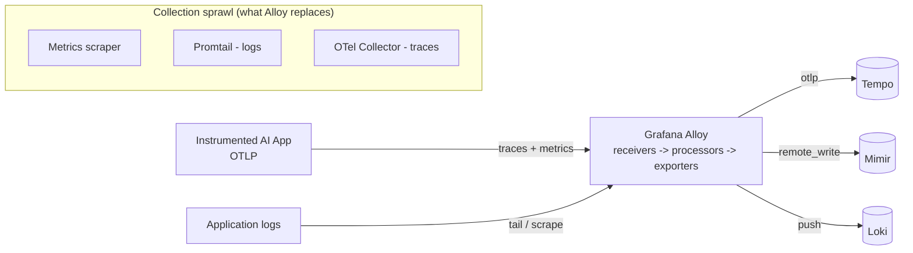

By this point in the week you have three storage backends — Tempo, Mimir, Loki — each with its own ingestion protocol expectations. The naive way to feed all three is three separate collection agents: something scraping and remote-writing metrics, something tailing and shipping logs, something else running an OTel Collector for traces. That's not a hypothetical — it's the default state most platforms drift into, one agent added at a time as each signal gets instrumented separately. It's also three configurations that can silently diverge, three agents that can each fall behind or misconfigure independently, and three things an on-call engineer needs to know how to debug instead of one.

Grafana Alloy is the answer to that sprawl: a single collector binary that speaks OTel natively for traces and metrics, handles log collection and forwarding to Loki in the same process, and configures all three through one unified configuration language.



## What Alloy actually is

Alloy is built on the same component model as the vanilla OTel Collector — receivers, processors, exporters — but extends it to cover logs as a first-class signal alongside traces and metrics, and configures everything through a single declarative language (River, now generally referred to as the Alloy configuration syntax) rather than three separate tools' separate YAML dialects. If you've worked with the OTel Collector before, the mental model transfers almost directly: data comes in through receivers, gets transformed or filtered by processors, and goes out through exporters. Alloy just makes all three signal types first-class citizens of that same pipeline instead of bolting logs on as an afterthought.

## A practical configuration

Here's a configuration shaped like what a platform team would actually run: an OTLP receiver taking traces and metrics from instrumented applications, a processing stage doing the same redaction and sampling work the October collector post covered, and three exporters fanning out to each backend.

```river
otelcol.receiver.otlp "default" {
  grpc {
    endpoint = "0.0.0.0:4317"
  }
  http {
    endpoint = "0.0.0.0:4318"
  }
  output {
    traces  = [otelcol.processor.batch.default.input]
    metrics = [otelcol.processor.batch.default.input]
  }
}

otelcol.processor.batch "default" {
  timeout = "5s"
  output {
    traces  = [otelcol.exporter.otlp.tempo.input]
    metrics = [otelcol.exporter.prometheus.mimir.input]
  }
}

// Same redaction pattern as the Oct 13 collector post, now running inside Alloy
otelcol.processor.transform "redact_content" {
  trace_statements {
    context = "span"
    statements = [
      "delete_key(attributes, \"gen_ai.prompt\") where attributes[\"pii.detected\"] == true",
    ]
  }
}

otelcol.exporter.otlp "tempo" {
  client {
    endpoint = "tempo-distributor.internal:4317"
  }
}

otelcol.exporter.prometheus "mimir" {
  forward_to = [otelcol.exporter.otlphttp.mimir_remote_write.input]
}

otelcol.exporter.otlphttp "mimir_remote_write" {
  client {
    endpoint = "https://mimir.internal.example.com/api/v1/push"
    headers  = { "X-Scope-OrgID" = "team-fraud-detection" }
  }
}

// Log collection and forwarding to Loki, in the same binary
loki.source.file "app_logs" {
  targets = [
    {__path__ = "/var/log/agent-runtime/*.log", job = "agent-runtime"},
  ]
  forward_to = [loki.write.default.receiver]
}

loki.write "default" {
  endpoint {
    url = "https://loki.internal.example.com/loki/api/v1/push"
    headers = { "X-Scope-OrgID" = "team-fraud-detection" }
  }
}
```

That's traces, metrics, and logs — receive, process, export — defined in one file, operated as one process, with one tenant header convention applied consistently across all three outbound paths. The redaction processor is functionally the same job the October collector post walked through; Alloy just runs it alongside log collection instead of in a separate binary that has no visibility into the log pipeline at all.

## Deployment pattern: agent tier and gateway tier

Most enterprise deployments of Alloy run it in two tiers, not one, and the distinction matters for where processing load and configuration complexity live:

- **Agent tier** — a lightweight Alloy instance running close to the application (as a sidecar, a node-level DaemonSet in Kubernetes, or embedded in the app's own deployment), doing minimal work: receiving OTLP from the app, maybe basic batching, and forwarding onward. Kept deliberately thin so it doesn't become a bottleneck or a resource hog on every node.
- **Gateway tier** — a smaller number of centrally-operated Alloy instances that receive from all the agent-tier instances, and do the heavier lifting: the redaction and sampling logic, tenant header enforcement, fan-out to all three backends. Centralizing this tier is what lets a platform team change redaction policy or add a new exporter once, instead of redeploying configuration to every node running an agent-tier instance.

Why both instead of just one centralized tier: pushing all processing to a single gateway tier means every span, log line, and metric sample makes a network hop before any batching or filtering happens, which is wasteful at volume. Why both instead of just agent-tier processing everywhere: policy changes (a new redaction rule, a new tenant onboarding) would need rolling out to every single agent instance individually instead of to a handful of gateway instances. Two tiers is more infrastructure to run than one, but it's the pattern that holds up once you have enough traffic and enough policy complexity that neither extreme works well alone.

## Migrating from the vanilla OTel Collector

If you're running the October posts' plain OTel Collector setup already, the migration path is more mechanical than most "move to a new tool" stories. Alloy's trace and metric handling is built on OTel Collector components directly, so the receivers, processors, and exporters you already have configured largely carry over with syntax translation rather than a redesign. The actual new capability you're adding is the log-handling side — `loki.source.*` and `loki.write` blocks — which has no equivalent in the vanilla collector because it never handled logs at all. In practice, most teams making this move keep their existing trace/metric pipeline logic nearly unchanged and spend their actual migration effort on standing up the log collection half fresh, since that's genuinely new ground rather than a port of something that already existed.
