Everything this week built toward this post, and it's worth being blunt about why it matters: Loki, Tempo, and Mimir running side by side, each perfectly configured on its own, are still just three dashboards an engineer has to manually cross-reference during an incident if nothing links them together. That's slower than it needs to be, and slow during an incident has a real cost. The thing that makes the LGTM stack more than the sum of its parts is correlation — specifically, exemplars on the metrics side and a consistently propagated trace ID on the logs side, both pointing back at Tempo.

```mermaid
flowchart LR
    Alert[Quality metric dip<br/>alert fires] --> Mimir[Mimir: latency histogram panel]
    Mimir -->|exemplar click| Tempo[Tempo: specific slow trace]
    Tempo -->|trace_id shared| Loki[Loki: logs filtered by trace_id]
    Loki --> Finding[Exact tool call<br/>that went wrong]

    style Mimir fill:#2b2b40
    style Tempo fill:#2b2b40
    style Loki fill:#2b2b40
```



## The trace ID as the universal correlation key

Every signal this week has pointed back to the same identifier. Thursday's Loki post showed structured logs carrying `trace_id` as a JSON field, pulled straight from the active OTel span context. Tuesday's semantic conventions post established that every GenAI span lives inside a trace with its own trace ID. The missing piece is the metrics side: a metric data point, by default, has no concept of "which trace was active when this sample was recorded" — it's just a number with labels and a timestamp. Exemplars are what close that gap.

## Exemplars, concretely

An exemplar is a sampled trace ID attached to a specific data point within a histogram metric. Not every sample gets one — that would be prohibitively expensive at scale — but a representative subset does, which is enough. When a histogram bucket shows an unusual number of observations (say, a spike in the "over 10 seconds" bucket of a request-latency histogram), the exemplar attached to one of the samples that landed in that bucket is a real, concrete trace ID you can click through to. You're not left staring at an aggregate number wondering which request caused it — you have one specific example to start from.

This matters specifically for AI workloads because aggregate latency numbers hide a lot of real variance. A p99 latency spike could be one runaway agent loop, a genuinely slow model under load, or a tool call that hung — and those three causes need completely different fixes. An exemplar is what turns "p99 went up" into "here's an actual trace from the spike, go look at it."

## Configuring exemplar support

This requires changes on both the application side and the Grafana side — neither alone is sufficient.

**Application side**: the metrics SDK needs to attach the current trace context when recording a histogram observation. With the OpenTelemetry Python SDK, this is largely automatic once the metrics and trace providers share the same context propagation, but it's worth confirming explicitly rather than assuming it works:

```python
from opentelemetry import trace, metrics

tracer = trace.get_tracer("platform.llm-wrapper")
meter = metrics.get_meter("platform.llm-wrapper")

request_duration = meter.create_histogram(
    name="llm_request_duration_seconds",
    description="LLM request duration",
    unit="s",
)

def call_claude(messages, model):
    with tracer.start_as_current_span(f"chat {model}") as span:
        start = time.monotonic()
        response = anthropic_client.messages.create(model=model, messages=messages)
        duration = time.monotonic() - start

        # recording while the span is active lets the SDK attach
        # the current trace context as an exemplar automatically
        request_duration.record(duration, attributes={"model": model})
        return response
```

The key detail: the histogram `record()` call has to happen while the span from `start_as_current_span` is still active. Record it after the `with` block exits and there's no active trace context left to attach — you'll get a histogram with no exemplars at all, which is a silent failure mode worth testing for explicitly rather than assuming it's working.

**Grafana side**: Tempo needs to be configured as a linked data source from Mimir, with the exemplar's trace ID field mapped to Tempo's trace lookup:

```yaml
# Grafana data source provisioning for Mimir, with Tempo linked
apiVersion: 1
datasources:
  - name: Mimir
    type: prometheus
    url: https://mimir.internal.example.com/prometheus
    jsonData:
      httpHeaderName1: "X-Scope-OrgID"
      exemplarTraceIdDestinations:
        - name: trace_id
          datasourceUid: tempo-datasource-uid
    secureJsonData:
      httpHeaderValue1: "team-fraud-detection"
```

With that in place, a histogram panel in Grafana renders exemplars as small diamond markers on the graph. Clicking one jumps directly into Tempo's trace view for that exact trace ID — no manual copy-pasting a trace ID between two separate browser tabs.

## Trace-to-logs and logs-to-trace linking

The second half of the correlation chain is configuring Tempo and Loki to link to each other directly, so a span in a trace view can jump to its correlated log lines and vice versa:

```yaml
# Grafana data source provisioning for Tempo, linked to Loki
apiVersion: 1
datasources:
  - name: Tempo
    type: tempo
    url: https://tempo.internal.example.com
    jsonData:
      tracesToLogsV2:
        datasourceUid: loki-datasource-uid
        tags: ["service.name"]
        filterByTraceID: true
        spanStartTimeShift: "-5m"
        spanEndTimeShift: "5m"
```

`filterByTraceID: true` is what makes this useful rather than just noisy — without it, "logs for this span" turns into "all logs from this service in a time window," which is a much weaker query than "the exact log lines this specific request produced." With it set, clicking "logs for this span" in Tempo's trace view runs the LogQL query from Thursday's post automatically, filtered to that exact trace ID, with the time window padded a few minutes on either side to catch async log lines that might be slightly out of order.

## A worked incident, start to finish

Here's how this is meant to play out in practice, tying every pillar from this week together:

1. **The alert fires on a metric.** A quality-sample-rate gauge (from Tuesday's recommended Mimir metric set) drops below its SLO threshold. The alert — built on a Mimir-backed recording rule — pages the on-call engineer with a link straight into a Grafana dashboard panel.
2. **The engineer opens the panel and clicks an exemplar.** The latency histogram for the affected endpoint shows a cluster of exemplar markers right around the time the quality metric started dropping. One click lands directly in Tempo, on one specific trace from that cluster.
3. **The trace shows the shape of the failure.** In Tempo's trace view, the engineer sees a `chat claude-sonnet-5` span with a `tool_use` finish reason, followed by an `execute_tool payment_lookup` child span that took 8 of the trace's total 11 seconds — unusually long for that tool.
4. **The engineer clicks through to correlated logs.** Using the trace-to-logs link, Grafana runs the LogQL query filtered to that exact trace ID and pulls up every structured log line the agent emitted during that request.
5. **The logs show the actual cause.** A log line tagged `decision: "retry_triggered"` shows the `payment_lookup` tool returned a malformed response on the first attempt, triggered an internal retry with a fixed 5-second backoff, and succeeded on the second try — explaining both the latency spike and, since the retry logic silently swallowed the first failure, why nothing showed up as an outright error anywhere else.

That's five steps from alert to root cause, each one handing off to the next signal type without the engineer manually reconstructing context in between. That handoff — not any single pillar on its own — is what the LGTM stack is actually for. Everything built this week (semantic conventions giving every signal a consistent vocabulary, Tempo making trace retention affordable, Mimir making metrics scale past one node, Loki making log detail queryable without full-text indexing cost, Alloy collecting all three through one pipeline) exists in service of that one moment: an engineer going from "something's wrong" to "here's exactly what happened and why" without leaving Grafana.

Next week picks up from here with the operational layer this series deliberately left out — multi-tenancy in depth, HA topology, Kubernetes deployment, retention policy, alerting strategy, dashboard design, and migrating an existing single-node setup onto all of this without downtime.
