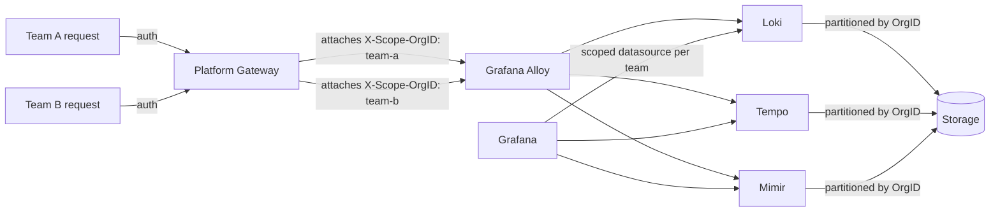

Once an AI platform has more than a couple of teams onboarded through the golden-path templates (`/posts/self-service-ai-platform-golden-paths/`{: .filepath} on this blog covers how that onboarding works), every one of those teams starts producing its own traces, logs, and metrics. That's the whole point — observability is supposed to scale with adoption. The problem nobody budgets time for is that the LGTM stack you stood up for one team's debugging doesn't automatically isolate the next nine. Without deliberate tenant boundaries, a dashboard query from Team A can accidentally scan Team B's spans, a careless LogQL query can surface another team's prompt content, and a noisy-neighbor team running a high-volume batch job can degrade query latency for everyone sharing the same ingesters. This is the same noisy-neighbor and data-leakage problem the platform's compute and storage layers already have to solve — it just hasn't been obvious that the observability layer has it too, until the week someone notices they can see a different team's trace data in Explore.



## The shared mechanism: `X-Scope-OrgID`

Loki, Tempo, and Mimir all inherited their multi-tenancy model from Cortex, which means they all solve this the same way: every write and every read carries an `X-Scope-OrgID` HTTP header, and each component partitions its storage and its query execution by that value. A write tagged `team-checkout` is physically separated from a write tagged `team-fraud` at the storage-block level — not just filtered out in a query. This is deliberate. Because all three components use the identical header and the identical partitioning concept, you only have to learn this mechanism once and it applies uniformly across traces, logs, and metrics.

The critical operational detail is where that header gets set. It must never be something an individual service or team sets for itself — if teams could set their own `X-Scope-OrgID`, nothing would stop a misconfigured (or malicious) service from reading another tenant's data by sending the wrong header. The header has to be attached by infrastructure the teams don't control: your platform gateway authenticates the request and determines the caller's identity, and the collection layer (Grafana Alloy, sitting between instrumented services and the LGTM backends) stamps the header based on that identity before forwarding anything onward.

```river
// Alloy config fragment — tagging telemetry with tenant identity
// derived from an upstream auth header the gateway already sets
otelcol.processor.attributes "tenant_tag" {
  action {
    key    = "loki.tenant"
    action = "insert"
    value  = env("TENANT_ID")
  }
  output {
    logs    = [otelcol.exporter.loki.default.input]
    traces  = [otelcol.exporter.otlp.tempo.input]
    metrics = [otelcol.exporter.prometheus.mimir.input]
  }
}
```

In practice, each Alloy instance (or a thin sidecar in front of it) is deployed per-tenant-aware routing path, resolving tenant identity from the same auth context the gateway already established — not re-implementing auth itself.

## A consistent tenant ID strategy

The platform almost certainly already has a canonical team or project identifier — it's what your model registry and gateway auth already key cost attribution and access control on (the reference architecture post on this blog, `/posts/enterprise-ai-platform-reference-architecture/`{: .filepath}, lays out where that identity lives). The mistake teams make is inventing a *new* ID scheme for observability instead of reusing that one. Do not let Loki use `team_id`, Tempo use `project-slug`, and Mimir use something else again. Pick the platform's existing team/project identifier, lowercase and hyphenate it consistently (`X-Scope-OrgID` values are case-sensitive strings with some character restrictions), and use that exact value across all three components. One tenant ID, one lookup table, zero per-component translation logic to keep in sync.

## Per-tenant limits so one tenant can't starve the rest

Logical isolation stops data leakage, but it doesn't stop a resource fight. All three components support per-tenant override files that cap ingestion rate and query concurrency:

```yaml
# mimir runtime overrides — limits.yaml
overrides:
  team-checkout:
    ingestion_rate: 50000       # samples/sec
    ingestion_burst_size: 100000
    max_series_per_user: 500000
    max_concurrent_queries: 8
  team-fraud-ml:
    ingestion_rate: 200000      # higher volume, high-stakes agent traffic
    ingestion_burst_size: 400000
    max_series_per_user: 1500000
    max_concurrent_queries: 16
  # unlisted tenants fall back to the global default block above
```

Loki and Tempo have equivalent `overrides` blocks for per-tenant rate limits and query scheduler concurrency. Set a conservative platform-wide default, then grant explicit overrides to tenants that have earned higher limits through actual measured volume — don't hand out high limits speculatively.

## Grafana-side isolation

Partitioned storage doesn't help if Grafana itself hands every user a data source that queries across all tenants. Provision data sources per-team (via Grafana's provisioning API or Terraform), each hardcoded to send the correct `X-Scope-OrgID`, and combine that with Grafana's RBAC so a team's folder and dashboards can only be pointed at their own scoped data source. A platform engineer doing cross-tenant debugging is the one exception — give that role a separate, explicitly audited data source rather than loosening everyone else's.

## When logical isolation isn't enough

For most tenants, the `X-Scope-OrgID` model is genuinely sufficient — the data never physically commingles, and query-time filtering is enforced by the storage layer itself, not by application logic that could have a bug. But a regulated business unit with a hard data-residency or physical-separation requirement (common in financial services and healthcare subsidiaries) may need a fully separate LGTM deployment, in its own object storage bucket, in its own region. That's a real cost multiplier — a second control plane to operate — so reserve it for tenants with an actual regulatory requirement for physical separation, not as a default posture. For everyone else, logical multi-tenancy inside one well-run stack is the right tradeoff, and it's the foundation the rest of this week's posts build on.
