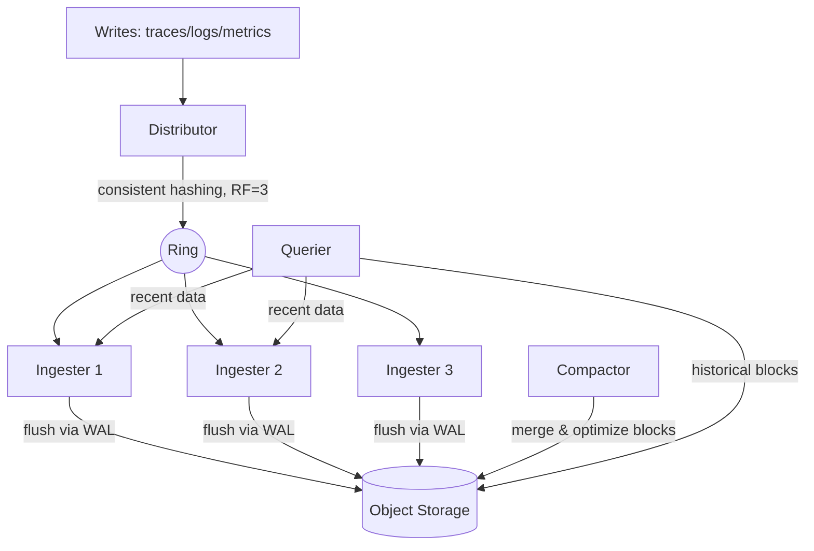

The multi-tenancy model covered yesterday isn't the only thing Loki, Tempo, and Mimir share — all three are built on architectural patterns that trace back to Cortex, the project that figured out how to make Prometheus horizontally scalable years before Mimir existed. That lineage matters practically: once you understand how one of these three components scales, you understand all three, because they use the same vocabulary of distributors, ingesters, a ring, queriers, and compactors. Most teams I've seen scale this stack reactively — adding replicas of whatever pod is using the most CPU at the moment — without understanding which component that pod actually is or what scaling it does and doesn't fix. That's how you end up with ten querier replicas and an ingester that's still falling over.

## The five components you need to reason about

**Distributors** are the stateless front door for writes. They validate incoming data, then use consistent hashing to decide which ingesters should receive each series, log stream, or trace. Because they're stateless, scaling distributors is the easy case — add replicas behind a load balancer and move on.

**Ingesters** are where it gets interesting. Each ingester holds recent data in memory, backed by a write-ahead log (WAL) on disk for crash recovery, and periodically flushes completed blocks to object storage. Ingesters are stateful, and they're almost always the component that determines whether this stack is healthy or struggling, because memory usage here is driven by cardinality — the number of distinct series, label combinations, or trace attributes — not raw request volume.

**The ring** is the consistent-hashing mechanism that decides which ingesters own which pieces of the keyspace, and it's what makes the whole thing horizontally scalable without a central coordinator for every write. Replication factor (RF) determines how many ingesters each piece of data is written to.

**Queriers** read from both places data can live: the ingesters directly (for the recent window of data still in memory) and object storage via the compactor's blocks (for anything historical). A query that spans "the last hour" versus "the last 30 days" hits very different code paths internally, which is why query latency on long time ranges is dominated by object storage read patterns, not ingester load.

**Compactors** run in the background, merging small blocks written by many ingesters into larger, more query-efficient blocks, and applying retention and (for Mimir) downsampling rules. A compactor that's falling behind is a slow-motion outage — queries get progressively slower as unoptimized blocks pile up.

## Replication factor is a cost/durability dial

RF=3 is the common enterprise default, and it means every write lands on three ingesters, with reads able to succeed as long as a quorum (typically 2 of 3) responds. That buys you tolerance for a single ingester failing or restarting without losing data or failing queries — at the cost of 3x the ingester memory and compute versus RF=1. Drop to RF=1 and you've effectively made each ingester a single point of failure for the slice of keyspace it owns; a restart means a gap in your data, not just a slower query. For an AI platform where traces and logs are sometimes the only record of what an agent actually did, that gap is a real cost, not a rounding error. RF=3 is worth the spend for production; RF=1 is fine for a pure sandbox or dev-only stack.

## Scaling the right component

The mistake I see most often: a team notices dashboards are slow, sees high CPU somewhere, and adds replicas of whatever that is — usually queriers, because querier CPU spikes are the most visible symptom. If the real bottleneck is ingester memory pressure from runaway cardinality (a new high-cardinality label someone added to span attributes, say), adding querier replicas does nothing; the ingesters are still the thing falling over, just with more queriers now waiting on them.

The diagnostic order that actually works:

- **Write throughput bottleneck** (distributors queueing, 5xx on writes) → scale distributor replicas. Cheap, stateless, low risk.
- **Read/dashboard-load bottleneck** (query latency up, ingester/object-storage CPU fine) → scale querier replicas, and check if query-frontend caching is configured.
- **Memory/cardinality bottleneck** (ingester OOMs, WAL replay taking minutes after restarts) → this is the one replicas alone don't fix. You need to find and cut the cardinality source first (an unbounded label value — session IDs or raw user IDs ending up as metric labels is the classic AI-platform version of this mistake), then scale ingesters if volume genuinely warrants it.

## A rough capacity worked example

Say your platform's agent traffic produces roughly 2 million active metric series across all tenants during peak hours — a number you'd pull from exactly the cardinality concerns raised in week one of this series around Mimir. A reasonable rule of thumb is 2–3 KB of ingester memory per active series including label overhead, which puts you in the 4–6 GB range of *working set* per ingester replica before WAL and buffer overhead, so plan ingester pod memory requests closer to 8–12 GB with headroom, and size replica count from there against your RF. This is a starting estimate, not a target — validate it against your actual ingester memory metrics under real load before trusting it for a capacity commitment.

## Watch the stack's own health

The observability stack needs its own observability. Three metrics are worth alerting on before they become an outage: ingester WAL replay time after a restart (climbing replay time is an early signal of cardinality growth outrunning capacity), ring member health (unhealthy or flapping ring members mean reads are silently losing replicas), and compactor backlog (a growing queue of unprocessed blocks means query latency across the whole stack will degrade over the following days, not immediately). Catching these early is the difference between a capacity-planning conversation and a 2am page.
