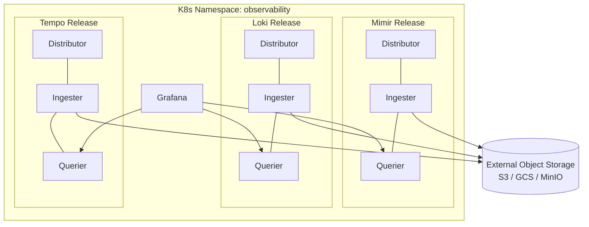

The single-node docker-compose setup from `/posts/oss-llm-observability-stack-otel-grafana/`{: .filepath} on this blog was the right call when the goal was "get traces flowing and prove the architecture works." It is not the setup you run once multiple teams depend on this stack for production debugging — a single container with local disk has no replication, no horizontal scaling, and nothing resembling the ring architecture from yesterday's post. Kubernetes with Grafana's own Helm charts is the practical path from there to something that can actually carry enterprise load, and it gets you running faster than hand-writing StatefulSets and Services for every component yourself.



## Distributed mode, not single-binary mode

Each of Grafana's charts ships two deployment shapes. Single-binary (or Mimir's "monolithic" mode) runs every component in one process per pod — it's the Kubernetes-native equivalent of the docker-compose setup, useful for a small internal tool but still carrying the same scaling ceiling. Distributed mode (`mimir-distributed`, `tempo-distributed`, and Loki's simple-scalable or fully distributed mode) splits distributors, ingesters, queriers, and compactors into independently scalable Deployments/StatefulSets — this is what lets you apply everything from yesterday's post about scaling the right component instead of the whole binary. For anything past a single team's dev environment, distributed mode is the only one worth standing up.

## Object storage is a hard prerequisite, not an afterthought

None of these charts will run meaningfully without an S3-compatible backend configured before install — this isn't optional tuning, it's where ingesters flush data and where queriers read historical blocks from. AWS S3, GCS, and Azure Blob all work natively; for on-prem or air-gapped enterprise environments, self-hosted MinIO is the standard substitute and speaks the same S3 API. Provision the bucket(s) and credentials first. A representative values snippet for Mimir:

```yaml
# mimir-values.yaml — storage section
mimir:
  structuredConfig:
    blocks_storage:
      backend: s3
      s3:
        endpoint: s3.us-east-1.amazonaws.com
        bucket_name: ai-platform-mimir-blocks
        region: us-east-1
    common:
      storage:
        backend: s3
        s3:
          endpoint: s3.us-east-1.amazonaws.com
          bucket_name: ai-platform-mimir-blocks
          secret_access_key: ${MIMIR_S3_SECRET}  # from a mounted K8s Secret
          access_key_id: ${MIMIR_S3_ACCESS_KEY}
```

Loki and Tempo take the equivalent `storage.s3` (or `storage.trace.backend: s3` for Tempo) block in their own values files, pointed at their own buckets — keep traces, logs, and metrics in separate buckets so retention and lifecycle policies (covered in the next post) can be set independently per signal type.

## Resource sizing: a starting point, not a target

For a moderate starting scale — a handful of onboarded teams, not yet the full platform — reasonable starting requests look like:

```yaml
# per-component resource requests, representative starting values
ingester:
  resources:
    requests: { cpu: "2", memory: "8Gi" }
    limits:   { memory: "12Gi" }
querier:
  resources:
    requests: { cpu: "1", memory: "2Gi" }
distributor:
  resources:
    requests: { cpu: "500m", memory: "512Mi" }
```

Treat these as a place to start a load test, not a number you commit to capacity planning with. Real cardinality and query patterns from your actual AI platform traffic will push these in both directions — a platform with many low-volume teams needs different ingester sizing than one with a handful of very high-volume agent workloads. Measure, then adjust; don't ship these numbers to production unexamined. The one sizing mistake worth calling out explicitly: teams copy a values file from a blog post or a vendor's reference architecture and treat the numbers in it as safe defaults for their own traffic. They aren't. Every number above exists to be replaced once you have fifteen minutes of real ingestion metrics from your own platform.

## The install walkthrough

```shell
helm repo add grafana https://grafana.github.io/helm-charts
helm repo update

helm install mimir grafana/mimir-distributed \
  -n observability --create-namespace \
  -f mimir-values.yaml

helm install loki grafana/loki \
  -n observability \
  -f loki-values.yaml

helm install tempo grafana/tempo-distributed \
  -n observability \
  -f tempo-values.yaml
```
{: .nolineno }

Your `values.yaml` files should carry four sections consistently: the object storage backend config shown above, replica counts per component (start conservative — 3 ingesters at RF=3, 2 distributors, 2 queriers — and scale from real metrics), the resource requests/limits, and the multi-tenancy gateway configuration from this week's first post, since the gateway needs to inject `X-Scope-OrgID` into every write that reaches these charts' entrypoints. Getting that last piece wrong at install time means retrofitting tenant isolation onto a stack that's already receiving unpartitioned data — do it at deploy time, not after.

## Day-2 concerns worth flagging now

Two things bite teams later if they're not planned for at install time. First, upgrade strategy: pin exact chart versions in your values repo (never `helm upgrade` against `latest` on a stack this operationally significant), and test every upgrade in a staging namespace with representative traffic before touching production — Grafana's charts do change default values and config schemas between major versions. Second, object storage itself needs a backup story: bucket versioning and cross-region replication (or MinIO's equivalent) for the blocks storage, since losing that bucket is losing every trace, log, and metric this stack has ever stored, not just the ingesters' in-memory buffer. Both of these are cheap to set up now and expensive to realize you skipped after an incident.
