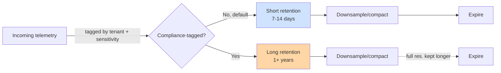

Retention for AI platform telemetry pulls in two directions at once, and most teams only notice this once both pressures show up in the same quarter. Compliance and audit requirements push toward keeping trace and log data for a long time — a trace might be the only record that an agent read a particular document before taking an action, and if that action touches a regulated decision path, someone will eventually ask for proof of what happened and when. Cost pressure pushes the opposite direction — every day of retention is more object storage, more compaction CPU, more index to query against. Set one global retention value for the whole platform and you've guaranteed you're either overpaying for data nobody needs kept that long, or deleting data you'll regret not having. The fix is treating retention as a deliberate, per-tenant, per-signal decision rather than a single knob.



## Tiered retention, not one global setting

Most trace and log volume on an AI platform is low-stakes debug exhaust — a retrieval call, a tool-call span, a routine log line from an internal productivity tool. That data earns its keep for a week or two while someone's actively debugging, then it's dead weight. A smaller slice of traffic — anything touching a regulated decision path, a customer-facing financial or healthcare interaction, a trace that's evidence in an audit trail — needs to survive for a year or more. The right design keeps both: a short default retention window applied platform-wide, with explicit, tagged overrides that extend retention for the traffic that actually needs it.

## Implementing it: per-tenant overrides, not a global value

Both Loki and Tempo support per-tenant retention overrides on top of a global default — this is the same override mechanism from this week's multi-tenancy post, applied to retention instead of rate limits:

```yaml
# loki runtime overrides — retention section
limits_config:
  retention_period: 336h   # 14 days, platform default

overrides:
  team-fraud-ml:            # compliance-tagged tenant
    retention_period: 8760h # 365 days
  team-compliance-audit:
    retention_period: 17520h # 730 days, regulatory minimum for this BU
```

Tempo's `overrides.per_tenant_override_config` works the same way for trace block retention. The key operational discipline is tagging tenants correctly at onboarding time — decide whether a team's traffic is compliance-relevant when they're provisioned through the platform's golden path, not after someone asks for a trace that's already been deleted.

## Compaction and downsampling as a cost lever

Mimir's compactor doesn't just merge blocks — it can downsample older metric data, reducing a high-resolution series to coarser resolution once it's past a configurable age, which cuts storage and query cost for long-tail historical queries that don't need second-level precision. The tradeoff is real: if someone needs to debug an incident from four months ago at full granularity — the exact token-level latency spike at 3:14pm on a specific day — downsampled data won't have it anymore. Set the downsampling threshold based on how far back your team has actually needed full-resolution debugging in practice, not a guess. A reasonable default is full resolution for 30 days, downsampled beyond that.

## Observability cost is a platform cost, not a rounding error

This stack has real infrastructure cost — ingester and querier compute running continuously, object storage that grows every day, and egress if queries cross regions. It's tempting to treat that as overhead nobody attributes to anyone, but on a platform that already tracks per-team cost through the gateway (this blog's post on [LLM API gateway compliance and cost control](/posts/llm-api-gateway-compliance-cost-control/) covers how that attribution works), observability infrastructure deserves the same treatment. A team generating ten times the trace volume of its neighbors because of a chatty instrumentation choice should see that reflected in what their usage costs the platform — otherwise nobody has an incentive to fix over-instrumented code, and the bill just grows quietly in a shared line item.

## A worked cost comparison

Take a representative AI platform producing roughly 50 GB/day of raw trace and log data pre-compaction. At 14-day retention, steady-state object storage sits around 700 GB once old data has aged out and new data keeps arriving — call it low hundreds of dollars a month in object storage at typical cloud blob pricing, plus compute for ingesters and compactors. Stretch that same ingestion rate to 1-year retention and steady-state storage grows to roughly 18 TB — over 25x the storage footprint, even before accounting for the fact that long-retention tenants are usually also the ones generating richer, more detailed spans. That order-of-magnitude jump is exactly why tiering matters: paying 25x the storage cost for the 5% of traffic that genuinely needs a year of retention is a reasonable tradeoff; paying it for all traffic by default is not. Run this calculation against your platform's actual daily ingestion volume before setting any retention policy — the ratio holds regardless of your absolute numbers, and it's the number that makes the retention conversation concrete instead of abstract.

That same calculation is the argument you bring to whoever owns the compliance requirement when they ask for a year of retention "to be safe." A year of retention applied to every tenant by default, instead of the tenants that actually need it, is a 25x storage bill increase for a requirement that in most organizations covers a small fraction of total traffic. Tiering isn't a cost-cutting shortcut taken against compliance's wishes — it's the only way to satisfy a genuine long-retention requirement without making the whole platform pay for data that was never going to be queried a year from now.
