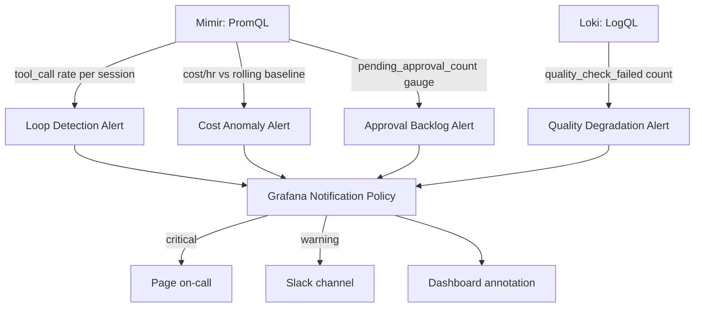

CPU, memory, and HTTP error rate alerts will tell you when a box is on fire. They will not tell you that an agent has been stuck calling the same tool in a loop for the last four minutes, that this hour's cost-per-session has drifted three times above baseline, or that a model swap quietly dropped output quality without a single exception being thrown. This blog has covered the failure-mode categories that matter for agent systems before — stuck loops, cost anomalies, quality degradation, and approval backlogs piling up behind a human-in-the-loop gate are the ones that actually bite teams in production. What hasn't been covered yet is turning those categories into real, running alert rules against the LGTM stack this series has been building. That's what this post does.



## Grafana unified alerting, as much as you need to know

Grafana's alert rules can query any data source you've already configured — a Mimir instance via PromQL, a Loki instance via LogQL, or trace-derived metrics from Tempo — on a schedule, evaluate a threshold condition, and route the result through notification policies to wherever it needs to go. The alert rule itself doesn't care which pillar of the LGTM stack it's querying; it's the same rule engine either way. That uniformity is exactly why it's worth building these four categories as real rules instead of leaving them as a conceptual list.

## Four worked alert rules

**Loop detection**, via Mimir PromQL — alert when a single session's tool-call rate spikes well above normal conversational cadence:

```yaml
# Grafana alert rule (provisioned), condition query
expr: |
  rate(gen_ai_tool_call_total{session_id!=""}[5m]) > 2
for: 2m
labels:
  severity: critical
  category: loop-detection
annotations:
  summary: "Session {{ $labels.session_id }} calling tools at {{ $value }}/sec — likely stuck loop"
```

**Cost anomaly**, via Mimir PromQL — alert when the rolling cost-per-hour metric deviates sharply from its own trailing baseline, reusing the cost metrics this series has built on top of Mimir:

```yaml
expr: |
  (
    sum(rate(gen_ai_cost_usd_total[1h]))
    /
    avg_over_time(sum(rate(gen_ai_cost_usd_total[1h]))[24h:1h])
  ) > 3
for: 10m
labels:
  severity: warning
  category: cost-anomaly
```
{: .nolineno }

**Quality degradation**, via Loki LogQL — alert on a spike in explicit quality-check failures logged by the production eval pipeline:

```logql
sum(count_over_time({app="ai-platform"} |= "quality_check_failed" [15m])) > 50
```
{: .nolineno }

```yaml
for: 5m
labels:
  severity: warning
  category: quality-degradation
```
{: .nolineno }

**Approval backlog**, via Mimir PromQL — alert when a gauge tracking pending human-in-the-loop approvals crosses a threshold long enough to indicate a stuck review queue rather than normal variance:

```yaml
expr: pending_approval_count > 25
for: 15m
labels:
  severity: warning
  category: approval-backlog
```
{: .nolineno }

## Routing without burning out on-call

These four categories don't deserve the same urgency. A stuck loop can burn real money and keep running unattended for hours, so it pages on-call immediately. A cost anomaly is worth human attention within the hour, not the minute, so it routes to a Slack channel the platform team watches during business hours. Quality degradation and approval backlog are usually trend signals rather than page-now emergencies — route them to a dashboard annotation and a daily digest unless they cross a second, more severe threshold. Configure this split in Grafana's notification policies by matching on the `severity` and `category` labels set in each rule above, rather than inventing a separate routing mechanism per alert:

```yaml
# notification policy routing fragment
routes:
  - matchers: [category = loop-detection]
    receiver: pagerduty-oncall
    group_wait: 30s
  - matchers: [category = cost-anomaly]
    receiver: slack-platform-cost
  - matchers: [category =~ "quality-degradation|approval-backlog"]
    receiver: slack-platform-quality
```
{: .nolineno }

Getting this wrong in the generous direction — routing everything to pager — is how a useful alert becomes the one everyone mutes within a month. Start conservative on what pages a human and expand only once you trust a category's signal-to-noise ratio.

## Test against history before enabling in production

Every one of these thresholds is a guess the first time you write it. Before flipping a new rule to active, run its query against two to four weeks of historical data in Grafana's Explore view and check how often it would have fired. A loop-detection threshold that would have fired forty times last week against normal, non-looping agent behavior is miscalibrated, not working as intended — tighten it before it goes live, not after it's paged someone at 2am for the fifth time in a row. This backtesting step takes twenty minutes per rule and is the single highest-leverage thing you can do to avoid building an alerting system nobody trusts.

A secondary check worth doing at the same time: look at whether a rule's `for` duration is actually filtering transient noise. A loop-detection condition that evaluates true for thirty seconds during a legitimately bursty but healthy tool-call pattern shouldn't fire if `for` is set to two minutes — but if your backtest shows it firing anyway, the underlying PromQL window is too short, not the `for` clause. Fixing the query is the right move there, not stretching `for` until the symptom disappears without the rule actually getting more accurate.

None of these four rules are the last alert rules this platform will ever need. They're the starting set that maps directly onto failure modes specific to generative and agentic systems, layered on top of whatever hard-error and infrastructure alerting you already have from before this stack existed. Add to this set as new failure modes show up in production — a new tool integration that fails silently, a provider that starts truncating responses without an error code — rather than trying to anticipate every category up front.
