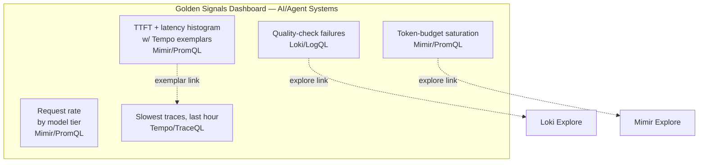

The four golden signals — latency, traffic, errors, saturation — are the right starting vocabulary for any dashboard, and they're also the wrong four metrics if you apply them to an AI platform unchanged from how you'd build them for a stateless web service. This blog's post on [AI platform SLOs and error budgets](/posts/ai-platform-slos-error-budgets/) already made the case that "the system responded" and "the system was correct" are different properties; a golden-signals dashboard that only measures the first one is lying to whoever's on call. Here's the panel-by-panel build that reinterprets each signal correctly and wires it to the LGTM stack this series has put together.



## Reinterpreting each signal

**Latency** isn't one number for a generative system — time-to-first-token and total completion time measure genuinely different user experiences. A chat interface where TTFT is fast but total completion drags is a different problem (and a different fix) than one where both are slow. The dashboard needs both, not an average that hides which one is actually broken — this connects directly to the two-number latency target that SLO post argued for.

**Traffic** needs a breakdown that plain request-per-second doesn't give you: requests split by model tier (a cheap, fast model and an expensive, slow one have completely different cost and latency profiles, and lumping them together hides which tier is driving a spike) and by agentic versus direct call (an agent run might fan out into a dozen underlying model calls for one user-visible request — counting those as "traffic" the same way you'd count a single direct API call misrepresents both volume and cost).

**Errors** has to split into two buckets that traditional error-rate panels conflate into one: hard errors (exceptions, timeouts, non-200s — the kind any APM already catches) and soft errors (a call that returned 200 with a structurally valid response that an eval scored as wrong). A dashboard that only shows hard-error rate will read "healthy" through a real quality incident — this is the same silent-failure problem [this blog's post on designing for AI failure modes](/posts/designing-for-ai-failure-modes/) described, now given an actual panel.

**Saturation** stops being just CPU and memory and becomes token-budget consumption against your rate limits, and concurrent-agent-session count against whatever concurrency your platform can sustain. A platform can be CPU-idle and still be saturated on its token budget with a provider, and a saturation panel that only watches infrastructure metrics will miss that entirely.

## The panel build

1. **Request rate by model tier** — Mimir/PromQL: `sum by (model_tier) (rate(gen_ai_requests_total[5m]))`
2. **TTFT + latency histogram with exemplars** — Mimir/PromQL: `histogram_quantile(0.95, sum by (le) (rate(gen_ai_ttft_seconds_bucket[5m])))`, with exemplar support enabled so a p95 spike on the histogram links straight through to the matching trace in Tempo — the correlation mechanism this series' week-one post on cross-signal correlation covered in depth.
3. **Quality-check failures** — Loki/LogQL: `sum(count_over_time({app="ai-platform"} |= "quality_check_failed" [5m]))`
4. **Token-budget saturation** — Mimir/PromQL: `sum(gen_ai_tokens_consumed_total) / sum(gen_ai_token_budget_limit)`
5. **Slowest traces, last hour** — Tempo/TraceQL: `{duration > 5s} | select(resource.service.name)`, rendered as Grafana's trace-list panel so it's a one-click jump into the actual trace, not just a number.

## Dashboard-as-code, not a UI build

Build this once in the UI to get the queries right, then export it and check the JSON into the platform's config repo, provisioned via Grafana's dashboard provisioning (a `provisioning/dashboards` config pointing at the file, or the Grafana Terraform provider if the rest of the platform is managed that way):

```yaml
# grafana provisioning/dashboards/golden-signals.yaml
apiVersion: 1
providers:
  - name: ai-platform-golden-signals
    orgId: 1
    folder: "AI Platform"
    type: file
    options:
      path: /etc/grafana/dashboards/golden-signals-ai-agents.json
```
{: .nolineno }

This gets you a dashboard that's identical across staging and production, survives a Grafana restart without someone remembering which panels they'd tweaked, and shows up in code review like any other config change — which matters more than it sounds like it should, because a dashboard quietly drifting out of sync between environments is how an on-call engineer ends up debugging against the wrong baseline.

## Resist the urge to add a sixth panel

This dashboard has one job: be the screen every on-call engineer opens first, in the first thirty seconds of an incident, and get a correct read on whether the problem is latency, volume, hard errors, soft/quality errors, or saturation. Every additional panel dilutes that. The discipline that keeps this dashboard useful is linking out — each panel should have a drill-down link into the relevant Tempo, Loki, or Mimir Explore view for deeper investigation — rather than cramming a deeper view onto the same screen. If you find yourself wanting a sixth golden-signal panel, it's a sign you need a second, more specialized dashboard, not a bigger version of this one.
