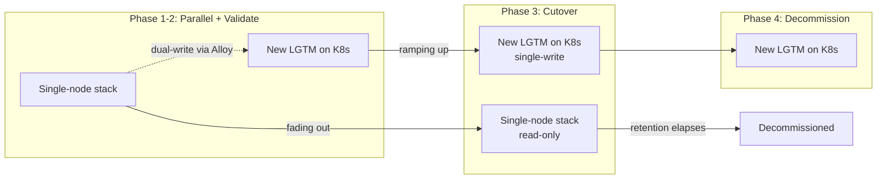

Six posts into this series and everything so far has assumed you're building the enterprise stack from scratch. Most teams reading this aren't starting from scratch — they're running the single-node OTel Collector, Tempo, and Prometheus setup from `/posts/oss-llm-observability-stack-otel-grafana/`{: .filepath} on this blog, it's been working fine, and now someone's asking whether it's time to move. This post is the actual runbook for that move: when to do it, how to phase it so you're never choosing between "cut over blind" and "run two stacks forever," and what goes wrong when teams skip a phase.



## When to actually trigger this migration

Don't migrate because this series exists — migrate because one of three concrete triggers has actually happened. First: tenant growth past what a single Prometheus instance's cardinality can absorb — if you're adding teams through the golden-path onboarding this blog has described and you're watching Prometheus memory climb with each new team rather than query latency stay flat, that's the ceiling showing up. Second: a compliance retention requirement single-node local storage genuinely can't satisfy affordably — needing a year of trace retention on local SSD is a different cost problem than needing a year on object storage. Third: the single-node stack itself has become the recurring incident — Prometheus OOMing, Tempo's local storage filling disk at 2am — rather than the thing that helps you debug incidents elsewhere. Any one of these is sufficient justification. None of them being true yet means stay on single-node; the migration itself has real cost and operational risk, and "the enterprise version exists" is not a reason to take that on early.

## Phase 1: stand up in parallel, dual-write

Deploy the Kubernetes-based Mimir/Loki/Tempo stack from this series' Kubernetes post entirely in parallel — new namespace, new object storage buckets, nothing pointed at it yet that matters. Then reconfigure Alloy (or add a second Alloy pipeline) to dual-write: every span, log line, and metric that currently goes to the single-node stack also goes to the new stack, unchanged, for a transition window measured in weeks, not days. Nothing is reading from the new stack yet — this phase is purely about building up real historical data in the new system before anyone depends on it.

```river
// Alloy fragment — fan-out to both old and new backends during transition
otelcol.exporter.otlp "legacy_single_node" {
  client { endpoint = "legacy-collector:4317" }
}
otelcol.exporter.otlp "new_lgtm_tempo" {
  client { endpoint = "tempo-distributor.observability:4317" }
}
// both listed as outputs of the same processor chain
```
{: .nolineno }

## Phase 2: migrate dashboards and alerts, validate side by side

Take every dashboard and every alert rule from this series' dashboards and alerting posts and point a second copy of each at the new stack's data sources, running alongside the originals pointed at the old stack. For at least a week, watch both side by side. A request-rate panel that shows materially different numbers between old and new, or an alert rule that fires on one stack but not the other at the same moment, is a real discrepancy — usually a labeling difference, a sampling config mismatch, or a tenant-tagging gap from this series' multi-tenancy post — and it needs to be understood and fixed before anyone trusts the new stack for anything production-critical. This is the phase teams are most tempted to rush or skip, and it's the one that actually catches the problems that would otherwise surface for the first time during a real incident on the new stack.

## Phase 3: cut over, keep the old stack read-only

Once dashboards and alerts agree between the two stacks, reconfigure Alloy to single-write — new data goes only to the new stack. Do not decommission the old stack yet. Leave it running, read-only, for the remainder of whatever retention window it was already holding data under. Anyone needing to look up something from before the cutover date still has somewhere to look; anyone debugging something from after the cutover date is already using the new stack. This is what avoids the two bad options of a flag-day cutover (lose query access to pre-cutover history) or running both stacks fully live forever (pay for both indefinitely).

## Phase 4: decommission

Once the old stack's retention window has fully elapsed — every piece of data it was ever going to hold has aged past the point anyone could legitimately need to query it — tear it down. Not before. The temptation to reclaim that infrastructure early is real, especially if it's sitting idle and read-only for weeks, but the whole value of phase 3 was guaranteeing nobody loses access to historical data, and decommissioning early breaks that guarantee for no real savings.

## What goes wrong when a phase gets skipped

The most common failure is skipping phase 2's side-by-side validation and discovering discrepancies only after fully cutting over — at which point there's no old-and-new comparison left to diagnose against, just a production dashboard that doesn't match what people remember it showing. The second most common: the new stack's per-tenant limits (configured per this series' multi-tenancy post) reject data the old, unrestricted single-node setup never questioned, and a team's traffic silently starts dropping at the new ingestion boundary during phase 1 or 3 with nobody noticing until a gap shows up in their dashboard. Both are avoidable by actually watching the dual-write and side-by-side phases closely instead of treating them as a formality to get through quickly.

## The checklist

- [ ] Trigger confirmed: tenant growth, compliance retention, or recurring stack-itself incidents — not just "it's time"
- [ ] New Kubernetes LGTM stack deployed, object storage provisioned, multi-tenancy configured
- [ ] Alloy dual-writing to old and new stacks
- [ ] Dashboards and alert rules duplicated against new data sources
- [ ] Side-by-side validation run for at least a week, discrepancies resolved
- [ ] Alloy cut to single-write; old stack set read-only
- [ ] Old stack's retention window tracked to full expiry
- [ ] Old stack decommissioned

The single-node stack this series started from was never the wrong call — it was the right tool for the scale it was built for, and most teams run it successfully for a long time before any of the three triggers above actually fire. This migration playbook is what outgrowing it concretely looks like: not a rewrite, not a rip-and-replace, but four phases that each remove one specific risk before moving to the next.
