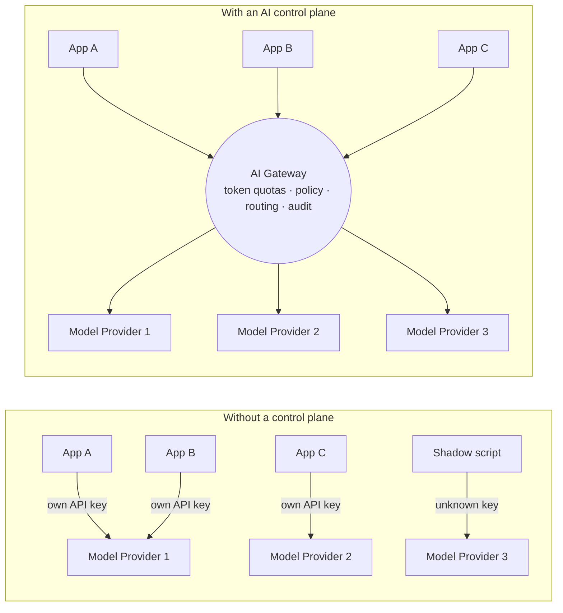

Every engineering org I've talked to in the last year has the same story. Someone needed an LLM call in production, they stuck an API key in an environment variable, and it worked. Then three more teams did the same thing. Six months later nobody can tell you how many OpenAI or Anthropic keys exist in the company, what they're being used for, or why last month's bill tripled. Putting an nginx or an API Management instance in front of those calls feels like the obvious fix. It isn't, and the reason why is worth being precise about, because it's the premise for everything else in this series.

A reverse proxy was built to solve HTTP problems: distribute load across backends, terminate TLS, maybe rate-limit by request count. None of that maps cleanly onto what actually goes wrong with LLM traffic. Here are the five problems that a bare proxy has no model for.

On the left: nobody owns the chokepoint, so nobody owns the answers. On the right: every answer — cost, safety, routing, audit — lives in one place.

## 1. Cost runaway: request count tells you almost nothing

A reverse proxy's idea of throttling is "N requests per minute." For LLM traffic, that's close to useless. A single chat completion request can cost a fraction of a cent or several dollars depending entirely on output length and which model tier served it — easily a 100x to 1000x spread between the cheap end and the expensive end. Rate-limiting by request count caps the wrong variable. A team that fires off twenty requests a minute against a small model is fine; a team that fires off five requests a minute against a frontier model generating long outputs can blow through a monthly budget in an afternoon.

What you actually need is throttling denominated in tokens — the unit the bill is actually computed in — not requests. That's a genuinely different capability from anything a generic gateway ships with out of the box, and it's the first thing dedicated AI gateway products add. We'll look at Azure API Management's token-bucket implementation of this in the next post.

## 2. Shadow AI: the chokepoint doesn't exist yet

If there's no shared gateway, there's no single place to ask "which applications are calling which models, at what volume." Teams provision their own keys because it's the fastest path to shipping, and in isolation that's a reasonable decision. In aggregate it means security and finance are both flying blind. I've seen this surface during a compliance audit, which is the worst possible time to discover it — "we need to know every model call that touched customer data in the last quarter" is not a question you can answer retroactively from CloudTrail-equivalent logs scattered across a dozen provider dashboards.

## 3. Inconsistent governance

Content safety, PII redaction, jailbreak defenses — if there's no shared enforcement layer, every team either reimplements this themselves (inconsistently, with varying diligence) or skips it entirely because it's not their core deliverable. I've reviewed internal tools where the only thing standing between a user's prompt and a raw model call was "we trust our users." That's not a policy, it's an absence of one. A control plane lets you enforce a baseline once, centrally, and let individual teams add stricter rules on top if their use case needs it — not the other way around.

## 4. Multi-model routing and fallback

Hardcoding a single provider into application code means a provider outage is your outage, and a provider price change is your migration project. Abstracting the model behind a stable interface — so routing decisions, fallback behavior, and cost-tier selection live in the gateway instead of scattered through application code — is what lets you actually take advantage of the model landscape moving as fast as it currently is, rather than being stuck re-plumbing twenty services every time you want to switch providers.

## 5. Compliance audit: access logs aren't a usage ledger

A reverse proxy's access log tells you a request happened. It doesn't tell you which identity made it, which model served it, how many tokens were consumed, or whether the content was flagged. Regulators and internal auditors increasingly want exactly that — an immutable usage ledger keyed by identity, model, and token count. Building that bolted onto a generic proxy is possible; it's also exactly the kind of plumbing you'd rather not own if a vendor has already built it correctly.

## What this series covers

This is the opening post in a twelve-post series on AI gateways — the vendor-native products built specifically to solve these five problems, not the DIY architecture for building one yourself (I've written about that build-your-own path already, and will keep referencing it as the comparison point rather than repeating it). Over the next eleven posts we'll go through Azure's offerings (API Management's GenAI gateway capabilities and AI Foundry's governance layer), AWS Bedrock Guardrails and AgentCore Gateway, GCP's Apigee and Vertex AI, Snowflake's Cortex AI Gateway, and the OSS alternatives — Kong AI Gateway, LiteLLM, Portkey — before landing on a decision framework for choosing between cloud-native and OSS, and for multi-cloud strategy generally.

The tension that runs through all of it, and that I'll keep coming back to post by post: almost everything these vendor products do is technically buildable yourself with an open-source proxy, a Redis instance, and a vector store for similarity matching. The real decision was never "is this capability otherwise unavailable" — it's whether the vendor's pre-integrated identity, billing, and observability are worth what you pay in lock-in and license cost versus the engineering time of owning that plumbing yourself.

One honest caveat before we get into product specifics: this is a genuinely fast-moving space. Several flagship features from the vendors we'll cover are still preview-stage as of late 2026, sitting right next to features that are fully GA and production-proven. I'm going to flag that distinction explicitly, post by post, rather than treating "shipped by a major cloud vendor" as a synonym for "ready to put in front of production traffic." The rest of this series works through those products one at a time, starting with Azure.
