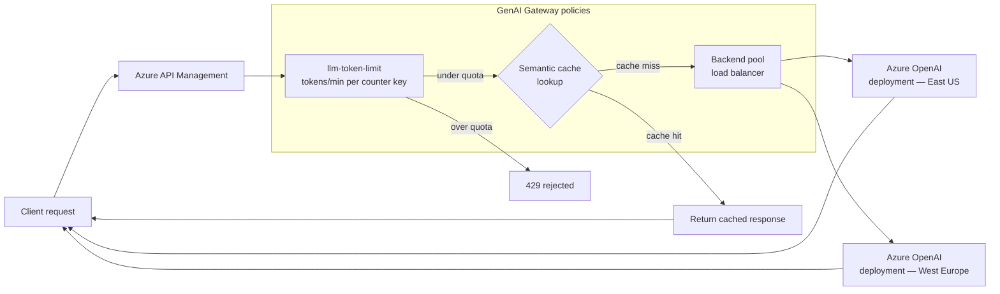

In the last post I laid out why request-count throttling is close to meaningless for LLM traffic — the cost of a single request can swing by two or three orders of magnitude depending on output length and model tier. Azure API Management's answer to that, and the reason it's worth treating as more than "APIM with an OpenAI backend," is the `llm-token-limit` policy. It's the clearest example in this whole series of a gateway vendor building a policy primitive around the actual cost driver instead of the easy-to-measure proxy for it.



## Token-denominated rate limiting

`llm-token-limit` caps tokens-per-minute against a counter key you define — subscription ID, API key, a custom header, whatever identity boundary matters to you — and it can span windows beyond just a minute: hour, day, week, month quotas are all supported, so you can pair a tight per-minute burst limit with a looser monthly budget ceiling on the same key. A representative policy looks like this:

```xml
<llm-token-limit
    counter-key="@(context.Subscription.Id)"
    tokens-per-minute="20000"
    estimate-prompt-tokens="true"
    remaining-tokens-variable-name="remainingTokens"
    remaining-tokens-header-name="x-ratelimit-remaining-tokens" />
```
{: file="apim-policy.xml" }

The `estimate-prompt-tokens` flag matters in practice — it lets APIM tokenize the incoming prompt and account for it against the quota before the response comes back, instead of only debiting the counter after the fact based on the completion's reported usage. Without that, a burst of long prompts can land before the quota catches up with them. This is the piece of the GenAI gateway feature set I'd call unambiguously production-grade: it's well documented, it composes cleanly with ordinary APIM rate-limit policies you may already have, and it's the policy every Azure OpenAI deployment I've seen in production actually turns on first.

## Semantic caching — GA, but still the newer piece

Semantic caching in APIM reached general availability, and the architecture is worth understanding rather than treating as a black box. It's two backing pieces working together: an embeddings backend (configured via `embeddings-backend-id`) computes a vector for the incoming prompt and does the similarity match, and Azure Managed Redis — specifically its RediSearch module — stores and queries the cached entries. The policy configuration looks roughly like this:

```xml
<azure-openai-semantic-cache-lookup
    score-threshold="0.05"
    embeddings-backend-id="embeddings-backend"
    embeddings-backend-auth="system-assigned" />

<!-- ... forward request to backend pool on cache miss ... -->

<azure-openai-semantic-cache-store duration="3600" />
```
{: file="apim-policy.xml" }

The practical win is the same one I called out when covering DIY semantic caching architectures on this blog — on read-heavy, repetitive-query workloads (FAQ bots, internal knowledge search, anything where many users ask semantically similar things in different words), cache hit rates in the 30-60% range are realistic, and every one of those hits is a request that never touches the model deployment at all, bypassing cost and latency together. Where I'd push back on treating this as equivalent to the token-limit policy: it's newer, it requires you to provision and maintain a Managed Redis instance and an embeddings deployment correctly, and the threshold tuning (`score-threshold` above) is workload-specific enough that I wouldn't ship a default value into production without testing it against your actual query distribution first.

## Backend pools: load balancing and circuit breaking

The third piece is a native backend-pool feature — not GenAI-specific, but it's what makes multi-deployment Azure OpenAI setups viable. You define a pool of backends (typically the same model deployed across regions, for quota pooling and failover both), pick a load-balancing mode — round-robin, priority-weighted, or weighted — and APIM handles unhealthy-backend ejection automatically when a deployment starts erroring or timing out.

```xml
<backend-pool name="openai-pool" >
    <backend id="openai-eastus" priority="1" weight="100" />
    <backend id="openai-westeurope" priority="2" weight="100" />
</backend-pool>
```
{: file="apim-policy.xml" }

This earns its place in a GenAI gateway discussion specifically because Azure OpenAI quota is allocated per deployment, per region. Pooling across regions isn't just an availability play — it's how you get more effective throughput out of the quota you've already been granted without filing a quota increase request every time traffic grows.

## The piece that's still preview: the standalone AI Gateway tier

A standalone "AI Gateway" tier of APIM hit public preview in mid-2026, and it's a meaningfully different shape of product from "APIM with GenAI policies bolted on" — it ships OpenTelemetry-based token-usage metrics natively, which matters if you've already standardized observability around OTel (something I covered when this blog looked at agent observability stacks earlier this year). A follow-up update added content safety checks aimed specifically at MCP and A2A agent traffic, plus deeper token observability. I want to be explicit here because it's easy to blur this with the token-limit and caching policies above: those are mature, widely deployed, and documented in depth. The standalone tier and its MCP/A2A safety checks are preview-stage as of this writing. If you're evaluating this for production today, budget for the difference — build on the token-limit and backend-pool policies now, and treat the standalone tier as something to pilot, not something to commit a production architecture to yet.

## The DIY comparison

Everything above is replicable with a self-hosted LiteLLM-style proxy. Token-bucket rate limiting, semantic caching against a vector store, backend failover — none of it is a capability that's otherwise unavailable, which is the theme I flagged in the series opener. What APIM gives you instead is the integration work already done: declarative XML policy instead of application code you maintain, native Entra ID authentication instead of you wiring up your own auth layer, and portal-level observability instead of standing up your own dashboards. The honest tradeoff is the one I made with the DIY gateway posts on this blog — you own the Redis and embeddings wiring either way; the question is whether you want to own it inside your own proxy code or configure it as policy inside a managed control plane. For a team already standardized on Azure OpenAI and Entra ID, the policy route is usually the faster path to something auditable. For a team that needs provider-agnostic routing across Azure, Anthropic, and OpenAI from one place, the calculus shifts — and that's exactly the ground the OSS posts later in this series will cover.

Token limits and caching are only half of the Azure picture, though. The other half — content safety and governance — lives in a completely different product, and conflating the two is one of the most common mistakes I see teams make when they design their Azure AI architecture.
