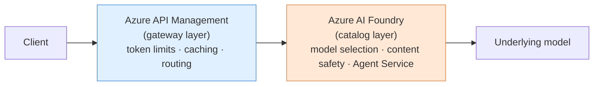

I've sat in enough architecture reviews to know the exact moment this confusion happens. Someone says "we're using Azure AI Foundry, so we have an AI gateway covered," and the conversation moves on. It shouldn't. Foundry and API Management solve different halves of the same problem, and treating one as a substitute for the other is how teams end up in production with content safety but no cost governance, or token quotas but no idea what's actually in the prompts flowing through them.

Two distinct boxes, two distinct jobs. APIM decides whether and how a request gets through and to which backend. Foundry decides which model answers it and whether the content on either side of that call is safe. Neither one does the other's job, and that's by design, not an oversight.

## What Foundry's content safety actually does

Every serverless-API deployment from Foundry's model catalog has Azure AI Content Safety filters applied by default — hate speech, self-harm, sexual content, violence, checked across both the prompt going in and the completion coming out. That's a genuinely useful default; most teams I've worked with want this baseline and would rather not reimplement it per application, which is exactly the inconsistent-governance problem I raised in the series opener.

The gotcha that catches people is billing. Content safety is billed separately from inference, and — this is the part that surprises teams doing cost planning — you're charged for the safety check even when it blocks the content. A request that never produces a usable completion still shows up on the content safety line item. If you're forecasting cost for a high-volume application, budget for that line separately rather than assuming a blocked request is a free request. I've seen this come up as an unpleasant surprise during a monthly cost review more than once.

## Agent Service now hosts third-party models too

Foundry's Agent Service expanded in November 2025 to host third-party frontier models — Anthropic, Meta, xAI, DeepSeek — alongside Azure's own catalog, inside the same agent-building surface. That's a meaningful shift: it means Foundry's agent layer isn't a Microsoft-model-only story anymore, and teams building agents don't have to split their tooling between "the Foundry way" for Azure models and something else entirely for everything else.

## Guardrails: real, but narrower than the name suggests

"Guardrails" is Foundry's newer unifying governance layer, sitting on top of content safety and meant to give teams one place to configure policy instead of scattered per-deployment settings. Two things worth being precise about, because the name invites overclaiming:

- It's explicitly **preview-stage**, not GA.
- It's currently scoped **only to agents built in Foundry Agent Service** — not to every agent that happens to be registered in the Foundry control plane generally. If your agent lives outside Agent Service, Guardrails in its current form doesn't apply to it.

That scoping matters for anyone doing architecture planning right now. "We're adopting Guardrails" is not yet the same statement as "we have unified governance across every agent in our Foundry tenant."

## The false-positive problem, honestly

The content safety filters are tunable by severity, and the real-world issue teams report is false positives on legitimate engineering content — code snippets discussing exploits for defensive purposes, security research write-ups, discussions of violence in a fictional or historical context for a content-moderation tool being built. Depending on where severity thresholds are set, this content gets blocked, and because of the billing behavior above, you pay for the block too. This isn't a hypothetical edge case; it's a friction point that shows up as soon as you have engineers doing security-adjacent work through a Foundry-fronted model. If your workload touches security research, red-teaming, or anything that discusses attacks and vulnerabilities as its actual subject matter, test your severity settings against representative real content before you ship, not after a false positive blocks a demo in front of a client.

## Foundry is not the traffic layer — say it again

The point this whole post exists to drive home: Foundry is the model and agent catalog, plus content safety on top of it. It is not routing, not caching, not rate-limiting. Those live in APIM, which I covered in the previous post. A team that stands up Foundry and calls it done has safety but no cost control — no token-denominated throttling, no semantic cache, no backend pooling across regions. A team that stands up APIM alone has cost control and routing but no content moderation layer unless they build one themselves. These two products are meant to be composed, with APIM in front making the gateway-layer decisions and Foundry behind it serving the model with its own safety layer applied — not treated as alternatives where you pick one.

## When you actually need both

Foundry alone is a reasonable choice for prototyping and single-model experimentation — a small team evaluating whether a model fits their use case doesn't need token quotas yet. The moment you're in production, with multiple teams hitting the same deployments and a cost center that needs to be defensible, you need Foundry **and** APIM composed together: APIM enforcing the quota and routing policy at the front door, Foundry serving the model and applying content safety behind it. I'd treat "do we have both layers, or just one" as a standing question in any Azure AI architecture review from here on — it's the single most common gap I see when something that looked fine in a pilot turns into a production incident.
