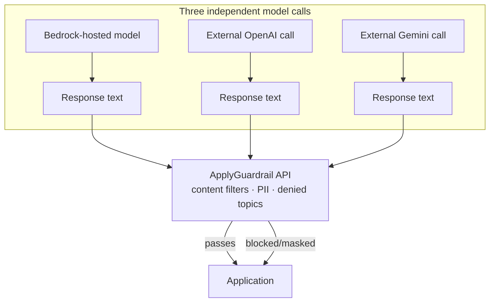

Three posts into this series and the pattern on the Azure side was consistent: governance tools tend to be scoped to the models hosted inside the same product. Foundry's content safety applies to Foundry-served models and Foundry-built agents. That's a reasonable default, but it means the safety layer travels with the hosting platform. AWS made a different design choice with Bedrock Guardrails, and it's worth understanding why, because it changes how you'd architect around it.

`ApplyGuardrail` is a standalone API. It takes text — input or output — and runs it against a guardrail configuration you define: content filters, PII detection, denied topics, word filters, grounding checks. Critically, that text doesn't have to have come from a Bedrock-hosted model. You can call a model outside Bedrock entirely — OpenAI, Gemini, anything — and still pipe the resulting text through `ApplyGuardrail` as a separate, explicit step.



## Why the decoupling matters

This is the design decision that makes Bedrock Guardrails a different category of product from a model-hosting platform's built-in safety filter. Because the API operates on arbitrary text rather than on a Bedrock inference call, it's genuinely provider-agnostic — you can run your own proxy in front of Claude or GPT calls, however you're routing them, and still pipe every response through the same `ApplyGuardrail` check for a consistent policy layer regardless of which provider actually served the request. That's exactly why independent AI gateway products (several of the OSS gateways later in this series among them) wrap `ApplyGuardrail` as a general-purpose policy primitive instead of treating it as Bedrock-only tooling. Most vendor guardrail products are scoped to their own hosted models the way Foundry's content safety is scoped to Foundry; this one explicitly isn't, and that's the detail worth remembering when you're evaluating it.

## A representative call

Here's what a realistic invocation looks like with boto3, screening a model's output against a guardrail configured with content filters, PII detection, and denied topics:

```python
import boto3

client = boto3.client("bedrock-runtime", region_name="us-east-1")

response = client.apply_guardrail(
    guardrailIdentifier="arn:aws:bedrock:us-east-1:123456789012:guardrail/abc123",
    guardrailVersion="1",
    source="OUTPUT",  # or "INPUT" to screen the prompt instead
    content=[
        {
            "text": {
                "text": model_response_text,
            }
        }
    ],
)

if response["action"] == "GUARDRAIL_INTERVENED":
    for assessment in response["assessments"]:
        print(assessment)  # which filter triggered: content, PII, denied topic, etc.
    # handle block/mask — don't forward raw model_response_text to the caller
else:
    forward_to_caller(model_response_text)
```
{: file="apply_guardrail.py" }

The guardrail itself — the filter thresholds, the PII entity types to detect and mask, the denied-topics list — is configured once as a resource in Bedrock and referenced by ARN here, which is the same separation-of-policy-from-code pattern APIM uses with XML policies: the enforcement logic lives in a managed resource, not scattered through application code.

## Cross-account enforcement and the union model

Cross-account guardrail enforcement went GA in April 2026. The practical shape of this: policies can be set at the organization level, the account level, and the individual request level, and at runtime they compose as a union — the strictest applicable rule wins, not the most permissive. That's a meaningful governance primitive on its own. A central security team can set an org-wide floor — say, PII masking is always on, certain denied topics are always blocked — and individual teams building on top of it can tighten those policies further for their specific use case, but they can't loosen the org floor out from under central policy. That one-directional composition is exactly the property you want when a security team is trying to guarantee a baseline across dozens of teams they don't have day-to-day visibility into.

## Where this sits relative to Azure's version

Worth stating plainly, since the previous two posts spent real time flagging preview-stage caveats on the Azure side: `ApplyGuardrail` and cross-account enforcement are production-ready, not preview. This is a useful maturity data point across vendors — it's not the case that every cloud provider's AI governance tooling is at the same stage of readiness, and part of doing this evaluation well is tracking GA-versus-preview per product rather than per vendor. AWS shipped the cross-account composition model as GA; Azure's equivalent unifying layer (Foundry Guardrails, from the last post) is still preview and narrower in scope. Neither fact makes one vendor categorically ahead of the other across the board — it just means you need to check maturity feature by feature, not take a vendor's overall reputation as a proxy for any specific capability being ready.

## What this doesn't cover

`ApplyGuardrail` answers "is this content safe to send or return." It has nothing to say about whether an agent should be allowed to call a particular tool, hit a particular downstream system, or take a particular action with real-world side effects — that's a fundamentally different question, about agent permissions and tool-calling boundaries rather than content policy, and it's the problem AWS Bedrock AgentCore Gateway is built to solve. That product gets its own deeper treatment later in this series. For now, the distinction to hold onto: guardrails are about content, agent gateways are about actions, and a mature AWS AI architecture typically needs both layers working together rather than assuming one covers the other.
