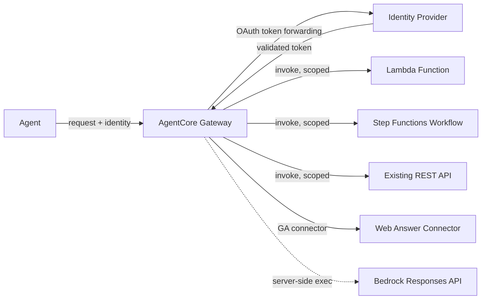

Bedrock Guardrails answers one question: is this content safe to send or receive. AgentCore Gateway answers a completely different one: can this agent safely call this tool, and who is it calling it as. If you've been following this series, Part 1 covered Guardrails as the content-safety layer on AWS — this post is about the piece that sits next to it, not on top of it, because the two solve unrelated problems and teams that conflate them end up with a content filter and no actual authorization model for tool use.



## The problem AgentCore Gateway actually solves

Say you have an internal API — order lookup, inventory check, whatever — and you want an agent to call it as a tool. The naive path is to hand the agent a long-lived API key and let it make the call directly. That works in a demo and becomes a security incident report six months later, because now every agent process on every team that needs that API is carrying a credential with no expiry, no scoping, and no audit trail tying a specific call back to a specific user's session.

The alternative — build OAuth handling into the agent's tool-calling code — is correct but expensive. Every team doing this ends up reimplementing token refresh, scope validation, and error handling for expired credentials, and they do it slightly differently each time.

AgentCore Gateway exists to make this a solved problem once, centrally, instead of a problem each team solves badly. It wraps an existing API, Lambda function, or Step Functions state machine as an MCP tool, and it puts the auth handshake at the gateway layer instead of inside the agent.

## What's actually new here, and when it landed

A few specific capabilities matter for understanding where this product actually is in its maturity curve:

- **OAuth token forwarding** (May 2026) — the gateway can forward a validated OAuth token to the downstream API on the agent's behalf, instead of requiring the API to trust the gateway blindly or the agent to hold its own credential.
- **VPC egress support** (April 2026) — lets the gateway reach targets inside a private VPC, which matters because most of the APIs worth wrapping as agent tools are internal and not sitting on the public internet.
- **Server-side tool execution** (February 2026) — Bedrock's Responses API can now invoke Gateway tools directly, server-side, without the client having to orchestrate the tool call itself. Before this, your application code was the thing deciding when to call a Gateway tool and feeding the result back into the model; now that loop can run entirely on AWS's side.
- **Step Functions as a wrappable target** — a more recent addition, letting you expose an entire state machine (not just a single Lambda) as one callable tool.
- **A built-in cited-web-answer connector** (November 2026, GA, currently us-east-1 only) — a packaged way to give an agent web-search-with-citations without wiring up a separate tool yourself.

I'd stop short of calling all of this uniformly mature. The core pieces — wrapping an API as an MCP tool, and the auth/identity model around that — are solid and have had enough time in production to be trustworthy. The newer connectors (Step Functions, Web Answer) are recent enough that I'd pilot them carefully rather than assume they behave exactly like the longer-lived Lambda-wrapping path. And if you see "model routing" mentioned in Bedrock AgentCore material, read it skeptically — in practice this mostly means reference architectures for fallback multiplexing across inference targets (added October 2026), not a fully packaged routing product feature the way, say, Apigee's dynamic routing policies are. I'll get into that contrast in the next post in this series.

## A representative tool definition

Here's roughly what wrapping a Lambda function as an AgentCore Gateway tool looks like — simplified for clarity, but the shape is accurate:

```json
{
  "toolName": "lookup-order-status",
  "target": {
    "type": "lambda",
    "arn": "arn:aws:lambda:us-east-1:123456789012:function:order-status-lookup"
  },
  "schema": {
    "input": {
      "type": "object",
      "properties": {
        "orderId": { "type": "string" }
      },
      "required": ["orderId"]
    }
  },
  "auth": {
    "type": "oauth2",
    "tokenForwarding": true,
    "identityProvider": "arn:aws:cognito-idp:us-east-1:123456789012:userpool/us-east-1_example",
    "requiredScopes": ["orders:read"]
  },
  "networking": {
    "vpcConfig": {
      "subnetIds": ["subnet-0abc123"],
      "securityGroupIds": ["sg-0def456"]
    }
  }
}
```

Notice what's not in this definition: no static API key, no credential the Lambda function or the agent has to manage. The gateway holds the `requiredScopes` check and the token forwarding configuration, and every call that reaches the Lambda carries a token that's already been validated against the identity provider. The Lambda function itself doesn't need to know anything about agents — it's just getting called with a validated identity attached, same as it would from any other authenticated caller.

## Why centralizing this matters operationally

Without something like this, the auth problem for agent tool-calling gets solved — or more often, not solved — independently by every team building an agent. One team gives their agent a service account key with broad permissions because scoping it down is extra work under deadline. Another team builds a custom token-refresh wrapper that works until the identity provider changes its token format. A third team just doesn't bother with auth at all because the API they're wrapping is "internal anyway."

AgentCore Gateway doesn't make any of these teams smarter about security. It just makes the easy path also the correct path: wrap the API as a Gateway tool, configure the OAuth scopes once, and every agent that calls it inherits the same identity brokering without writing auth code.

## How this compares to a DIY proxy

If you've read the earlier posts on this blog about building your own LLM gateway (`/posts/building-internal-llm-gateways/`) or the production architecture follow-up (`/posts/production-llm-gateway-architecture/`), you'll recognize a lot of gateway patterns — rate limiting, routing, observability. AgentCore Gateway is not really competing in that space. A LiteLLM-style proxy is solving model multiplexing: which provider and model handles this completion request, with fallback and cost tracking across them. That's a real and useful problem, but it's a different problem from tool/auth brokering.

AgentCore Gateway's value is specifically in turning *non-model* resources — APIs, functions, workflows — into things an agent can call with a real identity attached, where the auth logic lives at the gateway instead of being duplicated in every agent's codebase. If your gateway need is "route my completions across providers," look at LiteLLM or build the DIY pattern from the earlier posts. If your need is "let my agent call this internal API without handing it a standing credential," that's the problem AgentCore Gateway is actually built for.

## Where this doesn't reach

One thing worth being explicit about: AgentCore Gateway governs *access* to a tool — whether this agent, with this identity, is allowed to call this tool at all. It says nothing about what happens once the tool call executes — whether the code the tool runs is sandboxed, what it's allowed to touch on the filesystem or network once invoked, or how you contain a tool call that goes wrong after authorization succeeded. That's a sandboxing and execution-isolation problem, and it's a separate concern from the authorization problem this gateway solves. If you're building agents that execute arbitrary or semi-trusted tool calls, you still need an answer for containment that sits downstream of whatever AgentCore Gateway lets through.
