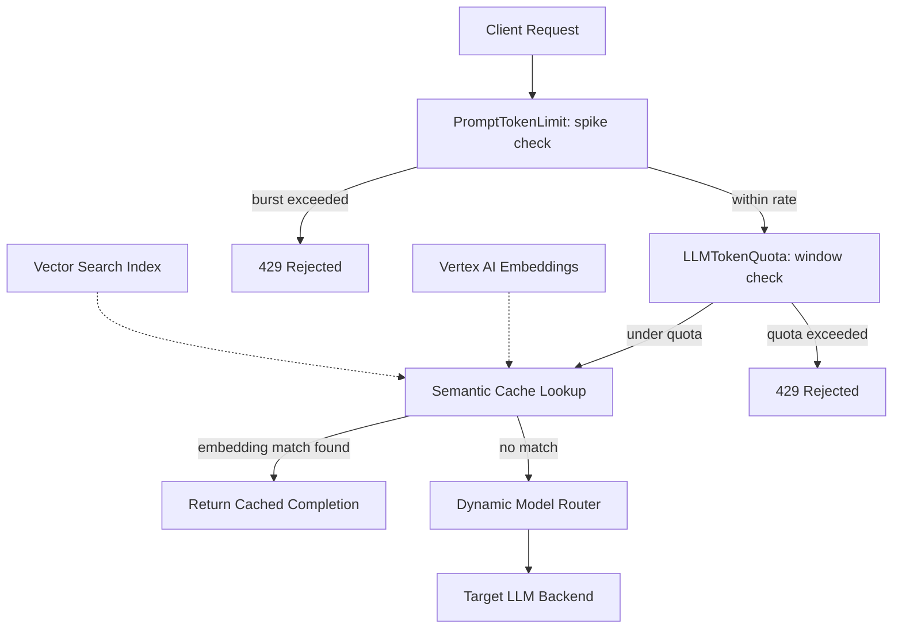

The previous post in this series covered AWS AgentCore Gateway, where the honest framing was "the auth model is solid, some connectors are brand new, and don't trust the routing story too far." Apigee's AI Gateway is a different kind of product maturity story. The token quota, spike-arrest, and semantic caching policies covered here are documented, shipped capabilities — not flagged as preview in anything I could find — which is a genuinely useful data point if you're trying to figure out which hyperscaler's AI gateway tooling you can actually rely on today versus which you should revisit in six months.



## Two token policies, not one, and why that distinction matters

Apigee ships two separate policies for controlling token consumption, and it's worth understanding why you need both rather than treating them as redundant.

**`LLMTokenQuota`** is a fixed-window cap — something like 1,000 tokens per minute, or 10 million tokens per month, per consumer or API product. This is the policy that answers "has this team burned through its allotted budget for the period."

**`PromptTokenLimit`** is a spike-arrest-style throttle on the *rate* of prompt tokens coming in, independent of the window total. This is the policy that answers a different question: is this specific burst of traffic, right now, going to overwhelm backend capacity, even if it's technically still under this minute's or month's quota.

The reason you want both: a fixed-window quota alone doesn't stop a client from sending its entire minute's allotment in a half-second burst. If your quota is 1,000 tokens/minute and a client sends all 1,000 tokens' worth of prompt in one rapid-fire batch of requests, `LLMTokenQuota` sees that as compliant — you're under the window total — but your backend just took a spike it wasn't sized for. `PromptTokenLimit` is the policy that smooths that burst out, independent of whether the window total would've allowed it.

A representative `LLMTokenQuota` policy configuration:

```xml
<LLMTokenQuota name="Token-Quota-Per-Team" continueOnError="false" enabled="true">
  <DisplayName>LLM Token Quota - Per Team</DisplayName>
  <Interval ref="request.header.x-team-id">1</Interval>
  <TimeUnit>minute</TimeUnit>
  <AllowedTokenCount>1000</AllowedTokenCount>
  <Identifier ref="request.header.x-team-id"/>
  <TokenCountRef>flow.llm.tokenCount</TokenCountRef>
  <MessageWeight ref="flow.llm.weight">1</MessageWeight>
</LLMTokenQuota>
```

In practice you'd pair this with a `PromptTokenLimit` policy applied earlier in the flow, so bursts get smoothed before the window-level quota is even evaluated.

## Semantic caching: Vertex Embeddings plus Vector Search

The caching layer doesn't do literal string matching on prompts — it embeds the incoming prompt using Vertex AI Embeddings, checks it against a Vector Search index of previously-seen prompts, and if there's a close-enough match, returns the cached completion instead of calling the backend model again. This is the same basic pattern you'd build yourself with an embeddings call plus a vector index plus Redis for the cache store — Apigee is just packaging it as a policy you attach to a proxy rather than infrastructure you stand up and maintain.

Dynamic model routing policies sit alongside this for multi-model traffic — routing a request to a specific backend model based on configured rules, which composes naturally with the caching layer: check cache first, route to the appropriate backend on a miss.

## The honest caveat: token counting isn't the same as your bill

Apigee's token counting uses a standard tokenizer to estimate token counts for the quota and spike-arrest policies. That tokenizer is not guaranteed to match the actual tokenizer each model provider uses for billing. If you're treating Apigee's `LLMTokenQuota` numbers as a precise stand-in for what you'll be billed, you're trusting an approximation. For rate limiting and abuse prevention, this is a non-issue — a slightly-off token count still does the job of smoothing load and capping runaway usage. For cost forecasting or chargeback to internal teams, it's a real gap: validate Apigee's counts against your actual provider invoices before you build financial reporting on top of them, because the numbers won't reconcile exactly.

## Why I'd call this the most "finished" hyperscaler AI gateway, for this scope

This is a narrower claim than "Apigee is the best AI gateway," so let me be precise about it. For the specific feature set this series is tracking — token-based quota and throttling, semantic caching, model routing — Apigee's policies are documented and shipped, full stop. Compare that to the Azure material covered in Part 1 of this series, where some of the GenAI gateway capabilities carried preview caveats, or to Snowflake's offering covered later in this post series, which is explicitly preview-stage as of this writing. Apigee's AI gateway policies don't carry that same "not yet GA" asterisk in the documentation I reviewed.

That doesn't mean Apigee is flawless — the tokenizer mismatch above is a real precision gap, and "shipped" doesn't mean "perfectly calibrated." But if you're ranking these offerings by how much you can build on them today without betting on a roadmap, Apigee's AI gateway feature set is currently ahead on that specific axis.

## The DIY comparison

This series has referenced the DIY gateway posts on this blog a few times now — building an internal LLM gateway (`/posts/building-internal-llm-gateways/`) and the production architecture that follows it (`/posts/production-llm-gateway-architecture/`). What Apigee is doing here is functionally close to a LiteLLM-plus-Redis-plus-embeddings stack: token-based rate limiting, a semantic cache, model routing. If you built that stack yourself, you'd get roughly the same capability.

The reason Apigee is worth a second look, specifically if you're already running it, is that you get this as an extension of infrastructure you're already paying for and already have analytics and quota tooling wired into. If your org runs Apigee for its existing API management and is now bolting AI traffic onto the same platform, the AI gateway features ride on top of monitoring, alerting, and access control you've already built out for your non-AI APIs. That's a meaningfully different cost-benefit calculation than standing up a parallel DIY stack from zero. If you're not already an Apigee shop, the calculus is closer to a toss-up between adopting Apigee specifically for this or building the narrower DIY version — and that decision should weigh what else you'd use Apigee for, not just the AI gateway features in isolation.

Apigee's policies, as covered here, control AI *traffic* — rate, quota, caching, routing. They say nothing about which models are even allowed to be reachable in the first place. That's a separate governance layer, covered in Vertex AI's Model Garden.
