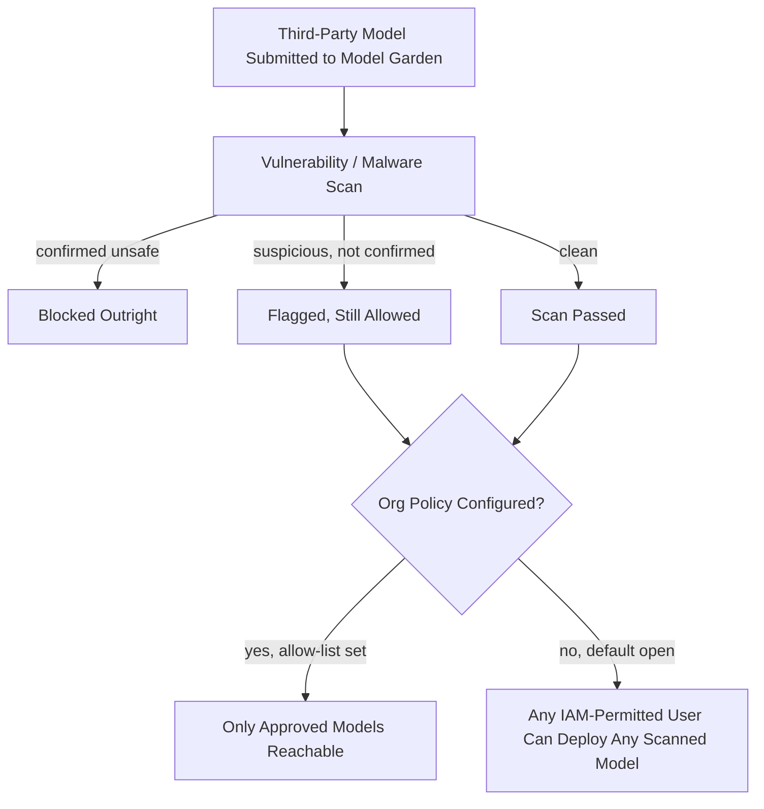

The previous post covered Apigee's AI Gateway — token quotas, spike-arrest, semantic caching, all of it operating on traffic that's already headed to a model. This post is about a layer underneath that: which models are even reachable to begin with. Apigee doesn't answer that question, and it was never meant to. Vertex AI's Model Garden is where GCP actually puts that control, and the default posture there is more permissive than most platform teams assume until something forces them to look.



## Scanning third-party models: block on confirmed, flag on suspected

Model Garden pulls in a large number of third-party models, many sourced from HuggingFace, and runs vulnerability and malware scanning against them before they're made available. Models that are confirmed unsafe get blocked outright — they're not deployable through the Garden at all. Models that are merely flagged as suspicious, without a confirmed finding, are allowed through with a flag attached rather than blocked.

That "flag but allow" choice looks soft until you think through the alternative. Fully blocking on suspicion alone, with no confirmation, would mean a nontrivial number of legitimate research and experimentation models get walked off a cliff on a false positive — and in a fast-moving open model ecosystem, false positives at the "suspicious" tier are common enough that blocking on them would create real friction for teams doing legitimate evaluation work. Google's choice to flag instead of block at that tier is a deliberate tradeoff between safety and usability, not a gap in the scanning pipeline. The gap, if there is one, is somewhere else — and it's the next point.

## The actual gap: open by default

Org Policy in GCP can restrict which Model Garden models are reachable at the organization level — you can configure an explicit allow-list so that only approved, reviewed models can be deployed by anyone in the org, regardless of what Model Garden's own scanning says about a given model.

Here's the part worth being direct about: if you haven't configured that Org Policy, the default is open to anyone who holds sufficient IAM permissions. Any team member with model-deployment IAM roles can pull and deploy any model from Model Garden that passed scanning — including models that were flagged as merely suspicious — without that decision going through any additional review. There's no org-level gate unless you build one yourself.

This is exactly the shadow-AI problem this series opened with back in Part 1. A platform team assumes model access is governed because scanning exists, and discovers during an audit that half a dozen teams have been deploying whatever looked useful on Model Garden, flagged models included, because nobody had actually turned on the allow-list. Scanning is a quality signal on individual models; it is not an access control, and conflating the two is how this gap goes unnoticed for a long time.

A representative Org Policy constraint for locking this down looks roughly like this:

```yaml
name: organizations/123456789/policies/aiplatform.restrictModelGardenModels
spec:
  rules:
    - values:
        allowedValues:
          - "projects/vertex-model-garden-public/models/approved-model-a"
          - "projects/vertex-model-garden-public/models/approved-model-b"
    - denyAll: true
      condition:
        expression: "resource.name.startsWith('projects/vertex-model-garden-public/')"
```

The specific resource identifiers will depend on your org's structure, but the shape is the same: an explicit allow-list, with everything outside it denied by default, rather than the reverse.

## This is governance of access, not of traffic — and that's the point

It's worth being precise about what Model Garden's governance layer is and isn't doing, because it's easy to conflate with Apigee's job from the previous post. Apigee governs the traffic that's already headed to a model you've already decided is reachable — rate, quota, caching, routing. Model Garden governs whether a given model is reachable at all, before any traffic question is relevant.

These compose rather than overlap. A locked-down Org Policy on Model Garden determines the universe of models your organization permits; Apigee's policies then govern how traffic to those approved models behaves once it's flowing. You need both, and neither substitutes for the other. This is exactly the same composition pattern covered for Azure in Part 1 of this series — AI Foundry's guardrails and model governance sitting alongside APIM's traffic-layer gateway controls, each handling a different layer of the problem. If you've internalized that pattern for Azure, Vertex plus Apigee on GCP should pattern-match immediately: same shape, different vendor.

## Grounding and enterprise data — a more cautious note

Vertex positions grounding-with-enterprise-data and safety filters as part of the governance story for regulated use cases — the idea being that responses can be anchored to approved internal data sources rather than relying solely on a model's unconstrained output, with safety filtering layered on top. I'll be honest that I didn't find enough concrete 2026 detail on exactly how this governance layer is configured or audited to describe it precisely here, so take this as a general positioning point rather than a specific feature claim: if your use case is regulated and grounding matters to your compliance story, verify the current state of this directly against Google's documentation rather than relying on a general description like this one.

## The practical recommendation

If you're running a GCP platform and haven't explicitly configured an Org Policy restricting Model Garden access, treat that as a day-one governance task, not something to get to after the AI rollout is already underway. The default posture — open to anyone with model-deployment IAM permissions — is the kind of thing that looks fine right up until an audit, a security review, or an incident surfaces exactly which models are actually running in production and who approved them. Nobody did, because nobody had to.
