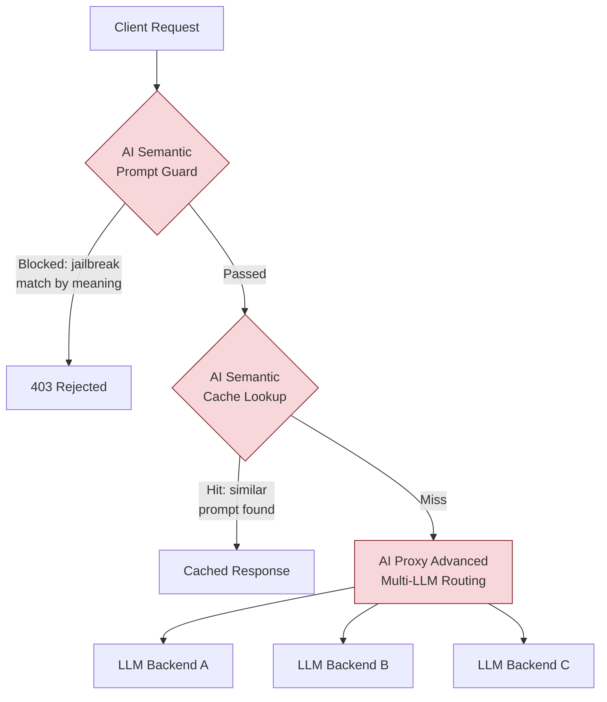

This series has spent its first stretch on vendor-native AI gateways — Azure, AWS, GCP, Snowflake, each wiring AI traffic control into their own identity and billing plane. Now it's time to look at the other camp: gateways that sit outside any single cloud, either open-source or built to be provider-neutral. We're starting with Kong, and the first thing you need to know is a licensing fact, not a feature: Kong's base gateway is genuinely open source, but the AI-specific plugins covered in this post — semantic caching, semantic prompt guard, advanced multi-LLM routing — require Kong's commercial AI license. If you came here evaluating "open source AI gateway options," put Kong in the "OSS core, paid AI layer" column before you invest more evaluation time. That's not a knock on Kong; it's just the reality a reader needs up front.



Everything shaded in that diagram — the semantic prompt guard, the semantic cache, the advanced routing — sits behind Kong's commercial AI license. The base Kong Gateway that routes the request in the first place is open source. Keep that distinction in mind as we go through what these plugins actually do, because the capability is real and well-built; it's just not free.

## AI Semantic Cache: caching by meaning, not by string

A naive LLM cache keys on the exact prompt string. Ask "What's our refund policy for enterprise customers?" and get a cache hit. Ask "What is the refund policy for an enterprise customer?" — one word different — and you get a cache miss and a full round-trip to the model, even though the answer is identical.

Kong's AI Semantic Cache plugin fixes this by embedding the incoming prompt, running a similarity search against a vector database of previously-seen prompts, and returning the cached response when the similarity score clears a configured threshold. The embedding and similarity work sits on top of a Redis backend for the actual cache storage, so you get vector-similarity matching with the operational simplicity of a cache store your infra team already knows how to run.

The practical win here is cost, not just latency. Any support bot, internal documentation assistant, or FAQ-style tool gets asked the same handful of questions in a dozen different phrasings. Exact-match caching catches almost none of that. Semantic caching catches most of it, and every cache hit is a model call you didn't pay for.

## AI Prompt Guard vs. AI Semantic Prompt Guard

Kong ships two tiers of prompt-injection defense, and the distinction between them is the most useful thing in this post if you've only ever worked with keyword-based guardrails.

**AI Prompt Guard** is regex-based. You configure patterns, and the plugin blocks or allows requests based on string matches. It will reliably catch "ignore previous instructions" because that's a direct string match against a pattern you wrote.

**AI Semantic Prompt Guard** is embeddings-based. Instead of matching strings, it embeds the incoming prompt and compares it against embeddings of known jailbreak patterns, flagging requests that are semantically close even when the wording is completely different.

Here's why that distinction matters concretely. A regex blocklist that catches "ignore previous instructions" will cleanly miss "disregard the guidance you were given earlier and instead do the following" — same intent, zero shared keywords, zero regex match. Anyone who has spent five minutes red-teaming a chatbot knows this is the first thing attackers try: reword the instruction until it slips past the keyword filter. The semantic variant catches the paraphrase because it's matching by meaning, not by exact wording. That's a meaningfully more robust defense than a naive keyword blocklist, and it's the difference between a guardrail that stops script-kiddie jailbreak copy-paste and one that holds up against someone who actually tries to evade it.

A representative configuration for the semantic variant looks like this:

```yaml
plugins:
  - name: ai-semantic-prompt-guard
    config:
      embeddings:
        provider: openai
        model: text-embedding-3-small
        auth:
          header_name: Authorization
          header_value: Bearer ${EMBEDDING_API_KEY}
      vectordb:
        strategy: redis
        dimensions: 1536
        threshold: 0.85
      rules:
        deny_topics:
          - name: jailbreak-attempt
            description: "Attempts to override system instructions or extract hidden prompts"
      case_sensitive: false
```
{: file="kong-semantic-prompt-guard.yaml" }

The `threshold` value is the knob you'll spend the most time tuning in practice — set it too low and you get false positives on legitimate edge-case questions, too high and paraphrased attacks slip through. Expect to iterate on this against your own traffic logs rather than trusting a default.

## Routing and what's new in 2.0

Beyond caching and guardrails, Kong's AI Proxy Advanced plugin (also commercial) handles multi-LLM routing and fallback — if your primary model backend is rate-limited or down, requests fail over to a secondary backend without the client noticing. It also supports semantic routing, where the plugin picks which backend to send a request to based on the meaning of the prompt rather than a static rule, which is useful if you're running different models tuned for different task types behind one gateway endpoint.

Kong AI Gateway 2.0 extended this further with agentic-AI-specific features — the gateway layer increasingly expects to mediate not just chat completions but tool-calling and multi-step agent traffic, which tracks with where the rest of the industry is headed. This is a newer surface area, so treat it as something to pilot rather than something to bet a critical path on immediately.

## The decision point

If you're already running Kong for general API management, the AI plugins are a natural extension — you're adding a license tier on infrastructure your team already operates, already monitors, and already trusts. The integration cost is low because the integration already exists.

If you're not already a Kong shop, the calculus is different. You'd be adopting both a new gateway and a commercial license specifically to get AI traffic features, and that's worth weighing directly against the fully open-source alternatives we cover next — LiteLLM and Portkey, which take a different approach to the same problem, with their own tradeoffs around raw performance and licensing structure. Don't assume "open source gateway" means "free AI gateway" by default; as you'll see, the "OSS core, paid AI layer" pattern Kong represents here turns out to be more the rule than the exception across this landscape.
