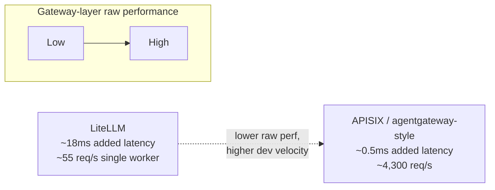

Yesterday's post on Kong ended on a licensing gotcha: the AI-specific plugins that make Kong interesting for this use case sit behind a commercial license, not the open-source base gateway. LiteLLM is a useful contrast, because it's genuinely open source all the way through — no commercial tier gating the routing, caching, or budget features. That's a real point of differentiation worth making directly, and it's also not the whole story, because LiteLLM pays for that openness with a measurable performance cost at the gateway layer. Let's get into both.



## LiteLLM: Python-native, broad coverage, genuinely OSS

LiteLLM's pitch is simple: one proxy, one OpenAI-compatible API shape, over 100 model providers behind it. Swap Anthropic for OpenAI for a self-hosted Llama endpoint by changing a config entry, not your application code. It's Python-native, which means if you need custom routing logic, a bespoke budget rule, or a one-off auth check, you write a few lines of Python rather than learning a plugin DSL in a language your team doesn't otherwise touch.

It also ships budget and rate-limit controls out of the box, which is the feature that usually matters most once more than one team is sharing a proxy:

```yaml
model_list:
  - model_name: claude-primary
    litellm_params:
      model: anthropic/claude-sonnet-5
      api_key: os.environ/ANTHROPIC_API_KEY

  - model_name: gpt-fallback
    litellm_params:
      model: openai/gpt-4o
      api_key: os.environ/OPENAI_API_KEY

router_settings:
  routing_strategy: usage-based-routing
  fallbacks: [{"claude-primary": ["gpt-fallback"]}]

litellm_settings:
  max_budget: 500          # USD per budget_duration
  budget_duration: 30d

general_settings:
  master_key: os.environ/LITELLM_MASTER_KEY
```
{: file="litellm-config.yaml" }

That's a working fallback-plus-budget setup in about fifteen lines, no license tier required. None of Kong's "the feature exists but it's gated" friction from the prior post applies here — if it's in the LiteLLM docs, you can turn it on.

## The latency tradeoff, honestly

Here's the part that doesn't show up in the feature comparison tables: independent benchmarking (Geekflare) found LiteLLM meaningfully slower per request than purpose-built API gateways. Specifically, LiteLLM added roughly 18ms of latency and handled around 55 requests/second on a single worker, while purpose-built proxies in the Apache APISIX / agentgateway class added roughly 0.5ms and handled around 4,300 requests/second.

That's not a rounding difference — it's close to two orders of magnitude on throughput. But it's also not a reason to write LiteLLM off. It's a tradeoff, and which side of it you want depends entirely on what you're building:

- **Lean LiteLLM** if you're doing moderate-volume internal tooling, prototyping across many providers, or building something where engineer iteration speed matters more than squeezing milliseconds out of the gateway hop. The 18ms is invisible next to a multi-second LLM completion anyway, for most workloads.
- **Lean toward a purpose-built proxy** if you're serving high-volume, customer-facing traffic where the gateway's own overhead compounds at scale — thousands of requests per second where even half a millisecond times volume adds up, or where the 55 req/s single-worker ceiling means you're now running a fleet of LiteLLM workers just to keep up.

There's also a hybrid pattern worth knowing: put LiteLLM's routing and provider-abstraction logic behind a faster edge proxy. The edge proxy absorbs the raw request volume and handles connection-level concerns; LiteLLM handles the actual multi-provider routing decision for the subset of traffic that needs it. You get the provider breadth without making every single request pay the LiteLLM overhead tax.

## Portkey: the pattern you'll see again and again

Portkey takes a different shape. Its gateway core is MIT/Apache-licensed — open, inspectable, self-hostable. But the hosted governance and observability control plane that most teams actually want — unified dashboards, policy management across teams, audit trails — is a paid product layered on top of that open core.

This is worth naming explicitly, because it's the same shape we saw with Kong, just arranged differently: **OSS core, paid enterprise layer**. Kong gates the AI-specific plugins behind a commercial license while the base gateway is free. Portkey keeps the full gateway open and gates the governance/observability layer instead. Different cut lines, same underlying business model. You'll see this pattern again before this series is done, and recognizing it changes how you should be evaluating these tools. You're almost never choosing between "free open source" and "paid vendor" in this space. You're choosing which vendor's split between free-core and paid-layer lines up with what you actually need to pay for.

One more data point worth flagging, not as praise or criticism but as market signal: Portkey was acquired by Palo Alto Networks in May 2026. For a platform team deciding whether to build a real dependency on a gateway vendor, acquisitions are relevant risk information — roadmap direction, pricing, and support priorities can all shift under new ownership. That doesn't mean don't use Portkey; it means if you're building on it, build with the awareness that you're now effectively building on a security-vendor subsidiary's roadmap, not an independent startup's.

## A brief, cautious word on Higress and Apache APISIX

Higress and Apache APISIX take yet another approach: rather than being purpose-built AI gateways, they're general-purpose gateways you likely already run, with AI traffic handling capabilities bolted on. That's a reasonable strategy if you're trying to avoid adding a new piece of infrastructure to your stack. I'll flag honestly that there's less independent benchmarking and real-world validation data available on the AI-specific capabilities of these two compared to Kong, LiteLLM, or Portkey — so treat any maturity claims about their AI feature set cautiously, as a "worth piloting" rather than "proven at scale" category, until more field data accumulates.

Next in this series, we pull all of this together — the cloud-native gateways from earlier posts and the OSS options here — into an actual decision framework, because by this point you've got enough conflicting tradeoffs on the table that "just pick one" isn't useful advice anymore.
