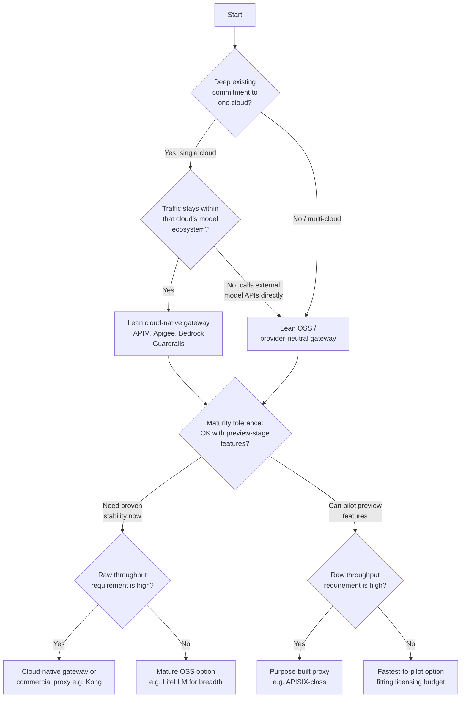

This series has covered a lot of ground: Azure's API Management and AI Foundry guardrails, AWS Bedrock Guardrails and the AgentCore Gateway, GCP's Apigee and Vertex AI Model Garden governance, Snowflake's Cortex AI Gateway, and over the last two posts, the OSS/third-party camp — Kong's commercially-gated AI plugins, LiteLLM's Python-native breadth, Portkey's split licensing, and the lighter-touch Higress/APISIX approach. If you've been reading along waiting for me to tell you which one wins, this is the post where I tell you that's the wrong question. These categories solve meaningfully different problems for meaningfully different organizational situations. What actually matters is knowing which axes determine the right fit for *your* situation.

Five axes actually drive this decision. None of them alone gives you the answer — you're scoring across all five against your own constraints.

## Axis 1: Existing cloud commitment

If your org already has deep identity, billing, and networking investment in one cloud, that cloud's native gateway integrates with less plumbing than an OSS alternative — even when the OSS option is technically more capable on paper. Azure APIM inherits your Entra ID setup. GCP Apigee inherits your IAM and billing exports. That "it just works with what we already have" property is worth real engineering time, and it's easy to underweight when you're evaluating feature lists side by side instead of actual integration effort.

## Axis 2: Multi-cloud / multi-provider reality

The flip side: if your AI traffic genuinely spans providers — calling Azure OpenAI from one team and Anthropic's API directly from another, as is increasingly normal — a cloud-native gateway tied to one provider's ecosystem stops being an asset and becomes a limitation. You end up running the native gateway for the traffic it covers and bolting something else on for everything else, which is exactly the fragmented picture this whole series opened by warning against. In that situation, a provider-neutral option — LiteLLM for its provider breadth, or the gateway layer underneath Kong or Portkey — fits the actual shape of your traffic better than forcing everything through one cloud's gate.

## Axis 3: Maturity tolerance

This series has been upfront that several vendor-native features we've covered are preview-stage, not generally-available production features with years of hardening behind them. A team that needs production-proven stability today has to weight that against a team willing to be an early adopter in exchange for tighter integration later. There's no wrong answer here, but there is a wrong way to decide it — by not asking the question at all and discovering the preview caveat only after you're already dependent on the feature.

## Axis 4: Raw performance requirements

The LiteLLM-versus-purpose-built-proxy tradeoff from the previous post generalizes. Cloud-native gateways and commercial proxies like Kong are generally built for production throughput from day one — that's the market they're selling into. Some OSS options trade raw gateway-layer performance for developer velocity and breadth, which is a fine trade for plenty of workloads and a bad one for high-volume customer-facing paths where every millisecond of gateway overhead compounds across millions of requests. Know which kind of traffic you're actually routing before you pick based on feature checklists alone.

## Axis 5: Licensing model tolerance

The pattern named in the last post — OSS core, paid enterprise layer — shows up often enough across this landscape that it should change how you frame the comparison. Almost no option here is purely free at production scale. Kong gates AI plugins behind a commercial license on an open base gateway. Portkey keeps the gateway open and gates governance on top. Cloud-native options bill through your cloud spend instead of a separate license. The real comparison isn't free versus paid — it's which vendor's particular split between free and paid lines up with your budget and the specific governance capabilities you're actually willing to pay for.

## A scoring approach, not a single winner

Rather than a single recommendation, score your own situation across these five axes — low/medium/high on each, weighted by how much it matters to your org — and let the pattern point you toward a category:

| Axis | Favors cloud-native | Favors OSS / third-party |
|---|---|---|
| Cloud commitment | High | Low |
| Multi-provider reality | Single provider | Multi-provider |
| Maturity tolerance | Low (need GA today) | High (OK piloting) |
| Raw performance needs | High at native scale | Moderate, velocity matters more |
| Licensing tolerance | Comfortable billing through cloud spend | Prefer separate, inspectable license terms |

A team heavily committed to one cloud, serving traffic that stays within that cloud's model ecosystem, needing proven stability now, is going to land on a cloud-native gateway almost every time — and that's the right call for them, not a compromise. A team spanning providers, comfortable piloting newer tooling, prioritizing engineer velocity over squeezing out gateway latency, is going to land on something like LiteLLM — and that's equally the right call, not a lesser one.

This series intentionally didn't crown a single winner, because there isn't one. The next and final post in this series looks at the scenario this framework simplifies away: what happens when your organization doesn't cleanly fit one category and ends up running more than one gateway layer at once — which, for larger or acquisition-grown enterprises, is the more common reality than this clean decision tree suggests.
