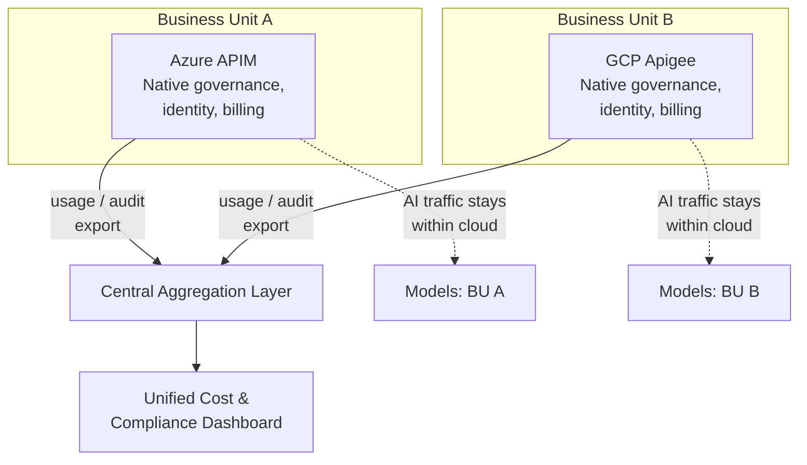

The decision framework in the last post assumes you get to pick a category and move on. Plenty of real enterprises don't get that luxury. If your company grew through acquisition, or has run genuinely multi-cloud infrastructure for a decade for reasons that predate anyone currently making AI platform decisions, you don't choose one gateway — you inherit several, and the real work is making them behave like one system instead of three unrelated ones.

The shape this usually takes: Azure APIM fronting AI traffic for a business unit that's always run on Microsoft infrastructure, a GCP Apigee deployment for a unit that came in through an acquisition, and a central LiteLLM or Kong instance someone on the platform team stood up trying to get a unified view across both. Each piece works fine in isolation. The problem is at the seams.

## The federated pattern

The architecture that actually works here is federation, not consolidation. Each cloud's native gateway keeps handling its own cloud's AI traffic and governance directly — leveraging the identity and billing integration this series has emphasized throughout every post on Azure, AWS, and GCP's native offerings. You don't rip that out. It's doing its job well, and it's the thing with the least integration friction for the traffic it's already covering.

What you add on top is a thin aggregation layer whose only job is pulling usage and audit data out of each native gateway's own reporting and rolling it into one company-wide view. This could be a central LiteLLM instance configured purely for reporting rather than as a traffic path, or a custom aggregator built against each cloud's metrics exports — Azure's gateway telemetry, a cloud data warehouse's own AI usage views, whatever each platform already emits. The specifics depend on what each native gateway exposes, but the pattern is consistent: pull reporting data centrally, don't force live traffic through a central chokepoint.

That second part is the mistake worth calling out directly, because it's the thing a well-intentioned platform engineer reaches for first: trying to route all AI traffic through one physical gateway across cloud boundaries so there's "one place" everything goes through. In practice this adds cross-cloud network hops to every single request, and it turns your aggregation layer into a single point of failure spanning two or three clouds' worth of production traffic. If that central hop goes down, every business unit's AI features go down with it, including the ones that had no business depending on cross-cloud infrastructure in the first place. Federated reporting avoids this entirely — if the aggregation layer is unavailable, each business unit's AI traffic keeps flowing through its own native gateway, and you just lose visibility into the combined dashboard until it's back.

## Who owns the seam

This creates an organizational question that's easy to skip past in an architecture diagram: who owns the aggregation layer, and how do you keep each cloud platform team's native gateway configuration consistent with a shared policy baseline without the aggregation layer itself becoming a bottleneck that every config change has to route through?

The pattern that tends to hold up is closer to hub-and-spoke than to centralized control: a small central platform team owns the aggregation layer and a thin, shared policy baseline (minimum guardrail requirements, required audit fields, naming conventions for cost attribution), while each cloud-specific platform team owns the day-to-day configuration of their own native gateway against that baseline. The central team isn't approving every routing rule change in Apigee or APIM — that would make them the bottleneck this is trying to avoid. They're defining what "compliant" means and auditing against it, while leaving implementation to the team that actually knows that cloud's gateway best.

## A worked example

Say your company runs Bedrock Guardrails for one business unit on AWS and Azure OpenAI through APIM for another, and finance wants one combined monthly AI spend report across both. You're not going to get there by forcing Azure's traffic through a Bedrock-fronted path or vice versa — that's the chokepoint mistake again, and it buys you nothing but latency and a new failure mode.

Instead: Bedrock's own usage reporting exports spend data by model and by tagged workload on the AWS side. APIM exports its own usage telemetry on the Azure side. The aggregation layer pulls both on a schedule — daily is usually fine for a finance report; nobody needs real-time cross-cloud spend reconciliation — normalizes the two into a common schema (cost, model, business unit, date), and writes the combined result into whatever dashboard or warehouse finance already looks at. Finance gets one number. Neither business unit's actual AI traffic ever left its own cloud. Nobody built a cross-cloud router nobody asked for.

## Closing the series

This series set out from a simple observation: once AI traffic moves from a demo to something your whole engineering org depends on, you need a control plane for it, the same way you needed one for internal APIs a decade ago. From there we walked the terrain — why a control plane matters in the first place, Azure's APIM and Foundry guardrails, AWS's Bedrock Guardrails and AgentCore Gateway, GCP's Apigee and Vertex AI governance, Snowflake's Cortex AI Gateway for data-adjacent workloads, then the OSS and third-party camp — Kong's commercially-gated AI plugins, LiteLLM's and Portkey's different takes on the "OSS core, paid layer" pattern — into a decision framework, and now this federated-reality closer.

The single takeaway the whole series has built toward: there is no universal right AI gateway. There's a right AI gateway, or a right combination of them, for a specific organization's cloud footprint, risk tolerance, and governance maturity. This series was meant as a map of that terrain, not a pointer to one destination on it. Where you land depends on constraints only you have full visibility into — and if this series did its job, you now at least know which questions to ask before you commit to an answer.
