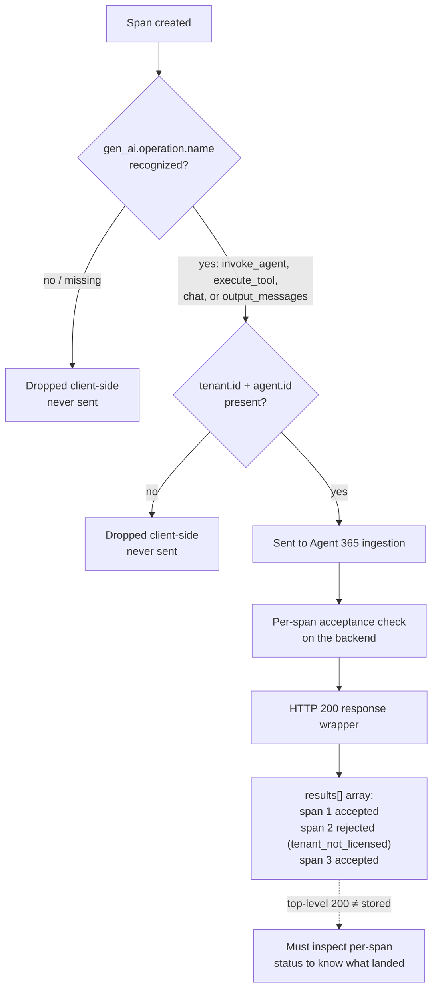

Microsoft Agent 365 is Microsoft's platform for managing and governing AI agents across an organization — identity, lifecycle, security — and it ships with an Observability SDK built on top of Microsoft's own OpenTelemetry Distro (there's a .NET build and a Python build, both on GitHub under the `microsoft` org). If you've already wired up the general OTel GenAI conventions I covered in the reference post last month, the good news is Agent 365 doesn't reinvent that vocabulary. It extends it. The `gen_ai.*` namespace you already know stays intact; Agent 365 layers a `microsoft.*` namespace on top, and the backend uses both together to decide whether a span is valid, who it belongs to, and whether it should exist in the product's dashboard at all.

The bad news is that "extends" means there's a second layer of required attributes you can get wrong in ways the standard conventions never warned you about, and at least one of those failure modes returns an HTTP 200 while quietly discarding your data. That's the post.



## The four operation types, and the one that kills a span outright

Agent 365's backend schema (`RawEventData`) has a field called `Operation`, and it's populated directly from your span's `gen_ai.operation.name` attribute. There are exactly four recognized values: `invoke_agent`, `execute_tool`, `chat`, and `output_messages`. Each maps to a different scope of what's being recorded — an agent being invoked, a tool being called, a model turn, or the agent's output being emitted.

Here's the part that's easy to miss if you're coming from a general OTel background where an unrecognized attribute value is usually harmless: if `gen_ai.operation.name` is missing, or it's set to something that isn't one of those four strings, **the entire span is dropped.** Not degraded, not stored with a null operation type — dropped. If you typo `invoke_agent` as `invokeagent` or `InvokeAgent`, or you're instrumenting a custom operation your own code calls "plan" or "route" because that's what it actually does, that span never reaches Agent 365's views, and nothing in your application tells you that happened unless you're specifically checking for it.

This is worth hard-coding as a constant in whatever wrapper you build, not a string literal scattered through call sites. One typo in one service is a silent gap in your traces that nobody notices until someone goes looking for a run that "should be there."

## The attributes required on every single span

Two attributes are non-negotiable, full stop, on every operation type:

**`gen_ai.agent.id`** — required on all four operation types. On `invoke_agent` spans specifically, Microsoft's own documentation describes this as mapping to the calling app's appId. Read that again, because it's a genuinely confusing naming choice: the `AgentId` / `AgentName` / `AgentBlueprintId` fields that show up on an `invoke_agent` record describe the agent that *made* the call, not the agent that got invoked. If you're instrumenting an orchestrator that invokes a worker agent, your instinct will be to put the worker's identity on these fields. Don't — that's backwards from what the schema expects on this particular span type. I'd budget real time for this in code review the first time your team touches invoke_agent instrumentation, because it's exactly the kind of thing that looks correct and compiles fine while being semantically wrong.

**`microsoft.tenant.id`** — required on every span, no exceptions, mapping to `OrganizationId` in the backend schema. This one has two separate failure modes worth knowing:

1. The tenant ID is also embedded in the ingestion API's URL path (`.../{tenantId}/...`), and that URL-path value is treated as authoritative. If the `microsoft.tenant.id` attribute on your span disagrees with the tenant ID in the URL you're posting to, the request is rejected outright with an HTTP 403. This is a real thing that happens when a service is misconfigured to point at the wrong tenant's endpoint while still stamping spans with the old tenant ID — you get an immediate, loud 403, which is actually the friendlier failure mode compared to what's coming next.
2. Per the Microsoft OpenTelemetry Distro's own documentation, a span that's simply missing `microsoft.tenant.id` *or* `gen_ai.agent.id` is dropped client-side — inside your process, before it's ever transmitted. You won't see a 403 for this one. You won't see anything. The span just doesn't leave your service.

## Required on InvokeAgent and ExecuteTool specifically

A second tier of attributes is required, but only on the `invoke_agent` and `execute_tool` scopes:

- **`microsoft.a365.agent.blueprint.id`** — required on both, per the Observability SDK documentation.
- **`microsoft.agent.user.id`** — required on both.

And specific to `execute_tool` alone:

- **`gen_ai.tool.call.id`** — required on ExecuteTool spans, per the .NET distro guide.

## `gen_ai.conversation.id` — the join key, and what happens if you skip it

`gen_ai.conversation.id` is required on every operation type, and Microsoft's documentation calls it out explicitly as "the primary join key for a run." That phrasing matters because of what happens when it's absent: a run without `gen_ai.conversation.id` will not show up in Microsoft Defender's agent-activity views, and it won't show up in the Microsoft 365 admin center either — even though the underlying span data may still physically exist in storage. The data isn't gone. It's just unreachable from the views anyone actually looks at.

For agents that don't have a natural conversation concept — a stateless tool-invocation agent, say, that doesn't maintain multi-turn context — the guidance is to generate a new GUID per run and use that as the conversation ID. Don't leave the attribute unset just because "conversation" doesn't conceptually apply to what your agent does.

## Where the docs genuinely disagree with each other

I want to flag this honestly rather than paper over it: Microsoft's own documentation is not internally consistent on a couple of points, and I'd rather tell you that plainly than pretend I've resolved it for you.

`gen_ai.agent.name` is listed as required on ExecuteTool spans in the .NET distro guide. The main attribute reference page does not mark it as required at all. I don't know which page is the one the backend actually enforces against, and I'm not going to guess. Set it anyway — it costs nothing and it's clearly a real, documented attribute — but don't assume omitting it is safe just because one of the two pages doesn't flag it, and don't assume including it satisfies some validation the other page implies exists. Test against your own tenant.

Similarly, the .NET distro guide lists both `microsoft.tenant.id` and a separate `user.id` as required on ExecuteTool, distinct from the `microsoft.agent.user.id` attribute described elsewhere. Whether `user.id` and `microsoft.agent.user.id` are meant to be the same value under two names, or genuinely two different fields, isn't something I can resolve from the documentation as published. Set both if you're instrumenting ExecuteTool and let your validation step — covered in the third post in this series — tell you whether one of them is being ignored.

## The gotcha that matters most: HTTP 200 doesn't mean your span was stored

This is the one I'd put at the top of a code review checklist. Ingestion requests to Agent 365's telemetry endpoint can return a top-level HTTP 200 OK even when individual spans inside that request were rejected. The response body carries a per-span results array, and each entry in that array has its own status — a given span can come back with a status of "rejected" and a reason like `tenant_not_licensed`, sitting right next to other spans in the same request that were accepted, all wrapped in an overall 200 response.

If your instrumentation code — or worse, your CI smoke test for "is telemetry working" — only checks `response.status_code == 200`, you will ship instrumentation that looks healthy and silently loses data for an entire class of spans. This is an easy mistake to make precisely because it's the opposite of how most APIs behave: a 200 almost always means "request succeeded," and here it only means "request was received and parsed," which is a materially weaker guarantee.

## A correctly attributed invoke_agent span

```python
from opentelemetry import trace
from opentelemetry.trace import SpanKind

tracer = trace.get_tracer("agent365.instrumentation")

def invoke_agent(conversation_id: str, calling_app_id: str):
    with tracer.start_as_current_span(
        "invoke_agent",
        kind=SpanKind.INTERNAL,
        attributes={
            "gen_ai.operation.name": "invoke_agent",
            "gen_ai.agent.id": calling_app_id,          # calling app's appId on this scope
            "gen_ai.conversation.id": conversation_id,  # primary join key — never omit
            "microsoft.tenant.id": tenant_id,           # must match the ingestion URL's tenant
            "microsoft.a365.agent.blueprint.id": blueprint_id,
            "microsoft.agent.user.id": user_id,
        },
    ) as span:
        result = run_agent_turn()
        span.set_attribute("gen_ai.response.model", result.model)
        return result
```

And the version that silently loses its data — note nothing here raises an exception:

```python
def invoke_agent_broken(conversation_id: str, calling_app_id: str):
    with tracer.start_as_current_span(
        "invoke_agent",
        kind=SpanKind.INTERNAL,
        attributes={
            "gen_ai.operation.name": "invoke_agent",
            "gen_ai.agent.id": calling_app_id,
            "gen_ai.conversation.id": conversation_id,
            # microsoft.tenant.id omitted — dropped client-side, before transmission.
            # No exception, no log line, no span. It simply never leaves this process.
        },
    ) as span:
        return run_agent_turn()
```

The next post in this series covers what happens when agents call each other — how `gen_ai.conversation.id` gets reused across two separate `invoke_agent` spans to stitch an agent-to-agent run together, and why the same attribute discipline described here feeds directly into Microsoft Defender's security views, not just Agent 365's own dashboard.
