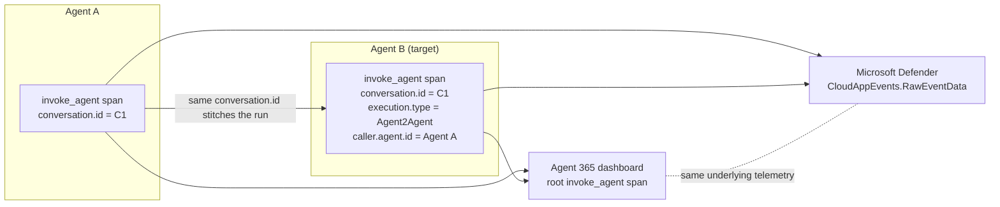

Yesterday's post covered the required attributes on an individual Agent 365 span and the ways a span can quietly disappear. This one is about what happens once you have more than one agent in the picture — one agent calling another, not just a tool — and why the attribute discipline that makes that multi-agent trace readable also happens to be the same discipline a security team relies on when they're hunting for something that went wrong.



## The root-span requirement, and the gap between "visible" and "queryable"

Agent 365's dashboard views are built around one specific assumption: every run has a root `invoke_agent` span. The views key off that span type to decide what counts as a "run" in the first place. If a run doesn't have a root `invoke_agent` span — say your orchestration only emits `execute_tool` and `chat` spans without ever wrapping them in an `invoke_agent` span — that run will not appear in Agent 365's main views.

That doesn't mean the data is lost. The child spans — `execute_tool`, `chat`, `output_messages` — remain individually queryable through Microsoft Defender's advanced hunting interface, which runs KQL over the raw event table directly. It's a genuinely subtle distinction and worth stating plainly: "doesn't show up in the dashboard" and "the data doesn't exist" are not the same claim. One is a presentation-layer guarantee, the other is a storage-layer guarantee, and Agent 365 only promises the first conditional on that root span being present. If you're debugging "why can't I find this run," checking advanced hunting before concluding the telemetry never arrived is worth the extra step.

Practically, this means your instrumentation needs an `invoke_agent` span at the top of every logical run, even in topologies where it feels redundant — a single-tool-call agent that just calls out to one API and returns still needs that wrapping span, or it's invisible to the people looking at the dashboard, even though a Defender analyst could still find its `execute_tool` span if they went looking.

## Agent-to-agent tracing: two invoke_agent spans, one conversation ID

When Agent A calls Agent B — a real agent-to-agent invocation, not a tool call — both agents emit their own `invoke_agent` span. This is different from the tool-calling pattern, where one agent's `execute_tool` span is a child of that same agent's trace. Here you have two independent `invoke_agent` spans, potentially in two different services, two different processes, maybe two different teams' code entirely.

The mechanism that ties them into one coherent run is the conversation ID. Both spans reuse the exact same `gen_ai.conversation.id` value. That shared value is what lets Agent 365 (and Defender, downstream) stitch Agent A's activity and Agent B's activity into a single run view instead of two unrelated ones.

On top of the shared conversation ID, the target agent's span — Agent B's, in this example — needs two additional things set that Agent A's span does not need:

- **`gen_ai.execution.type`** set to the literal string `"Agent2Agent"`. This is the signal that distinguishes "I was invoked by another agent" from "I was invoked directly by a user or a scheduler."
- **The `microsoft.a365.caller.agent.*` attribute group**, including `microsoft.a365.caller.agent.id`, identifying which agent initiated the call. This is also the one case where `microsoft.a365.caller.agent.id` is relevant at all — it's an optional attribute everywhere else, and it only makes sense on the target agent's invoke_agent span in this A2A scenario, since it's answering "who called me," which is meaningless outside this pattern.

```python
import uuid
from opentelemetry import trace
from opentelemetry.trace import SpanKind

tracer = trace.get_tracer("agent365.instrumentation")

# --- Agent A: the caller ---
def agent_a_invoke_agent_b(user_id: str):
    conversation_id = str(uuid.uuid4())  # no natural conversation concept — generate one per run

    with tracer.start_as_current_span(
        "invoke_agent",
        kind=SpanKind.CLIENT,
        attributes={
            "gen_ai.operation.name": "invoke_agent",
            "gen_ai.agent.id": "agent-a-app-id",
            "gen_ai.conversation.id": conversation_id,
            "microsoft.tenant.id": tenant_id,
            "microsoft.a365.agent.blueprint.id": "agent-a-blueprint",
            "microsoft.agent.user.id": user_id,
        },
    ):
        return call_agent_b(conversation_id, user_id)


# --- Agent B: the target, invoked by Agent A ---
def agent_b_handle_invocation(conversation_id: str, user_id: str, caller_agent_id: str):
    with tracer.start_as_current_span(
        "invoke_agent",
        kind=SpanKind.SERVER,
        attributes={
            "gen_ai.operation.name": "invoke_agent",
            "gen_ai.agent.id": "agent-b-app-id",
            "gen_ai.conversation.id": conversation_id,   # same value as Agent A — the stitch
            "gen_ai.execution.type": "Agent2Agent",       # marks this as an A2A invocation
            "microsoft.tenant.id": tenant_id,
            "microsoft.a365.agent.blueprint.id": "agent-b-blueprint",
            "microsoft.agent.user.id": user_id,
            "microsoft.a365.caller.agent.id": caller_agent_id,  # identifies Agent A
        },
    ):
        return run_agent_b_turn()
```

If Agent B doesn't set `gen_ai.execution.type` and the caller attribute group, the two spans may still share a conversation ID and get grouped into one run, but you lose the explicit signal that the run crossed an agent boundary — which matters more than it sounds like once you're trying to answer "how many of our runs this month actually involved agent-to-agent calls versus a single agent working alone."

## The part that's easy to underweight: this is also Defender's data

Here's the thing that makes Agent 365's design meaningfully different from most AI observability tooling I've worked with. The attributes in these spans don't only power Agent 365's own dashboards. They feed directly into Microsoft Defender — Microsoft's security and XDR product — through the `CloudAppEvents` table's `RawEventData` field, and that table is queryable through Defender's advanced hunting KQL interface.

That means a security analyst investigating "which agent called which tool, under which user's identity, across which tenant" is running queries against the exact same underlying telemetry a developer uses to figure out why a run didn't show up in the dashboard, or why a child span looks malformed. There's no separate security-specific instrumentation layer sitting on top. The attribute discipline is the security posture.

A representative advanced hunting query against this data might look like:

```kql
CloudAppEvents
| where Timestamp > ago(1d)
| where ActionType == "invoke_agent"
| extend AgentId = tostring(RawEventData.AgentId)
| extend ConversationId = tostring(RawEventData.ConversationId)
| extend CallerAgentId = tostring(RawEventData.CallerAgentId)
| extend ExecutionType = tostring(RawEventData.ExecutionType)
| where ExecutionType == "Agent2Agent"
| project Timestamp, AgentId, CallerAgentId, ConversationId, AccountId, OrganizationId
| sort by Timestamp desc
```

That's a security team asking "show me every agent-to-agent invocation in the last day, who called whom, under which account, in which tenant" — and it only works because the fields it's pulling out of `RawEventData` are the exact ones covered in the previous post and this one. If `microsoft.tenant.id` was missing on a span, that row is either absent from this table entirely (dropped client-side) or unattributable to a tenant (if it somehow made it through without the field populated). If `gen_ai.conversation.id` was missing, the security analyst loses the ability to correlate that invocation with whatever else happened in the same run — same gap the developer hits when the run doesn't show up in the admin center.

## Why this matters organizationally, not just technically

Most AI observability stacks treat "help engineers debug a broken trace" and "help a security team investigate suspicious agent activity" as two different problems requiring two different instrumentation efforts — one wired for APM, one wired for SIEM ingestion, usually maintained by two different teams who rarely talk to each other about attribute naming. Agent 365's model collapses that distinction. Getting the attribute discipline right — tenant ID on every span, conversation ID on every span, the A2A attributes set correctly on the target span — makes the data useful in both places simultaneously, because it's literally the same data.

The inverse is also true, and it's the part worth taking seriously rather than treating as a minor instrumentation nitpick: getting it wrong doesn't create one blind spot, it creates two at once. A missing tenant ID doesn't just mean a broken dashboard for engineering — it means that span's activity is unavailable to the security team hunting through the same window of time, because the span never reached the table either team queries. When you're reviewing instrumentation PRs for Agent 365, it's worth explicitly flagging that the required-attribute checklist isn't an observability nice-to-have you can defer. It's the thing standing between "normal operations" and "no record this ever happened," for both audiences, at once.
