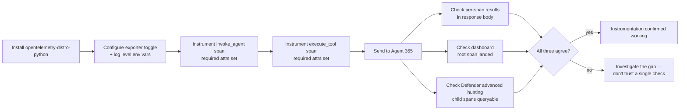

The last two posts covered what Agent 365 expects on a span and why spans disappear silently when it doesn't get it. This one is the part I'd actually hand to someone setting up instrumentation for the first time: install the right distro, set the right environment variables, write the spans with the right attributes, and — critically — validate that what you sent actually landed, since a 200 response alone doesn't tell you that.



## Use the distro, not a bare OTel SDK

The temptation when you already know OpenTelemetry is to wire up the standard SDK, set the attributes from the first post by hand, and point the exporter at Agent 365's endpoint yourself. Don't do that as your starting point. Microsoft publishes its own OpenTelemetry Distro — `opentelemetry-distro-python` and `opentelemetry-distro-dotnet`, both under the `microsoft` org on GitHub — specifically because it handles the Microsoft-specific attribute conventions and the endpoint/auth wiring for you. Rolling your own means re-deriving all of the tenant-matching and client-side-drop behavior described in the first post from scratch, with no guarantee you've replicated it correctly. Start from the distro. Deviate from it only once you understand exactly what it's doing for you.

```bash
pip install opentelemetry-distro-microsoft-agent365
```

(Package name as published by Microsoft's distro for Python — check the GitHub repo for the current install instructions, since distro packaging details are the kind of thing that shifts between releases.)

## Configuring the environment

Agent 365's testing documentation references a couple of environment variables worth setting explicitly rather than relying on defaults, especially while you're validating instrumentation for the first time:

```shell
# Toggle whether telemetry is actually exported — flip this off in local dev
# so you're not sending test spans into a real tenant's data.
export AGENT365_OTEL_EXPORTER_ENABLED=true

# Controls the verbosity of the distro's own internal logging —
# turn this up while you're debugging why a span didn't land.
export AGENT365_OTEL_LOG_LEVEL=debug
```
{: .nolineno }

> Keep the exporter toggle off by default in any environment that isn't a real target tenant. It's an easy way to accidentally pollute production telemetry with test runs, and because a 200 doesn't guarantee storage (more on that below), you won't necessarily notice until someone's dashboard has suspicious gaps or spikes.
{: .prompt-warning }

## Instrumenting a simple agent: invoke_agent followed by execute_tool

Here's a minimal agent that gets invoked, calls one tool, and returns — with every required attribute from the first post set explicitly rather than left to the distro's defaults, so it's clear exactly what's required where.

```python
import uuid
from opentelemetry import trace
from opentelemetry.trace import SpanKind

tracer = trace.get_tracer("agent365.instrumentation")

TENANT_ID = "your-tenant-guid"
AGENT_BLUEPRINT_ID = "support-agent-blueprint-v1"


def handle_request(user_id: str, user_message: str):
    conversation_id = str(uuid.uuid4())  # new GUID per run — this agent has no persistent conversation

    with tracer.start_as_current_span(
        "invoke_agent",
        kind=SpanKind.SERVER,
        attributes={
            "gen_ai.operation.name": "invoke_agent",        # must be exactly one of the four recognized values
            "gen_ai.agent.id": "support-agent-app-id",
            "gen_ai.conversation.id": conversation_id,       # required on every operation type
            "microsoft.tenant.id": TENANT_ID,                # required on every span, must match ingestion URL
            "microsoft.a365.agent.blueprint.id": AGENT_BLUEPRINT_ID,  # required on invoke_agent + execute_tool
            "microsoft.agent.user.id": user_id,              # required on invoke_agent + execute_tool
        },
    ):
        tool_result = call_lookup_tool(conversation_id, user_id, user_message)
        return f"Result: {tool_result}"


def call_lookup_tool(conversation_id: str, user_id: str, query: str):
    tool_call_id = str(uuid.uuid4())

    with tracer.start_as_current_span(
        "execute_tool",
        kind=SpanKind.CLIENT,
        attributes={
            "gen_ai.operation.name": "execute_tool",
            "gen_ai.agent.id": "support-agent-app-id",
            "gen_ai.conversation.id": conversation_id,       # same conversation ID as the parent invoke_agent
            "gen_ai.tool.call.id": tool_call_id,              # required specifically on execute_tool
            "microsoft.tenant.id": TENANT_ID,                # NOT inherited automatically — set it again here
            "microsoft.a365.agent.blueprint.id": AGENT_BLUEPRINT_ID,
            "microsoft.agent.user.id": user_id,
            "gen_ai.agent.name": "support-agent",             # required per the .NET distro guide, not flagged
                                                                # required on the main attribute reference page —
                                                                # the docs disagree; set it anyway, costs nothing
        },
    ):
        return lookup_backend(query)
```

Notice that `microsoft.tenant.id` is set again on the child `execute_tool` span even though the parent `invoke_agent` span already had it. That's deliberate, and it's the single most common mistake in the pitfalls section below — attributes don't inherit from parent span to child span automatically just because they're in the same trace. Each span is validated against its own attribute set.

## The required-attribute checklist

Pulling together what the first two posts covered, this is the table I'd actually keep next to the instrumentation code:

| Attribute | invoke_agent | execute_tool | chat | output_messages | Notes |
|---|---|---|---|---|---|
| `gen_ai.operation.name` | required | required | required | required | Must be exactly one of the four recognized values or the span is dropped client-side |
| `microsoft.tenant.id` | required | required | required | required | Must match the tenant ID in the ingestion URL or the request is rejected with 403; missing entirely drops the span client-side |
| `gen_ai.agent.id` | required | required | required | required | On invoke_agent, this is the calling app's appId — not the invoked agent's ID |
| `gen_ai.conversation.id` | required | required | required | required | Primary join key; omit it and the run won't appear in Defender's agent-activity views or the M365 admin center |
| `microsoft.a365.agent.blueprint.id` | required | required | — | — | Per the Observability SDK docs |
| `microsoft.agent.user.id` | required | required | — | — | Per the Observability SDK docs |
| `gen_ai.tool.call.id` | — | required | — | — | Per the .NET distro guide |
| `user.id` | — | required (per .NET distro guide) | — | — | Distinct from `microsoft.agent.user.id` in the docs — relationship between the two is not clearly resolved; set both |
| `gen_ai.agent.name` | — | required per .NET distro guide, not flagged on main reference | — | — | Documentation inconsistency — set it regardless |
| `gen_ai.execution.type` | required, value `"Agent2Agent"`, only on the target agent's span in an A2A call | — | — | — | Only relevant for agent-to-agent invocations |
| `microsoft.a365.caller.agent.id` (and `.caller.agent.*` group) | optional; only meaningful on the target agent's span in an A2A call | — | — | — | Identifies the calling agent |
| `microsoft.a365.agent.platform.id` | optional | optional | optional | optional | — |
| `microsoft.session.id` | — | optional per .NET distro guide | — | — | — |

Treat the rows marked as doc inconsistencies as "set it, then verify against your own tenant" rather than "this table resolved the ambiguity for you." It didn't, because the published docs themselves don't agree, and I'm not going to invent a resolution that sounds more confident than the source material actually is.

## Validating instrumentation — don't trust the HTTP status code alone

Since a 200 response from the ingestion endpoint doesn't guarantee a span was stored, validation needs three separate checks, not one:

**1. Inspect the per-span results in the response body.** Don't stop at `response.status_code`. Parse the results array and check each span's individual status:

```python
response = send_spans_to_agent365(batch)

if response.status_code == 200:
    for result in response.json().get("results", []):
        if result["status"] != "accepted":
            print(f"Span {result['span_id']} rejected: {result.get('reason')}")
            # tenant_not_licensed, validation_failed, etc. — a 200 wrapper
            # does not mean every span inside it was stored
```

**2. Confirm the run appears in Agent 365's dashboard view.** This confirms the root `invoke_agent` span specifically landed and was recognized as a run root — it's a different check from #1, because a span can be accepted by ingestion and still not surface as a dashboard-visible run if it isn't the root span type the dashboard keys off.

**3. Cross-check that child spans are queryable via Defender advanced hunting.** This is your secondary path, and it matters because — as covered in the previous post — a run missing its root `invoke_agent` span won't show up in the dashboard even if its `execute_tool` and `chat` children are sitting right there in `CloudAppEvents.RawEventData`, queryable the whole time. If the dashboard shows nothing but advanced hunting shows the child spans, that's a specific, diagnosable signal: your root span attribution is broken, not your instrumentation generally.

None of these three checks alone tells you the whole story. Running all three is what actually tells you "instrumentation confirmed working" instead of "instrumentation probably working, based on the one signal I happened to check."

## Common pitfalls

**Tenant ID set on the parent, forgotten on the child.** This is the mistake the code example above calls out directly. Spans don't inherit attributes from their parent in the trace just because they share a trace context. Each span needs `microsoft.tenant.id` set explicitly, every time, or that specific child span gets dropped client-side while its sibling spans in the same trace go through fine — producing a trace with confusing, partial gaps rather than an obvious all-or-nothing failure.

**Typos in `gen_ai.operation.name`.** Four strings, case-sensitive, no fuzzy matching on the backend as far as the documentation describes. `Invoke_Agent`, `invokeagent`, `invoke-agent` — none of these match `invoke_agent`, and the span is gone with no error raised in your own process. Define these four values as constants in one shared location in your codebase and never let a call site write the string literal directly.

**Trusting that Microsoft's own documentation is internally consistent.** It isn't, in at least the two places this series has flagged — `gen_ai.agent.name` on ExecuteTool, and the `user.id` versus `microsoft.agent.user.id` distinction. That's not a knock on the docs; this is a genuinely new product surface and cross-page consistency is hard to maintain at that scale. The practical implication is that no single doc page is your source of truth. Your actual tenant's ingestion behavior is. Build the validation steps above into your test suite, not just into a one-time manual check, so that a future doc update — or a future backend change that silently starts enforcing something it didn't before — gets caught by CI rather than by someone noticing a dashboard gap three weeks later.
