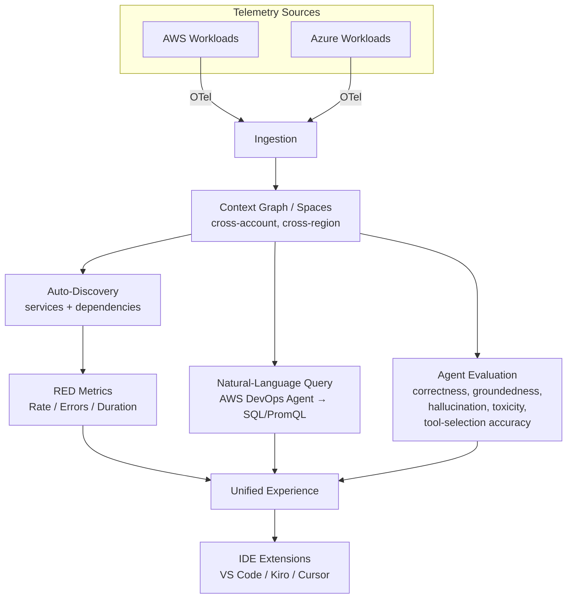

AWS shipped Amazon CloudWatch Omni in September 2026 and called it, in its own marketing copy, "the next generation of CloudWatch." That's a big claim for a product that's barely a season old, and I'd normally discount it on sight. But having gone through the documentation and the API reference in detail, the claim is closer to accurate than the usual rebrand-and-reannounce AWS tends to do with CloudWatch. Omni isn't classic CloudWatch with an AI label stuck on it — it's a separate experience, built on OpenTelemetry from the ground up, aimed specifically at the problem of observing applications and agentic workloads that classic CloudWatch's dashboard-and-alarm model was never designed for.

This post covers what Omni actually does, based on what AWS has documented. The next post in this pair deals with something that's going to trip up a lot of teams: Omni is not the only AI observability thing CloudWatch has shipped recently, and the three overlapping capabilities need to be told apart before you pick one.

## Spaces: the organizing unit

Classic CloudWatch's unit of organization was basically "an account, maybe a region, with namespaces and dashboards you build by hand." Omni replaces that with "spaces" — logical groupings of telemetry that span accounts and regions. If your agentic workload runs across three AWS accounts (say, a dev account, a shared tooling account, and prod) and two regions, a space is where you put all of that telemetry so it reads as one system instead of three separate CloudWatch consoles you have to context-switch between.

This matters more for agent workloads than for traditional services, because agents tend to touch more things — a retrieval service in one account, a tool-execution Lambda in another, a model endpoint in a third.

## Auto-discovery and RED metrics without dashboard setup

This is the part that will feel most immediately useful if you've ever inherited a service with zero observability and had to build RED (Rate, Errors, Duration) dashboards from scratch before you could even tell if it was healthy. Omni auto-discovers services and their dependencies from the telemetry it ingests and surfaces RED metrics automatically — no manual dashboard wiring, no deciding in advance which metrics matter enough to graph.

That's a meaningful shift in default posture. Classic observability tooling assumes you know what to watch before you watch it. Omni assumes it can figure out the topology from the traffic itself. Whether auto-discovery holds up for genuinely weird architectures — heavy queue indirection, event-bus fan-out — is the kind of thing you only find out by running it against your own system, but the documented intent is clear: zero-config RED visibility as a starting point, not an end state you build toward.

## Natural-language querying via the AWS DevOps Agent

Omni lets you ask a question in plain English and has something called the AWS DevOps Agent translate that into the underlying query — SQL or PromQL, depending on what's being asked. A representative example, roughly how AWS describes the capability: you type something like "which service had the highest error rate in the last hour, and what changed right before it started." Instead of you writing a PromQL rate query against error-count metrics, joining it against a deploy-event log, and eyeballing the timestamps, the DevOps Agent generates and runs the equivalent query against the underlying telemetry store and gives you the answer directly.

This is the same category of capability as asking an LLM to write SQL against your warehouse — not novel in concept — but it's notable AWS built it directly into the observability console rather than requiring you to export telemetry somewhere else first. If you've had an on-call engineer stall for ten minutes because they didn't remember the exact PromQL syntax they needed, this is aimed squarely at that gap.

## Agent evaluation built into the observability platform

This is the part I'd flag as the most genuinely new idea in the release, not just a UI convenience. Omni includes agent evaluation scoring as a native part of the platform — not a separate eval harness you run offline, but scoring applied to individual agent invocations as they happen: correctness, groundedness, hallucination, toxicity, and tool-selection accuracy.

The distinction matters because most teams I've talked to run evals as a pre-deployment gate — a batch job against a test set, checked in CI, disconnected from what's actually happening in production. Baking the scoring into the observability layer means you can, in principle, see "invocation #4821 scored low on groundedness" sitting right next to the trace showing what was retrieved and what the model said, in the same place you'd look for a latency spike. Whether the scoring models are reliable enough to trust unsupervised is a separate question worth testing against your own ground truth before wiring alerts to it — but having the scores live next to the trace is the right instinct.

## Framework and multi-cloud coverage

Omni has explicit integration support for LangChain, LangGraph, CrewAI, the OpenAI SDK, AWS's own Strands framework, and the Vercel AI SDK, plus IDE extensions for VS Code, Kiro, and Cursor. The framework list tells you AWS isn't assuming everyone building agents on AWS infrastructure is also using AWS's own agent framework — a reasonable bet, since in practice most teams I've seen are mixing LangGraph or CrewAI with Bedrock models underneath, not building purely on Strands.

The more interesting signal is multi-cloud ingestion. Omni is designed to ingest telemetry starting with Azure — an AWS-branded observability product explicitly built to watch workloads that aren't running on AWS at all. That's a real departure from the usual cloud-native pattern, where a vendor's tooling only has eyes on its own cloud and treats everything else as a black box you bolt on via an exporter if you're lucky. Reading it generously: AWS is betting that in a multi-cloud AI estate — which is most enterprise AI estates I've worked with — being the unifying observability layer is worth more than being the walled-garden one.

## What the API reference does and doesn't tell you

The Omni API reference exposes a `Node` type representing "a node in the context graph" — a service, a resource, or a remote service — which confirms there's a graph-based model underneath the auto-discovery and dependency mapping. What I did not find in the available documentation is a full, separate "Omni attributes" schema the way a product like Microsoft's Agent 365 publishes a single consolidated attribute reference for its own telemetry. If that kind of exhaustive attribute table exists, it wasn't surfaced in what AWS has published so far.

I'd read that as meaning Omni's distinctiveness is in the experience and evaluation layer sitting on top of OpenTelemetry data, not in inventing a new wire format you need to learn. That's probably the right design choice — a new attribute schema would mean yet another thing for every exporter and every team's instrumentation to learn — but it's worth being precise about: Omni's value proposition is the UI, the auto-discovery, the natural-language query, and the native eval scoring, not a novel data model you'd point to as "the Omni spec."

## Where this leaves you

Omni is months old as of this writing. The capabilities are real and documented — this isn't vaporware — but "the next generation of CloudWatch" launched in September 2026 is not the same claim as "production-proven for every workload shape." If you're starting a new agentic project on AWS and want unified cross-account visibility with evaluation built in from day one, it's worth a serious pilot. If you've already got GenAI Observability or AgentCore Observability wired into an existing system and it's working, there's a real question about how — or whether — you migrate, and that's exactly what the next post digs into, because conflating these three AWS capabilities is an easy and costly mistake to make.
