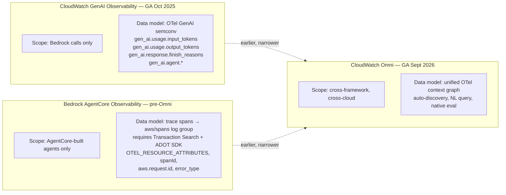

Yesterday's post covered Amazon CloudWatch Omni, AWS's September 2026 "next generation of CloudWatch" for AI and agentic workloads. If that were the only AI-flavored observability thing CloudWatch had ever shipped, this post wouldn't need to exist. It isn't. CloudWatch has two other, older, separate capabilities for AI workloads — CloudWatch Generative AI Observability and Bedrock AgentCore Observability — and I've already seen the three get casually conflated in conversation, as if they're the same feature with three different names slapped on at different times. They're not. They shipped at different times, they answer different questions, and they require different setup. Getting this straight matters before you decide what to actually turn on.

## The three, laid out chronologically

**CloudWatch Generative AI Observability** — GA October 13, 2025, over a year before Omni. This is the oldest of the three. It surfaces standard OpenTelemetry GenAI semantic-convention attributes specifically for Bedrock and agent calls: `gen_ai.usage.input_tokens`, `gen_ai.usage.output_tokens`, `gen_ai.response.finish_reasons`, and a `gen_ai.agent.*` attribute group covering id, name, description, and version. If you've read the OTel GenAI semantic conventions reference I wrote back in November, this is that same `gen_ai.*` namespace, applied specifically inside the CloudWatch product rather than something CloudWatch invented on its own. It answers one question: for calls through Bedrock, what did they cost in tokens, and how did they finish.

**Bedrock AgentCore Observability** — also predates Omni, also separate from GenAI Observability. This one is trace-level: it emits spans to a specific CloudWatch Logs log group named `aws/spans`. It only works if you've enabled CloudWatch Transaction Search and configured the AWS Distro for OpenTelemetry (ADOT) SDK. Configuration runs through `OTEL_RESOURCE_ATTRIBUTES`-style environment variables — `service.name`, `aws.log.group.names`, `cloud.resource_id` — and correlation happens through fields like `spanId` and `aws.request.id`, with `error_type` and `aws.region` for identifying what broke and where. This answers a narrower, deeper question than GenAI Observability: for an agent specifically built on Bedrock AgentCore, what did the actual execution path look like, span by span.

**Amazon CloudWatch Omni** — GA around September 2026, the newest and broadest. Covered in detail in the previous post: cross-account/cross-region "spaces," auto-discovery with automatic RED metrics, natural-language querying through the AWS DevOps Agent, native agent evaluation scoring (correctness, groundedness, hallucination, toxicity, tool-selection accuracy), explicit support for LangChain, LangGraph, CrewAI, the OpenAI SDK, Strands, and the Vercel AI SDK, and — notably — multi-cloud telemetry ingestion starting with Azure. This answers a much bigger question: across every framework and every cloud you're actually running on, what's the health and quality of the whole agentic system, not just the Bedrock-shaped slice of it.

## A comparison table

| | CloudWatch GenAI Observability | Bedrock AgentCore Observability | CloudWatch Omni |
|---|---|---|---|
| GA date | October 2025 | Pre-Omni (undated precisely in docs) | September 2026 |
| Scope | Bedrock calls specifically | Agents built on Bedrock AgentCore specifically | Cross-framework, cross-cloud, any agentic workload |
| What it answers | Token usage and finish reasons for Bedrock calls | Detailed execution trace for AgentCore agents | Overall system health, auto-discovered topology, agent quality |
| Setup required | Enable the feature on Bedrock usage | CloudWatch Transaction Search + ADOT SDK configured | Onboard into a space; OTel-based ingestion |
| Data model | OTel GenAI semconv (`gen_ai.*`) | Trace spans in `aws/spans` log group, `OTEL_RESOURCE_ATTRIBUTES`-based | Unified context graph (`Node` type), no separate attribute schema found in current docs |
| Built-in evaluation | No | No | Yes — correctness, groundedness, hallucination, toxicity, tool-selection accuracy |
| Natural-language query | No | No | Yes — via AWS DevOps Agent |
| Multi-cloud | No (AWS only) | No (AWS only) | Yes — ingests Azure telemetry |

## Practical guidance on what to actually turn on

If your AI workload is purely calls through Bedrock and what you need is basic visibility into token usage and how calls finished — cost tracking, finish-reason monitoring, nothing more exotic — GenAI Observability alone is probably sufficient. It's narrow, it's been GA for over a year, and it doesn't require you to stand up ADOT or Transaction Search.

If you're building agents specifically on Bedrock AgentCore and you need to debug execution paths at the span level — which tool call happened when, what the actual request ID chain looked like, where in a multi-step agent run something failed — AgentCore Observability's trace-based approach is the right tool, and it's the one built for that specific depth of detail. Be aware going in that it has real setup cost: Transaction Search and ADOT aren't optional extras, they're prerequisites.

If you want the newer, broader experience — cross-framework support because you're not purely on Strands, cross-cloud visibility because your estate isn't purely AWS, and evaluation scoring built into the same pane as your traces instead of a separate offline harness — Omni is the bigger bet, and it's the direction AWS is clearly pointing the product line. But it's new. Pilot it deliberately rather than assuming day-one production parity with tooling that's had a year or more to mature.

## The open question I won't pretend to have answered

Here's where I want to be honest about the limits of what's publicly documented: I could not confirm a clear coexistence or migration story for teams that already have GenAI Observability or AgentCore Observability wired in and are now considering Omni. Do the older two get deprecated on some timeline? Do they keep running in parallel indefinitely as narrower, cheaper options? Does Omni ingest their existing spans and attributes, or do you re-instrument from scratch? AWS's current documentation may have settled this by the time you're reading this post — check it directly before you plan a migration around an assumption I haven't verified. I'd rather flag that gap than make up a tidy migration path that sounds plausible and turns out to be wrong.

## Two philosophies, side by side

It's worth stepping back and noticing what this three-tool landscape says about AWS's approach versus the alternative. The Enterprise LGTM observability stack I wrote about across a run of posts in late November and early December takes a build-your-own-platform approach: you assemble Grafana, Loki, Tempo, Mimir, and Alloy yourself, and the attribute conventions you standardize on are whatever your platform team enforces. Microsoft, by contrast, has been consolidating toward a single unified attribute reference for Agent 365 rather than running parallel capabilities a team has to choose between.

AWS's current position sits between those two: it isn't asking you to assemble your own stack, but it also hasn't consolidated into one spec the way Microsoft's single-attribute-reference approach has. Right now, a team on AWS has to actively understand three distinct capabilities and pick the right one — or combination — for what they're actually running. That's not necessarily wrong, narrower tools solve narrower problems well, but it is more cognitive overhead than "there's one thing, and it does everything." Whether Omni eventually absorbs the other two or settles into permanent coexistence with them is the question worth revisiting once AWS's own documentation catches up to the product's age.
